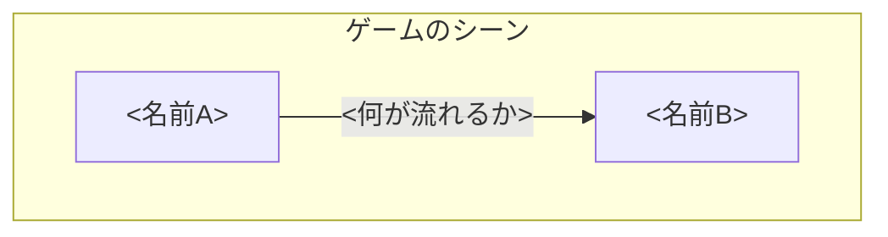

# デザインパターン① State パターン 導入編

## 概要

---

<この回で何を扱うのか、なぜそれが必要になるのかを 2〜4 行で。>
<機能名の説明から入らず、「ゲームで何が困るか」から入ること。>

> **今週の問い**：if 文はどこまで増やしていいのか？

**今週のゴール**：設計されたボス AI

**使用シーン**：`Assets/Application/Week11-StatePattern/Week11-StatePattern_Start.unity`
**完成見本**：`Assets/Application/Week11-StatePattern/Week11-StatePattern_Goal.unity`

> 先週欠席した人も `_Start` シーンから入れば合流できます。

### <節タイトル：まず全体像>

---

<この単元の登場人物（コンポーネント／概念）を 2〜3 個に絞って紹介する。>

- **<名前A>（<役割>）**
<1〜2 行の説明。具体例を必ず添える。>
- **<名前B>（<役割>）**
<1〜2 行の説明。>

> 基本的な考え方は、<A>が「<たとえ>」、<B>が「<たとえ>」に相当すると覚えるとよいでしょう。



<図の内容を 1〜2 行で言い直す。図だけで終わらせない。>


### <節タイトル：個別の要素>

---

<本文>

#### ゲームオブジェクトに追加する

1. <手順>
2. <手順>
3. <手順>

▼<補足キャプション>


#### 設定項目


| 設定項目 | 内容 |
| --- | --- |
| **<項目名>** | <内容> |
| **<項目名>** | <内容> |

#### <重要な項目だけ個別に掘る>

<「まずはこの5項目を理解すれば基本操作はできる」のように、優先度を示して終わるとよい。>

### コード例

---

```csharp
namespace Week11
{
    public class Sample : MonoBehaviour
    {
    }
}
```

### 💡 今週持ち帰る考え方

---

> 増える複雑さを「形」で受け止める

<なぜそう言えるのかを、この回の題材に即して 2〜4 行で説明する。>
<技術の話に戻さず、「他の場面でもこう使える」まで書ききること。>

### ✅ チェックリスト

---

授業の終わりに、自分で確認してください。

- [ ] <確認項目>
- [ ] <確認項目>
- [ ] <確認項目>

### 🔗 参考リンク

---

- [<タイトル>](<URL>)
