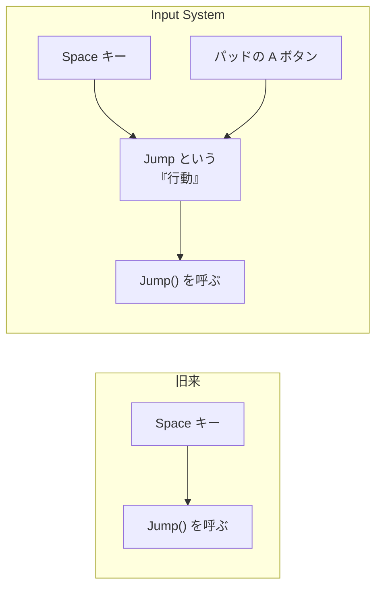
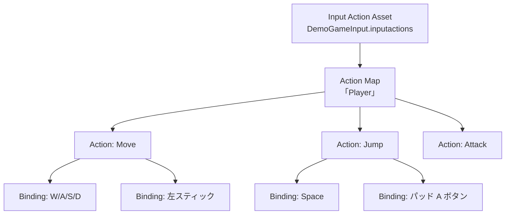
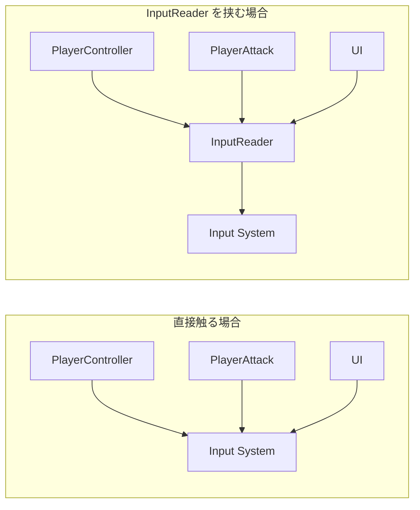

# 📎 付録：Unity Input System 入門

## この資料について

---

授業では正面から扱いませんが、**毎週当たり前のように使う**仕組みです。
「なんとなく動いているもの」のままにせず、一度目を通しておいてください。

読み終えると、次のことができるようになります。

- 入力の設定がどこにあるのか分かる
- 新しい操作（キー）を自分で追加できる
- 入力が効かないときに、どこを見ればいいか分かる

---

## 1. なぜ Input System を使うのか

---

昔ながらの書き方は、こうでした。

```csharp
// 旧来の書き方（このプロジェクトでは使いません）
if (Input.GetKeyDown(KeyCode.Space))
{
    Jump();
}
```

短くて分かりやすいのですが、ゲームが大きくなると困ります。

| 困ること | 具体的に |
| --- | --- |
| **キーを変更できない** | 「Space をやめて Enter にしたい」と言われたら、書いたところを全部探して直す |
| **ゲームパッドに対応しづらい** | キーボードとパッドで別々に `if` を書くことになる |
| **入力とゲームの処理が混ざる** | 「ジャンプする条件」を探したいのに、キーの話が邪魔をする |

Input System は、**「どのキーか」と「何をするか」を切り離す**ための仕組みです。



**ゲーム側は「Jump という行動が起きた」としか知りません。**
どのキーで起きたかは知らなくていい。これが一番の利点です。

---

## 2. 全体像

---

設定は `.inputactions` というファイルにまとまっています。
このプロジェクトでは `Assets/_DemoGame/Scripts/Input/DemoGameInput.inputactions` です。



ファイルをダブルクリックすると、専用のウィンドウが開いて編集できます。

---

## 3. 用語

---

| 用語 | 意味 | 例 |
| --- | --- | --- |
| **Action Asset** | 入力設定をまとめたファイル | `DemoGameInput.inputactions` |
| **Action Map** | 場面ごとの入力のまとまり | `Player`（操作中）／`UI`（メニュー中） |
| **Action** | ゲームにとっての「行動」 | `Move` `Jump` `Attack` |
| **Binding** | その行動に割り当てる実際のキー | `Space` `ゲームパッドの A` |

> **Action Map が「場面ごと」に分かれているのが重要です。**
> メニューを開いている間は `Player` を無効にして `UI` だけ有効にすれば、
> 「メニュー操作中にキャラが動いてしまう」が起きません。

---

## 4. Action の3つの型

---

Action には型があり、受け取れる値が変わります。

| 型 | 使いどころ | 返ってくるもの |
| --- | --- | --- |
| **Value** | 連続的に変化する入力 | `Vector2`（スティックの傾き）など |
| **Button** | 押した／離した | 押されたかどうか |
| **Pass Through** | 値をそのまま流したい | 入力の生の値 |

このプロジェクトの設定は次のようになっています。

| Action | 型 | 内容 |
| --- | --- | --- |
| `Move` | Value (Vector2) | 移動 |
| `Look` | Value (Vector2) | 視点 |
| `Jump` | Button | ジャンプ |
| `Sprint` | Pass Through | ダッシュ |
| `Attack` | Button | 攻撃 |
| `Interact` | Button | 調べる・押す |

---

## 5. このプロジェクトでの使い方

---

Input System には使い方がいくつかありますが、このプロジェクトでは
**`InputReader` という1つのクラスに、入力の扱いを全部閉じ込めています。**

`Assets/_DemoGame/Scripts/Input/InputReader.cs`

### 5.1 押しっぱなしと、押した瞬間

---

入力には2種類あり、扱い方が違います。

```csharp
// ① 押しっぱなしの「量」を毎フレーム見るもの
public Vector2 Move { get; private set; }
public Vector2 Look { get; private set; }
public bool IsSprinting { get; private set; }

// ② 押された「瞬間」だけ知りたいもの
public event Action Jumped;
public event Action Attacked;
public event Action Interacted;
```

使う側はこう書きます。

```csharp
// ① 毎フレーム見る
private void Update()
{
    Vector2 move = _input.Move;
    // ...移動処理
}

// ② 瞬間を受け取る
private void OnEnable()
{
    _input.Jumped += OnJumped;
}

private void OnDisable()
{
    _input.Jumped -= OnJumped;   // ★必ず外す
}
```

> **`+=` したら、必ず `-=` で外してください。**
> 外し忘れると、破棄されたはずのオブジェクトが呼ばれ続けて例外の原因になります。
> `OnEnable` で足して `OnDisable` で外す、をセットで覚えてください。

### 5.2 なぜわざわざラップするのか

---

ゲーム側のスクリプトが Input System を直接触ると、こうなります。



**Input System に触るクラスが1つだけなら、仕様変更のときに直す場所も1つで済みます。**

これは入力に限った話ではありません。
**外部のライブラリは、自分のコードで包んでから使う。** 後々ずっと効いてきます。

---

## 6. 新しい操作を追加するには

---

例として「しゃがむ（Crouch）」を追加する手順です。

```
1. DemoGameInput.inputactions をダブルクリックして開く
2. Player マップを選び、Actions の「＋」で Action を追加
3. 名前を Crouch、Action Type を Button にする
4. 右側の Binding に、割り当てたいキー（例：左 Ctrl）を設定
5. Save Asset を押す（★押し忘れに注意）
6. InputReader.cs に次を追加する
```

```csharp
// フィールド
private InputAction _crouchAction;

// 公開するイベント
public event Action Crouched;

// Awake の中
_crouchAction = _playerMap.FindAction("Crouch", throwIfNotFound: true);

// OnEnable の中
_crouchAction.performed += OnCrouch;

// OnDisable の中
_crouchAction.performed -= OnCrouch;

// メソッド
private void OnCrouch(InputAction.CallbackContext context) => Crouched?.Invoke();
```

> **`Save Asset` の押し忘れが本当に多いです。** 動かないときはまずここを疑ってください。

---

## 7. よくあるトラブル

---

| 症状 | 原因と対処 |
| --- | --- |
| **入力がまったく効かない** | InputReader の **Input Actions が未設定**。Inspector を確認する |
| **追加したキーが効かない** | `.inputactions` の **Save Asset を押していない** |
| **`FindAction` で例外が出る** | Action 名のつづり違い。大文字小文字も区別される |
| **UI のボタンが押せない** | EventSystem が `InputSystemUIInputModule` になっていない。Inspector の「Replace with InputSystemUIInputModule」を押す |
| **メニュー中にキャラが動く** | Action Map を切り替えていない。`SetInputEnabled(false)` などで止める |
| **オブジェクト破棄後に例外** | イベントの `-=` 忘れ |
| **Starter Assets 導入後に入力が効かない** | インポート時の再起動ダイアログで再起動していない |

---

## 8. 覚えておいてほしいこと

---

> **「どのキーか」と「何をするか」を切り離す。**

これは入力だけの話ではありません。
**変わりやすいもの**（キー割り当て、デバイス）と、**変わりにくいもの**（ジャンプするという行動）を
分けておくと、変更が来たときに壊れる範囲が小さくて済みます。

後期の授業では、この「分ける」という考え方を、
Week10（依存の向き）や Week12（変わるもの／変わらないもの）で改めて扱います。

---

## 9. 参考リンク

---

- [Input System 公式マニュアル](https://docs.unity3d.com/Packages/com.unity.inputsystem@latest)
- [Unity Learn - Input System](https://learn.unity.com/search?k=%5B%22q%3AInput%20System%22%5D)

---
