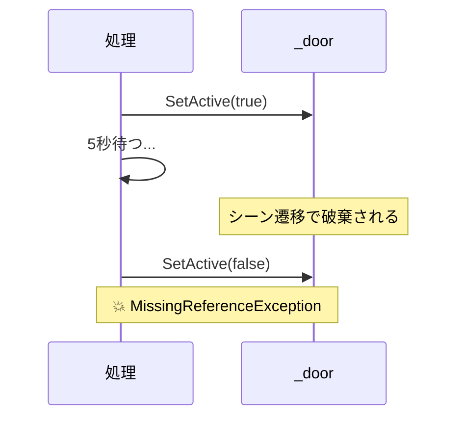
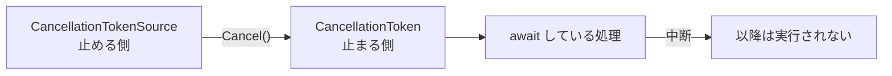
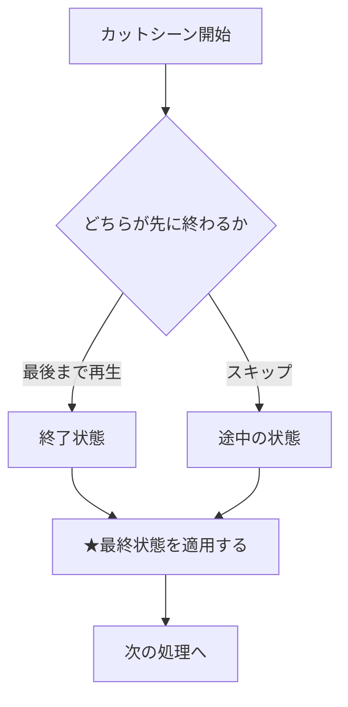

# 📎 付録：UniTask とキャンセル処理

## この資料について

---

UniTask の基本（`await` で待つ、`UniTask.Delay` で秒数を待つ）は**前期で扱いました。**
この資料はその先、**「始めた処理を、どうやって止めるか」**を扱います。

後期では演出が増えます。カットシーンが流れている最中にプレイヤーがスキップする、
扉が開いている途中でシーンを抜ける——こういう場面で「止め方」を知らないと、
**消えたはずのオブジェクトを触ろうとして例外が出ます。**

読み終えると、次のことができるようになります。

- 処理を安全に中断できる
- **演出をスキップできる**（Week03 の Timeline で使います）
- シーン遷移時に例外が出る原因が分かる

---

## 1. なぜ「止める」必要があるのか

---

こういうコードを書いたとします。

```csharp
private async UniTask OpenDoorAsync()
{
    _door.SetActive(true);
    await UniTask.Delay(TimeSpan.FromSeconds(5));   // ← 5秒待つ
    _door.SetActive(false);                         // ← ここで落ちることがある
}
```

5秒待っている間に**シーンを抜けたら**どうなるでしょうか。

`_door` はもう破棄されています。しかし待機が終わると、コードは何事もなかったように
`_door.SetActive(false)` を実行しようとして、**`MissingReferenceException`** で落ちます。



> **待っている間に、世界は変わります。** これが非同期処理の怖いところです。

---

## 2. CancellationToken

---

「もう止めていいよ」という合図を運ぶのが **CancellationToken** です。

```csharp
await UniTask.Delay(TimeSpan.FromSeconds(5), cancellationToken: token);
```

この `token` に「キャンセル」の合図が入ると、**待機が打ち切られ、以降の行は実行されません。**

| 用語 | 役割 |
| --- | --- |
| **CancellationToken** | 「止めていいか」を**受け取る**側 |
| **CancellationTokenSource** | 「止めて」と**言う**側 |



---

## 3. パターン① オブジェクトが消えたら止める

---

**いちばんよく使います。** これだけでも覚えて帰ってください。

```csharp
await UniTask.Delay(
    TimeSpan.FromSeconds(5),
    cancellationToken: this.GetCancellationTokenOnDestroy());
```

`GetCancellationTokenOnDestroy()` は、**その GameObject が破棄されたら自動でキャンセルされる**トークンを返します。
自分で `CancellationTokenSource` を用意する必要がありません。

> **`await` を書いたら、まず `GetCancellationTokenOnDestroy()` を付ける。**
> 習慣にしてしまってください。1 章の例外は、これだけで消えます。

お手本（`_DemoGame`）の `PlayerAttack.cs` も、この形で書かれています。

---

## 4. パターン② 演出をスキップする

---

ここが後期の本題です。

カットシーンを流しながら、**同時にスキップ入力も待ちます。**
そして**先に終わったほう**を採用し、もう片方を止めます。

```csharp
private async UniTask PlayCutsceneAsync(CancellationToken token)
{
    // このカットシーン専用の「止めるスイッチ」を作る
    // 親の token がキャンセルされたら、これも一緒にキャンセルされる
    using var cts = CancellationTokenSource.CreateLinkedTokenSource(token);

    // ① 演出の再生を待つ
    var playTask = PlayDirectorAsync(cts.Token);

    // ② スキップ入力を待つ
    var skipTask = WaitForSkipInputAsync(cts.Token);

    // ③ どちらか早いほうが終わるまで待つ
    await UniTask.WhenAny(playTask, skipTask);

    // ④ 決着がついたので、もう片方を止める
    cts.Cancel();

    // ⑤ ★どちらで終わっても、最終状態を必ず揃える
    ApplyCutsceneEndState();
}
```

### ⑤ がいちばん大事です

---

スキップした場合、演出は途中で止まります。
つまり**「扉が半分だけ開いた」「カメラが変な位置で止まった」状態**になり得ます。



> **スキップは「早送り」ではなく「結果だけ先に適用する」ことです。**
> 演出を止めたあと、**必ず終了状態を作り直してください。**
> ここを忘れると「スキップすると扉が開かないバグ」になります。毎年出ます。

---

## 5. パターン③ タイムアウト

---

「最大3秒だけ待つ。それ以上は諦める」。

```csharp
var timeoutCts = new CancellationTokenSource();
timeoutCts.CancelAfterSlim(TimeSpan.FromSeconds(3));

try
{
    await SomethingAsync(timeoutCts.Token);
}
catch (OperationCanceledException)
{
    Debug.Log("3秒待ったので諦めます");
}
```

---

## 6. キャンセルされたときの例外

---

キャンセルされると **`OperationCanceledException`** が投げられます。
**これは「エラー」ではなく「正常に止まった合図」です。**

```csharp
try
{
    await UniTask.Delay(TimeSpan.FromSeconds(5), cancellationToken: token);
}
catch (OperationCanceledException)
{
    // 止まっただけ。ここでエラーログを出す必要はない
    return;
}
```

> **`catch (Exception)` でまとめて握りつぶさないでください。**
> 本当のエラーまで隠れてしまい、原因が分からなくなります。

`Forget()` で投げっぱなしにしている場合、UniTask がこの例外を自動で握ってくれるため、
多くの場面では `try-catch` すら要りません。

---

## 7. よくある失敗

---

| 症状 | 原因 |
| --- | --- |
| **シーン遷移で `MissingReferenceException`** | `cancellationToken` を渡していない |
| **スキップすると扉が開かない・カメラが変な位置** | 中断後に**最終状態を適用していない**（4章⑤） |
| **キャンセルしたのに止まらない** | `await` に token を渡し忘れている。`Delay` だけでなく**すべての `await` に必要** |
| **コンソールが `OperationCanceledException` で埋まる** | 正常な合図をエラー扱いしている |
| **`CancellationTokenSource` を使い回して2回目が動かない** | 一度 `Cancel()` した CTS は再利用できない。**作り直す** |
| **Dispose 忘れ** | `using var cts = ...` と書けば自動で片付く |

---

## 8. サンプル

---

`Assets/Appendix/UniTask/` にサンプルシーンとスクリプトがあります（namespace は `Appendix`）。

| ファイル | 内容 |
| --- | --- |
| `Unitask.unity` | 動作確認用シーン |
| `UniTaskSample.cs` | 基本の待機／条件待ち／ループのキャンセル |

ボタンを押すと実行中の処理がキャンセルされます。
`Start()` の中でコメントを外して、それぞれの挙動を確かめてください。

---

## 9. 覚えておいてほしいこと

---

> **始めたものは、終わらせる責任がある。**

これは非同期処理だけの話ではありません。
開いたファイルは閉じる。確保した領域は返す。登録したイベントは外す。

**「始める側」と「後始末する側」をセットで設計する。**
後始末を後回しにしたコードは、忘れた頃に、原因の分かりにくい形で壊れます。

この考え方は Week03（演出のスキップ）と Week10（購読の解除）で、
別の顔をして再び出てきます。

---

## 10. 参考リンク

---

- [UniTask (GitHub)](https://github.com/Cysharp/UniTask)
- [CancellationToken（Microsoft Learn）](https://learn.microsoft.com/dotnet/api/system.threading.cancellationtoken)

---
