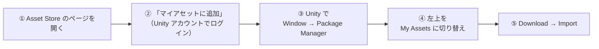

# 📦 使用アセット一覧

この授業で使う Unity Asset Store のアセットをまとめています。
**すべて無料**です。各自でダウンロードしてください。

---

## なぜ自分でダウンロードするのか

---

配布されるプロジェクトには、**アセット本体が含まれていません。**

- Asset Store のアセットは、**再配布が禁止**されているものがほとんどです
- モデルやテクスチャを含めるとリポジトリが非常に重くなり、ダウンロードに時間がかかります

そのため、プロジェクトを取得した直後は **モデルが表示されない／マテリアルがピンク色になる** 状態です。
下記のアセットをインポートすると直ります。

> エラーが出ていても慌てないでください。アセットを入れる前は出て当たり前です。

---

## ダウンロードと導入の手順

---

1. 下の表のリンクから Asset Store のページを開きます
2. **「マイアセットに追加」**（Add to My Assets）をクリックします
   - Unity アカウントでのログインが必要です
3. Unity を開き、メニューの **Window → Package Manager** を選びます
4. 左上のドロップダウンを **My Assets** に切り替えます
5. 目的のアセットを選び、**Download** → **Import** を実行します

> インポート時にファイル一覧が出たら、基本はすべてチェックを入れたまま **Import** で問題ありません。

---

## 1. 最初に入れるアセット（全員・必須）

---

Week01 の授業までに、この4つを入れておいてください。**全12回を通して使います。**

| アセット | 用途 | 主に使う週 | リンク |
| --- | --- | --- | --- |
| **サニーサイドアップ ユニティちゃん** | **主人公のモデル** | Week01〜（全週） | [公式サイト](https://unity3d.jp/unity-chan/) |
| **Starter Assets - ThirdPerson** | 三人称操作の土台 | Week01〜（全週） | [Asset Store](https://assetstore.unity.com/packages/essentials/starter-assets-thirdperson-updates-in-new-charactercontroller-pa-196526) |
| **FREE - Low Poly Swords - RPG Weapons** | プレイヤーが持つ剣 | Week01 | [Asset Store](https://assetstore.unity.com/packages/3d/props/weapons/free-low-poly-swords-rpg-weapons-198166) |
| **RPG Animations Pack FREE** | 攻撃モーション | Week01 | [Asset Store](https://assetstore.unity.com/packages/3d/animations/rpg-animations-pack-free-288783) |

### ⚠️ ユニティちゃんを使うときの注意（必ず読んでください）

---

#### URP 対応のモデルを選ぶこと

必ず **「サニーサイドアップ ユニティちゃん」**（2020年公開の新モデル）を選んでください。

従来のユニティちゃんモデルは Built-in Render Pipeline 向けです。
このプロジェクトは **URP** なので、従来モデルを入れると**マテリアルがピンク色**になります。

> 新モデルには **UTS2（ユニティちゃん・トゥーン・シェーダー2）の URP 版**が同梱されています。
> Week07 のセルルック制作で、お手本として中身を覗いてみてください。

#### ライセンスの順守が必要です

ユニティちゃんの利用には **ユニティちゃんライセンス（UCL）** の順守が必要です。

| | 内容 |
| --- | --- |
| **ライセンス表記** | 作品を公開・提出するときは、**ライセンスロゴの表示**が必要です |
| **確認すること** | ライセンスは改訂されています。**必ず公式サイトで現行版を確認**してください |
| **対象範囲** | 授業の課題提出だけでなく、**ポートフォリオとして公開する場合も対象**です |

公式サイト：https://unity3d.jp/unity-chan/
（旧アドレス `unity-chan.com` は、こちらへ転送されます）

> **「無料だから自由に使える」ではありません。**
> 他人が作ったものを使うときは、必ず条件を確認する。これは仕事でもまったく同じです。
> 面倒に見えますが、ここを飛ばして公開してしまうほうがずっと面倒なことになります。

### Starter Assets をインポートするときの注意

---

インポート中に **「Input System を有効にするために再起動が必要です」** という主旨のダイアログが出ます。
**Yes を選んで Unity を再起動してください。** 再起動しないと入力が効きません。

---

## 2. 週ごとに追加するアセット

---

> **選定中です。** 決まり次第このページを更新します。授業の1週間前までには確定させます。
> 現時点では「1. 最初に入れるアセット」だけ入っていれば授業を受けられます。
>
> 無料アセットが見つからないものは、**ProBuilder（Unity 内でモデリングできるツール）で自作**します。
> その場合はダウンロード不要です。**Blender は使いません。**

| 必要になるもの | 用途 | 使う週 | リンク |
| --- | --- | --- | --- |
| 敵キャラクターのモデルとアニメーション | 雑魚敵 | Week04 | 選定中 |
| ボスのモデルとアニメーション | ボス戦 | Week03 / Week11 | 選定中 |
| ステージ用のモジュールパーツ（床・壁・扉） | 塔の内部を組む | Week06 | 選定中 |
| エフェクト素材 | ヒットエフェクト、灯の点灯 | Week08 | 選定中 |
| BGM / 効果音 | タイトル・インゲーム・SE | Week12 | 選定中 |

---

## 3. Unity パッケージ（Asset Store ではありません）

---

こちらは **Asset Store ではなく Package Manager から入れるもの**です。
プロジェクトに設定済みのものは、開いたときに自動で取得されます。

| パッケージ | 用途 | 使う週 | 導入状況 |
| --- | --- | --- | --- |
| **UniTask** | 非同期処理 | Week09 | ✅ 設定済み（自動取得） |
| **Cinemachine** | カメラ制御 | Week02 | ✅ 設定済み |
| **Timeline** | 演出 | Week03 | ✅ 設定済み |
| **AI Navigation（NavMesh）** | 敵の経路探索 | Week04 | ✅ 設定済み |
| **Shader Graph** | シェーダー作成 | Week07 | ✅ 設定済み |
| **ProBuilder** | ステージ制作・レベルデザイン | Week06 | ⚠️ 未導入（Week06 までに導入します） |

> エフェクトは **Particle System**（Unity 標準機能）を使います。VFX Graph は使いません。
> 追加のインストールは不要です。
| **R3** | リアクティブプログラミング | Week10 | ⚠️ 未導入（Week10 の授業内で導入します） |

> ✅ のものは何もしなくて構いません。プロジェクトを開けば自動で入ります。

---

## 4. うまくいかないときは

---

| 症状 | 原因と対処 |
| --- | --- |
| **マテリアルがピンク色になる** | アセット未インポート、または URP 非対応のアセット。まず本ページのアセットを入れる |
| **ユニティちゃんがピンク色になる** | 従来モデルを入れている。**サニーサイドアップ ユニティちゃん**を入れ直す |
| **キャラクターが動かない** | Starter Assets のインポート後に Unity を再起動していない |
| **「マイアセットに追加」が押せない** | Unity アカウントにログインしていない |
| **Package Manager に My Assets が出ない** | Package Manager 左上のドロップダウンを確認する |
| **インポート時に上書き確認が出る** | 基本は上書きで問題なし。不安な場合は講師に確認してください |

上記で解決しない場合は、**エラーメッセージのスクリーンショット**を添えて Slack で質問してください。

---
