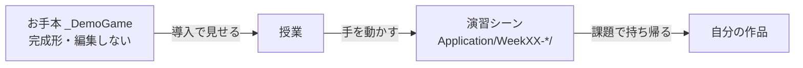
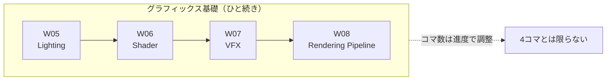
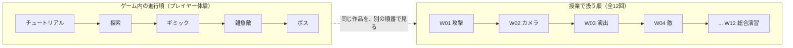

# 📐 後期授業 設計方針（講師用）

> このファイルは **講師用の設計メモ**です。Notion に添付するのは各週の資料のみで、このファイルは配布しません。
> 各週資料を書くときの判断基準がここに集約されています。
> 書式は **前期（Unity Game Dev Tutorial）の後半回に準拠**します。

---

## 1. この授業が本当に教えたいこと

技術（Unity の機能）は**題材**であって、目的ではありません。この授業は **二層構造**で設計します。

| 層 | 内容 | 評価のされ方 |
|---|---|---|
| 表層（技術） | Unity の機能を使って、3D ゲームの一場面を動かせる | 動いたかどうか |
| 深層（考え方） | 課題をどう分解し、どう道具を選び、どう詰まりを抜けるか | 説明できるかどうか |

**深層こそが「生きる術」です。** 学生が卒業後に Unity を使わなくなっても残るのは、
「曖昧な要求を観測可能な形に置き換える」「推測せず計測する」「変わるものと変わらないものを分ける」
といった思考の型のほうです。

そのため各週資料には必ず **「今週の問い」** と **「持ち帰る考え方」** を入れます。技術解説だけの回は作りません。

> 前期との差分：前期は技術解説が主でした。後期はここに「問い」と「考え方」、そして後述の「振り返り」を足します。

---

## 2. 12週の全体像

### 2.1 背骨：完成済みのお手本を、毎回参照する

授業は **全12回**です。各週は「独立した単元」として成立させます。

題材は **お手本作品『LUMEN（仮題）』** に固定します。セルルック調の3Dアクションアドベンチャーで、
塔を探索して3つの灯を灯し、最奥のボスを倒すとクリアです。

> **企画書**：[demo-game/01-concept.md](demo-game/01-concept.md)
> **仕様書**：[demo-game/02-spec.md](demo-game/02-spec.md)
> **授業との対応**（12回への分解・各回で見せる箇所など）：§7

#### お手本の位置づけ（重要）

| | |
| --- | --- |
| **場所** | `Assets/_DemoGame/`（namespace `DemoGame`） |
| **状態** | **完成形**。授業開始までに講師が作り切っておく |
| **使い方** | 各回の**導入と参考**として見せる |
| **編集** | **授業中に編集はしない。** 学生も触らない |
| **学生の作業場所** | 各週の専用シーン `Assets/Application/WeekXX-*/` |

**「作るとこうなる」を先に見せてから、演習で手を動かす。** この順序を毎回守ります。
ゴールの見えない作業は、学生にとって苦行にしかなりません。



### 2.2 独立性の担保ルール

「先週休んだから今週ついていけない」を**構造的に**防ぎます。

1. **各週に専用シーンと専用フォルダを持たせる**（`Assets/Application/WeekXX-<Topic>/`）
   その週のシーンを開けば、前週の成果物がなくても単元の内容は完結して学べる。
2. **各週フォルダに `_Start` と `_Goal` の2状態を用意する**
   - `_Start`：その週の作業前の状態（＝前週の完成形を配置済み）
   - `_Goal`：講師の完成見本
   欠席した学生は `_Start` から入れば合流できる。
3. **連結は「課題」で行い、「授業本体」では行わない**
   授業本体はその週のシーンで完結。課題で「自分の作品に取り込む」ところまでやらせる。
   前期同様、課題冒頭に `**前提条件：weekXX までの課題をクリアすること**` を明記する。
4. **お手本（`_DemoGame`）は授業中に編集しない**
   見せるだけ。編集すると「お手本がお手本でなくなる」ため、常に完成形を保つ。

この3点で「独立性」と「連続受講の意味」を両立させます。

### 2.3 各週の狙い一覧

| 回 | 技術トピック | 今週の問い | 持ち帰る考え方 |
|---|---|---|---|
| W01 | Animation・Animator 深掘り | 「攻撃が当たった」をゲームはどうやって知るのか？ | 曖昧な要求を**観測できる瞬間**に分解する |
| W02 | Cinemachine でのカメラ制御 | カメラを自分で書くと、何がそんなに大変なのか？ | **すでにある仕組みに乗るか、自分で作るか**を見極める |
| W03 | Timeline による演出制作 | 演出を全部スクリプトで書くと、なぜ破綻するのか？ | **誰が触る作業か**で道具を選ぶ＝分業の設計 |
| W04 | NavMesh と Unity AI 基礎／デザインパターン① State パターン | 敵の「考えていること」を、どうコードの形にするか？ | 増える条件分岐を**「状態」という形**で受け止める |
| W05 | グラフィックス基礎① Lighting | 光を置くだけで、なぜ世界の印象が変わるのか？ | 実行時コストを**前払い**するトレードオフ |
| W06 | グラフィックス基礎② Shader | 絵は「描く」しかないのか？ | 大量の手作業を**1本の式**に置き換える |
| W07 | グラフィックス基礎③ VFX | 「もっと派手にして」をどう具体的な作業に翻訳するか？ | 主観的な要求を**調整できるパラメータ**に翻訳する |
| W08 | グラフィックス基礎④ Rendering Pipeline | 画面に絵が出るまでに、何が起きているのか？ | **仕組みを知ると、選べるようになる** |
| W09 | 3D空間のレベルデザイン | プレイヤーはなぜ、教えてもいない方向へ進めるのか？ | **説明せずに伝える**。構造そのものが意図を語る |
| W10 | C# 発展① R3（Reactive Extensions） | 通知したい相手が増え続けると、コードはどう壊れるか？ | **依存の向き**を自分で決める |
| W11 | C# 発展② デザインパターン② MVP パターン（アウトゲーム編） | 「仕様変更に強い」とは具体的に何がどうなっていることか？ | **変わるもの / 変わらないもの**を分ける |
| W12 | 総合演習 | 12回ぶんの道具から、いま何を選ぶか？ | 知っていることと**選べる**ことは違う |

> 単元名は `index.md` が正です。ここを変えるときは必ず両方を直してください。

### 2.4 コマ割りは固定しない（W05〜W08）

---

**「1単元＝1コマ」とは限りません。** 特に **W05〜W08 のグラフィックス基礎①〜④** は、
4つでひと続きの内容です。



| | 方針 |
| --- | --- |
| **単元の順番** | 変えない。Lighting → Shader → VFX → Rendering Pipeline は積み上げの順 |
| **コマ数** | **固定しない。** 1単元に2コマ使っても、2単元を1コマにまとめてもよい |
| **判断基準** | 学生の手が止まっているかどうか。進度を見て決める |

**W05 Lighting は単体ではやや軽く、W06 Shader は重い**という見込みがあります。
W05 を早めに終えて W06 に食い込ませる、といった調整を想定しておいてください。

> **資料は単元ごとに作り、コマ割りは当日の進度で決める。**
> 資料を「1コマ分」に切り詰めると、かえって調整が効かなくなります。

---

## 3. 課題の設計方針

**全12回すべてに課題を置きます。例外なし。**
前期の課題ページの形式をそのまま踏襲します。

### 3.1 構成：3〜5問を「必須 → 推奨 → 応用」で並べる

| 難易度 | 問数の目安 | 性格 |
|---|---|---|
| **(必須)** | 1〜2問 | 全員がここまで来る。授業内容を、条件を少し変えて自力で再現する |
| **(推奨)** | 1〜2問 | 授業で触れた機能を、別の文脈に応用する。ここまでやれば十分 |
| **(応用)** | 1問 | 正解を1つに決めない。設計の余地を残す。余力のある学生の天井を外す |

問題番号は通し番号（`## 1 (必須) 〜`, `## 2 (必須) 〜`, `## 3 (推奨) 〜`, `## 4 (応用) 〜`）。

### 3.2 1問あたりの構成要素

前期の実例に合わせ、次の順で書きます。

```
## <番号> (難易度) <課題タイトル>

---

**前提条件：weekXX までの課題をクリアすること**   ← 連結がある場合のみ

<何を作るかの説明・2〜4行>

条件

```csharp
・条件1
・条件2
```

提出方法

<提出物の形式>をslackに提出してください

ヒント                                          ← 応用課題など、必要な場合のみ

```csharp
・アプローチA
    or
・アプローチB
```
```

- **条件・ヒントは ` ```csharp ` ブロックに `・` 箇条書き**で入れる（Notion 上でコードブロック表示になる前期の慣習）
- **提出方法は毎問書く。** 「動画」「音声を録音した動画」など、何が映っていれば合格かがわかる粒度で
- ヒントは答えを書かない。**選択肢を2つ並べて選ばせる**のが前期の良い型（例：`PlayerPrefs` or `.json`）

### 3.3 設計上の約束

- **必須は「授業の再演」にしない。** 授業と同じ手順をなぞるだけでは詰まりが発生せず、振り返りが書けません。
  条件を1つだけ変える（対象を変える／数を増やす／順序を変える）のが良い塩梅です。
- **応用は正解を配らない。** 「こうすればできる」ではなく「こういう状態にしてほしい」だけ書きます。
- **次週への連結を必ず書く。** 前提条件行、または課題末尾に1行。
  これが「連続して受講する意味」を学生に体感させる唯一の装置です。

### 3.4 ★後期から新設：振り返り

**前期には無かった要素です。後期から全週の課題末尾に追加します。**

提出物が動いているかは**足切り**であって評価ではありません。評価の重心は振り返りに置きます。

```
## 🔁 振り返り（必須）

---

次の3点を 3〜5行で、課題の提出と一緒にslackへ投稿してください。

1. **どこで詰まったか** — うまくいかなかった具体的な現象
2. **どう調べたか** — 何を見て、何を試したか
3. **どう解決したか** — 結局、原因は何だったか
```

- **「できました」だけは不可**とします。
- 詰まらなかった学生には「なぜ詰まらなかったか（何を事前に知っていたか）」を書かせます。
- 「詰まり→調べ方→解決」の筋道が書けている学生は、授業で扱っていない機能にも自力で到達します。
  そこを伸ばすのがこの授業の目的です。

---

## 4. ドキュメント運用ルール

### 4.1 ファイル構成：1週＝1ディレクトリ

前期同様 **1単元が複数ページに分かれます**（「導入編」「実践編」＋「課題」）。
また図・スクリーンショットが多いため、**週ごとにディレクトリを切り、画像を同梱**します。

```
doc/
├── index.md                      シラバス（Notion トップに対応）
├── course-design.md              ★このファイル（講師用・非配布）
├── templates/
│   ├── lecture.md                講義ページのテンプレート
│   └── assignment.md             課題ページのテンプレート
│
├── week01-animation/
│   ├── 01-intro.md               導入編    → Notion 1ページ
│   ├── 02-practice.md            実践編    → Notion 1ページ（必要なら 03, 04 と増やす）
│   ├── 99-assignment.md          課題      → Notion 1ページ
│   └── images/                   スクリーンショット置き場
│
├── week02-cinemachine/
│   └── ...
└── week12-finalproject/
    └── ...
```

- ページ数は単元によって変わります。**最低でも「導入編」＋「課題」の2ページ**。
- ファイル名の連番（`01-`, `02-`, `99-`）が Notion 上での並び順になります。
- 課題は必ず `99-assignment.md` に固定（どの週でも同じ場所にある状態にする）。

### 4.2 命名規約

- 週ディレクトリ：`week<2桁>-<topic>/`（小文字ケバブケース）
- `<topic>` は Unity 側のフォルダ名の後半と**必ず一致**させる
  （例：`week06-lighting/` ↔ `Assets/Application/Week06-Lighting/`）

### 4.3 書式規約（前期準拠）

`.md` を Notion にそのまま貼り付けて運用します。前期の書式を踏襲してください。

| 項目 | ルール |
|---|---|
| 見出し直下の区切り線 | `##` / `###` の直後に空行＋`---` を入れる（Notion の区切り線になる） |
| 見出しレベル | `#` ページタイトル → `##` 大項目 → `###` 節 → `####` 小項目 |
| 文体 | 敬体（です・ます）。学生が一人で読んで進められる粒度で |
| 図 | **Mermaid を積極的に使う**。仕組みの説明は文章より図が速い |
| スクリーンショット | `` で参照。Unity の画面は惜しまず貼る |
| 表 | 設定項目の一覧は必ず表にする（`| 設定項目 | 内容 |`） |
| 引用 | `>` は「覚え方」「考え方のポイント」に使う |
| 用語の導入 | `- **用語名**` ＋改行して説明、の形 |

**やってはいけないこと**

- ❌ `[Week01 - Animator](Week01 - Animator)` のような**スペース入りの相対リンク**は壊れます
- ❌ 図を省略してテキストだけで済ませること（前期の水準を下回ります）

### 4.4 アセットの扱い（学生配布ページ）

Unity Asset Store のアセット一覧は **`doc/assets.md` に一本化**します（学生に配布するページ）。

- **各週資料にダウンロードリンクを直接書かないこと。** 更新箇所が増えると必ずズレます。
  週資料では「このアセットを使う」とだけ書き、導入手順は `assets.md` へリンクします。
- **実在が確認できない URL は書かない。** 未選定のものは「選定中」のまま残します。
- 週ごとに追加するアセットは、**その週の1週間前までに確定**させて `assets.md` を更新します。
- **検証前の候補は `assets.md` に載せないこと。** 講師用の
  [demo-game/03-asset-candidates.md](demo-game/03-asset-candidates.md) で管理し、
  実機で検証が済んだものだけを `assets.md` へ移します。

**リポジトリにアセット本体を含めない方針です。**（Asset Store の無料アセットは再配布不可のものが大半、かつ容量が大きいため）

移行先で GitHub 管理する際は、インポート先フォルダを `.gitignore` に追加する必要があります。
インポート先はアセットごとに異なるため、**実際にインポートしてから確定**させてください。

```
# 例（実際のインポート先を確認してから記載すること）
/unity-game-dev-advance/Assets/StarterAssets/
/unity-game-dev-advance/Assets/<アセット名>/
```

> `.gitignore` には既に `*/Assets/_GitIgnore*` の行があります。
> 外部アセットを1箇所にまとめられる場合は、この仕組みを使う手もあります。

### 4.5 画像の扱い

- Notion からのエクスポート時、画像は `スクリーンショット YYYY-MM-DD HH.MM.SS.png` のような名前になります。
- リポジトリに入れる際は **内容がわかる名前にリネーム**してください（例：`audio-source-inspector.png`）。
- 置き場所は各週の `images/` 配下。

---

## 5. Unity プロジェクト規約

### 5.1 フォルダ

```
Assets/
├── _DemoGame/                お手本作品『LUMEN』の本体
│   ├── Scenes/               DemoTitle.unity / DemoInGame.unity
│   ├── Scripts/              Input / Core / Player / UI / Gimmick
│   ├── Prefabs/
│   └── Materials/
│
└── Application/              各週の授業用（学生が手を動かす場所）
    ├── Week01-Animation/
    ├── Week02-Cinemachine/
    ├── ...
    └── Week12-FinalProject/
```

- 週フォルダ名：`Week<2桁>-<Topic>`（PascalCase、シラバスの単元名に一致）
- **週フォルダ間の参照は禁止。** 共有したいものは `_DemoGame/` に上げる。
  これを破ると「その週のシーンだけ開けば学べる」という独立性が崩れます。
- 週フォルダから `_DemoGame/` を参照するのは可。逆（`_DemoGame` が週を参照）は禁止。

### 5.2 シーン

- メインシーン：`Week<2桁>-<Topic>.unity`（フォルダ名と同名）
- 補助シーン：`Week<2桁>-<Topic>_<用途>.unity`（例：`Week03-Timeline_BossDirection.unity`）
- 状態違い：`_Start` / `_Goal` サフィックス（2.2 参照）

### 5.3 スクリプト

#### namespace は必ず切ること

| 対象 | namespace |
| --- | --- |
| 各週の教材コード | `Week01` 〜 `Week12` |
| お手本作品（`_DemoGame/`） | `DemoGame` |

**理由：学生が同じクラス名を作ったときに、コンパイルエラーで授業が止まるのを防ぐためです。**
`PlayerController` や `GameManager` のような名前は学生も必ず作ります。
namespace が切られていないと、学生のスクリプトと衝突してプロジェクト全体がコンパイルできなくなります。

> **namespace を切り忘れたコードは教材に載せない。** 例外を作らないでください。

- 学生が読む教材コードなので、**省略記法より読みやすさを優先**します

---

## 6. 現状とのギャップ（2026-09-28 時点）

### 6.1 対応済み

- 週番号のズレを `index.md` 基準に統一（Unity 側フォルダをリネーム）
  - `Week05-Lighting` → `Week06-Lighting`
  - `Week06-Shader` → `Week07-Shader`
  - `Week07-PostProcess` → `Week08-VFX`（PostProcess は VFX 回に内包）
  - `Week10-Event` → `Week10-R3`（素の event は R3 への導入教材として残す）
- **Input System を StarterAssets 非依存で作り直し**（コンパイルエラーの解消）
  - 旧 `Application/InputSystem/`（`StarterAssetsInputsRapper` 等）を削除
  - `_DemoGame/Scripts/Input/InputReader.cs` として再実装。バインディングは旧定義を引き継ぎ
  - `Week01-Animation/` の `PlayerAttack` / `PlayerInteractiveController` を追従修正
- **お手本 `_DemoGame` の枠組みを実装**（入力・プレイヤー・UI・シーン遷移・仮ギミック）
- 付録資料 `appendix/input-system.md` を作成
- **12回構成への再編**（週ディレクトリの繰り上げ、各週のメイン内容を反映）
  - W05 Lighting / W06 Shader は**昨年の資料を反映済み**（画像の配置のみ残）
- **Unity 週フォルダのリネーム完了**
  - `Week06-Lighting` → `Week05-Lighting` ／ `Week07-Shader` → `Week06-Shader` ／ `Week08-VFX` → `Week07-VFX`
  - `Week09-UniTask` → `Assets/Appendix/UniTask`（単元廃止・付録化）
- **全 `.cs` に namespace を付与**（`EventSample.cs` に `Week10`、`UniTaskSample.cs` に `Appendix`）

### 6.2 未対応（ToDo）

**Unity プロジェクト（★ Unity Editor を閉じてから作業すること）**

- [ ] 未作成の週フォルダを用意：W02 / W04 / W08 / W09 / W11 / W12（6週分）
- [ ] 各週に `_Start` / `_Goal` シーンを用意（お手本の完成形から切り出す）
- [ ] `DemoInGame` にレベルを配置する（灯3つ・敵・ボス扉・ボス・UI）
- [ ] R3 パッケージ未導入 → W10 の授業内で導入する
- [ ] ProBuilder 未導入 → お手本のステージ制作と W09 で必要
- [ ] Player / Sword などのプレハブを `Week01-Animation/` から `_DemoGame/Prefabs/` へ移設

**お手本（`_DemoGame`）**

- [ ] ステージをモジュール化して6エリアを組む
- [ ] 灯の間ごとのギミックを実装（箱押し / 時限扉 / 撃破）
- [ ] ボスを実装（State パターン）
- [ ] セルルックシェーダーを作る
- [ ] **授業開始までに完成させる**（途中の状態では「お手本」にならない）

**ドキュメント**

- [ ] 各週の本文執筆（現在は骨子のみ。W05 Lighting と W06 Shader は昨年資料を反映済み）
- [ ] 各週の課題を具体化（現在はテンプレートのまま）
- [ ] スクリーンショットの撮り直し（W05 / W06 は昨年の画像を `images/` へ配置する必要あり）
- [ ] W05〜W08（グラフィックス基礎）の**実際のコマ割りを、資料を書きながら決める**（下記 2.4）

**要・削除判断（作りかけの残骸）**

| ファイル | 備考 |
|---|---|
| `Week07-Shader/New Scene.unity` | 未命名。中身を確認して削除 or リネーム |
| `Week07-Shader/New Shader Graph.shadergraph` / `.mat` | 同上 |
| `Week08-VFX/New Material.mat` | 同上 |
| `Week07-Shader/SampleVerterxShader.*` | `Verterx` → `Vertex` の誤字 |

### 6.4 UniTask の扱い（決定済み）

---

**付録に回しました。** `doc/appendix/unitask.md`／`Assets/Appendix/UniTask/`

- **基本（await で待つ、Delay で秒数を待つ）は前期で扱い済み**のため、後期では繰り返しません
- 後期で必要になるのは **キャンセル周り**（演出のスキップ、シーン遷移時の中断）
- 単独の単元は設けず、**Week03（演出のスキップ）で必要になったときに参照させる**運用にします

### 6.3 運用上の注意

- このマシンでは **git 管理しません**。最終的に `.zip` 化して別マシンへ移行します。
- `.gitignore` は移行先での利用を想定して残してあります。
- zip 化の前に `Library/`, `Temp/`, `.DS_Store` を除外すること。

---

## 7. お手本作品『LUMEN』と授業の対応

---

> **2026-10-01 に `doc/demo-game/` から移設しました。**
> `doc/demo-game/` 以下（企画書・仕様書・アセット選定・設計書）には**ゲームそのものだけ**を書き、授業との対応はすべてこの章に置きます。

### 7.1 なぜこの題材なのか（教材としての狙い）

---

この作品は、**後期12回のシラバスを1本の遊べる形に落とし込むため**に設計されています。
「Cinemachine を学ぶ」ではなく「視点を切り替えたいから Cinemachine を使う」という順序にすることで、
学生は機能の使い方ではなく**機能を選ぶ理由**を先に体験します。

| シラバスの単元 | この作品で「必要になる」瞬間 |
|---|---|
| Animation・Animator 深掘り | 剣を振って、当たった瞬間を取り出したい |
| Cinemachine でのカメラ制御 | 探索も戦闘も、1つのカメラでは成立しない |
| Timeline による演出制作 | ボスが出てくるところを「演出」にしたい |
| NavMesh と Unity AI 基礎／State パターン | 敵に追いかけてほしい。行動を段階的に変えたい |
| グラフィックス基礎① Lighting | 「灯が消えた塔」を成立させたい |
| グラフィックス基礎② Shader | セルルックにしたい |
| グラフィックス基礎③ VFX | 灯が点く瞬間を気持ちよくしたい |
| グラフィックス基礎④ Rendering Pipeline | なぜこの見た目になるのかを説明できるようにしたい |
| 3D空間のレベルデザイン | 説明せずに「こっちへ進め」と伝えたい |
| C# 発展① R3 | 灯の数が変わったら UI と扉の両方に伝えたい |
| C# 発展② MVP パターン | タイトルからリザルトまで繋ぎたい |
| 総合演習 | ここにない機能を、自分で足したい |

**この表が、12回を1本に繋ぐ根拠です。**

### 7.2 授業で扱う順と、ゲーム内進行順の違い

---

**この2つは一致しません。** 混同すると授業設計を誤ります。



- **ゲーム内進行順**＝チュートリアル → 探索 → ギミック → 雑魚敵 → ボス
- **授業で扱う順**＝シラバスの12回（技術の積み上げ順）

授業の順は「**その回に学ぶ技術が最も必要になる場面**」から決めています。

### 7.3 12回への分解

---

> **W05〜W08 は「1単元＝1コマ」ではありません。** グラフィックス基礎としてひと続きの内容で、
> コマ割りは進度に応じて調整します（§2.4）。

| 回 | 単元 | この回で扱うもの | `_Start` の状態 | `_Goal` の状態 |
| --- | --- | --- | --- | --- |
| **W01** | Animation・Animator 深掘り | プレイヤーの攻撃、ヒット判定、箱押しの IK | 木箱があるが壊せない | 木箱を壊せる。箱を押せる |
| **W02** | Cinemachine でのカメラ制御 | 手書きカメラ → Cinemachine への置き換え | 自作の追従カメラだけ | Cinemachine で制御できる |
| **W03** | Timeline による演出制作 | カットシーン（導入・ギミック解除・ボス戦前） | ボスが最初から立っている | 登場演出が流れる |
| **W04** | NavMesh と Unity AI 基礎／State パターン | 雑魚敵の追跡、ボスのフェーズ切り替え | 敵が置物。行動が `if` の入れ子 | 敵が追ってくる。State で整理されている |
| **W05** | グラフィックス基礎① Lighting | ライティング、ベイク、Reflection Probe | 全部リアルタイムライトで重い | ベイクされ、灯で明暗が変わる |
| **W06** | グラフィックス基礎② Shader | セルルック Shader Graph、頂点/フラグメント | 標準 Lit マテリアル | セルルックになる |
| **W07** | グラフィックス基礎③ VFX | Particle System × Shader のエフェクト | エフェクトなし | 灯が点る瞬間が気持ちいい |
| **W08** | グラフィックス基礎④ Rendering Pipeline | 描画の仕組みの総復習、SRP と PBR の対比、**PostProcess（Volume）** | 観察用シーン。PostProcess なし | 違いを説明でき、Volume をかけられる |
| **W09** | 3D空間のレベルデザイン | ProBuilder、インポート設定、LOD / カリング、導線 | 平坦で目印のない空間 | 導線が成立し、最適化されている |
| **W10** | C# 発展① R3 | `GameProgress`、灯・HP の通知 | ギミックが UI を直接触っている | 購読で繋がる |
| **W11** | C# 発展② MVP パターン | HUD、タイトル / ポーズ / 設定 / リザルト | インゲームのみ | 通しで遊べる |
| **W12** | 総合演習 | お手本にない機能を自分で足す | — | 自分の作品が進む |

#### 各回の「悪い実装 → 良い実装」

いくつかの回は、**わざと問題のある状態を `_Start` に用意します。**
学生が「これでは駄目だ」と体感してから解決策に進むためです。

| 回 | `_Start` に仕込む問題 | 気づかせたいこと |
| --- | --- | --- |
| W02 | カメラが自作で、壁にめり込む・カクつく | 自分で作るか、既存に乗るか |
| W04 | ボスの行動が `if` の入れ子で、条件を1つ足すと壊れる | 形で受け止める |
| W05 | 全部リアルタイムライトで、動かすと重い | 前払いというトレードオフ |
| W09 | LOD もカリングもなく、遠景まで全部描画している | 見えないものは描かない |
| W10 | 灯が UI・扉・BGM を直接触っていて、追加のたびに灯を修正する羽目になる | 依存の向き |

> **これがこの授業の肝です。** 正解から教えると「なぜそうするか」が残りません。

### 7.4 各回でお手本のどこを見せるか

---

| 回 | お手本の該当箇所 | 見せ方・使い方 |
| --- | --- | --- |
| **W01** | `PlayerAttack` の Animation Event（ヒット判定） | **「攻撃が当たった瞬間」を Animation Event という"観測点"として取り出している**のが要点。持ち帰る考え方に直結する |
| | 灯の間 A の箱押し（`PressBox`） | 既存 `PressBox.OnPressAsync()` は `AddForce` がコメントアウトされ、1秒待つだけ。ここを完成させるのが実装課題として使える |
| **W02** | TPS / FPS の視点切替 | 「どちらが優れているか」ではなく「**場面によって持ち替える**」設計。そのまま教材になる |
| | `CM_Impulse`（被弾・着地時の画面振動） | |
| **W03** | `CM_BossIntro`（ボス登場の Timeline） | |
| **W04** | 雑魚敵 → ボス | 雑魚敵の状態遷移をまず `if` 文で素朴に書き、**同じ回の後半でボスを作るときに「これ以上 if を増やせない」と気づかせる**。NavMesh と State パターンをセットで扱う回で、この流れが前半と後半を繋ぐ |
| **W05** | 灯の点灯で寒色 → 暖色に変わるライティング | |
| **W06** | セルルックシェーダー | **お手本は HLSL 手書き、授業は Shader Graph。** 学生は Shader Graph で作り、「同じ見た目を手書きで作ると、何が減らせるか」をお手本で見せる（[demo-game/05-graphics.md](demo-game/05-graphics.md) §2.1） |
| | ユニティちゃん同梱の UTS2（URP 版） | **自作セルルックシェーダーの比較対象**。「プロがどう作っているか」を見せてから自分で作らせる |
| **W07** | 灯が点く瞬間のエフェクト、`CM_LanternLit` | 主題は「パーティクルの打ち方」ではなく **Particle System と Shader をどう連携させるか**。W06 の続き。お手本はパーティクルごとの値を頂点（Custom Vertex Streams）で渡している |
| **W06〜W08** | 輪郭線 | お手本は画面空間（自作 Volume ＋ Renderer Feature）。**背面法との比較**を授業の題材にする |
| **W08** | Volume（Bloom など）と輪郭線の Volume | 輪郭線もお手本では自作の VolumeComponent。Bloom などと同じ仕組みで動くことを見せられる |
| **W09** | 目覚めの間のチュートリアル配置 | 「説明を読ませる」のではなく「やらないと進めない配置にする」。レベルデザインの基本 |
| | HUD の Canvas 分割 | UI パフォーマンスの単元は無くなったが、お手本側では正しく分けておく。最適化の話に触れる際の実例 |
| **W10** | `GameProgress` と灯 | ギミック側が UI を直接触らない。**灯は「自分が点いた」としか言わない。** 誰がそれを聞いて何をするかは聞く側が決める＝「依存の向きを自分で決める」の実例。R3 の導入手順そのものを授業内で扱うと、パッケージ管理の学習も兼ねられる |
| **W11** | HUD・タイトル・ポーズ・設定・リザルト | |
| **W12** | 体験の芯・作らないもの・拡張ポイント | 下記 §7.5 |

### 7.5 スコープ・拡張ポイントと授業

---

**お手本は学生が真似できる範囲を厳密に守ります。**
お手本を作るのは講師ですが、「頑張れば自分にも作れそうだ」と思える規模でなければ、
参考になりません。手の届かない完成度は、やる気を折ります。

- **「芯」を先に決めて、そこに入らないものを捨てる。** これは学生にそのまま教える内容でもある（W12 総合演習で振り返る）
- **「作らないもの」を先に決めるのが企画。** W12 の総合演習では、この判断そのものを学生に追体験させる。
  「時間が足りないから削る」のではなく「芯に入らないから最初から作らない」という順序を教える
- 灯の間の「並列・独立」という構造が、**学生の自由制作枠**をそのまま生む
- **失敗時のリトライの摩擦を最小化**しているのは、学生が何度も動作確認する前提の作りだから

お手本は**学生が編集しません。** そのかわり、**「ここを増やせる」と分かる構造**にしておきます。
総合演習（W12）で「自分なら何を足すか」を考えさせるときの土台になります。

| 拡張ポイント | 関連する回 |
| --- | --- |
| **灯の間を増やす** | W09（レベルデザイン） |
| **ギミックを差し替える** | W10（R3） |
| **ボスの行動を足す** | W04（State） |
| **アウトゲームを足す** | W11（MVP） |

> **授業では「増やせる構造になっている」ことを見せます。** 実際に増やすのは学生の課題です。

#### 学生に Blender は要求しない

ステージ制作は ProBuilder で完結させます。
講師がお手本を作る分には Blender を使ってかまいませんが、**学生が再現できる範囲**に留めます。
この授業の主題はプログラムと設計であり、モデリングではありません。

### 7.6 参考ゲームを授業で見せるとき

---

| ゲーム | 関連する回 |
| --- | --- |
| **Hi-Fi RUSH** | W06 / W07 |
| **Bomb Rush Cyberfunk** | W06 |
| **TUNIC** | W09 |
| **NIGHTIN CAGE** | W09 / W12 |
| **Honkai Impact 3rd** | W06 |

> **規模を真似しない。芯だけを見る。**

参考ゲームを挙げると、学生は「これを作りたい」と言い出します。それ自体はいいことですが、
**同じ規模を目指すと必ず未完成で終わります。**

授業で参考ゲームを見せるときは、**見る場所を指定**してください。

| ❌ こう言わない | ✅ こう言う |
| --- | --- |
| 「TUNIC を遊んでみて」 | 「TUNIC の最初の5分で、**一度も文字を読まずにどこまで進めるか**を見てきて」 |
| 「Hi-Fi RUSH きれいだよね」 | 「Hi-Fi RUSH の**輪郭線がどこに入っていて、どこに入っていないか**を見てきて」 |

**「どうやって作っているんだろう」と考えながら遊ぶ**のは、作り手にしかできない遊び方です。
この視点を持てるようになることが、この授業の目的のひとつでもあります。

### 7.7 VFX Graph を使わない理由（授業の観点）

---

| 理由 | 内容 |
| --- | --- |
| **現場の実情** | VFX Graph の採用例はまだ限られており、Particle System のほうが遭遇率が高い |
| **応用が効く** | Particle System は Shader の知識がそのまま活きる。GPU パーティクル特有の知識に閉じない |
| **週が繋がる** | **W06 で作ったシェーダーを W07 でそのまま使い回せる** |

### 7.8 既存資産の流用と、昨年度から引き継げる回

---

| 既存資産 | 流用先 |
|---|---|
| `Week01-Animation/` の Player / Sword / HitBox / HitChecker | プレイヤーの攻撃とヒット判定 |
| `Week01-Animation/IKControl.cs` / `PressBox.cs` | 灯の間 A の箱押しギミック（IK で手を箱に添える） |
| `Week01-Animation/IInteractiveObject.cs` | インタラクト全般の共通インターフェース |
| `Week03-Timeline/BossDirection/` | ボス登場演出 |
| `Week05-Lighting/` のマテリアル群 | ライティング検証用サンプル |
| `Week06-Shader/` の Shader Graph サンプル | セルルック制作の足がかり（授業側） |
| `Appendix/UniTask/UniTaskSample.cs` | キャンセル処理のサンプル（単元廃止・**付録化済み**） |
| `Week10-R3/EventSample.cs` | 「素の event の限界」を示す導入教材 |

| 回 | 状況 |
| --- | --- |
| **W01 Animation** | 内容はほぼ変わらない。既存実装をそのまま使える |
| **W03 Timeline** | 同上 |
| **W05 Lighting** | **昨年の資料が残っており、反映済み。** 画像の配置が必要 |
| **W06 Shader** | **昨年の資料が残っており、反映済み。** 画像の配置が必要 |

作業は主に資料の整備と、`_Start` / `_Goal` シーンの切り出しになります。

### 7.9 お手本の完成後にやること

---

**お手本を先に完成させてから、各週へ切り出します。**
逆順（週ごとに作って最後に繋ぐ）にすると、必ず繋がらなくなります。

```
1. 各回の _Start / _Goal シーンを、完成形から切り出して作る
2. Week01 から順に授業資料を執筆
```

#### アセットの採用が決まったら（学生配布ページへの反映）

1. [demo-game/03-asset-candidates.md](demo-game/03-asset-candidates.md) で採用したもののうち、学生も使うものを
   [assets.md](assets.md) の **「2. 週ごとに追加するアセット」** へ移動する
2. 用途・使う週・リンクを記入する
3. **授業の1週間前までに確定**させる（§4.4）

#### 授業との関係で使うパッケージ

| パッケージ | 必要になる週 |
| --- | --- |
| **R3** | W10（お手本では導入済み） |
| **ProBuilder** | W09（お手本では導入済み） |
