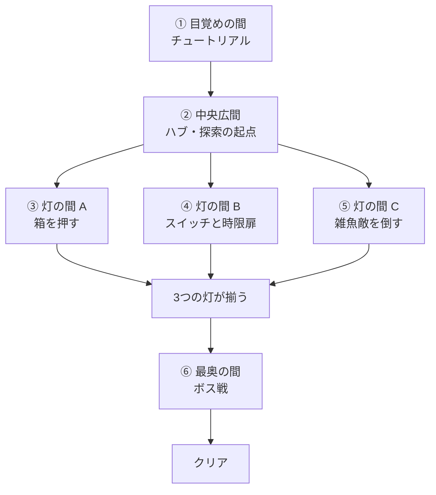
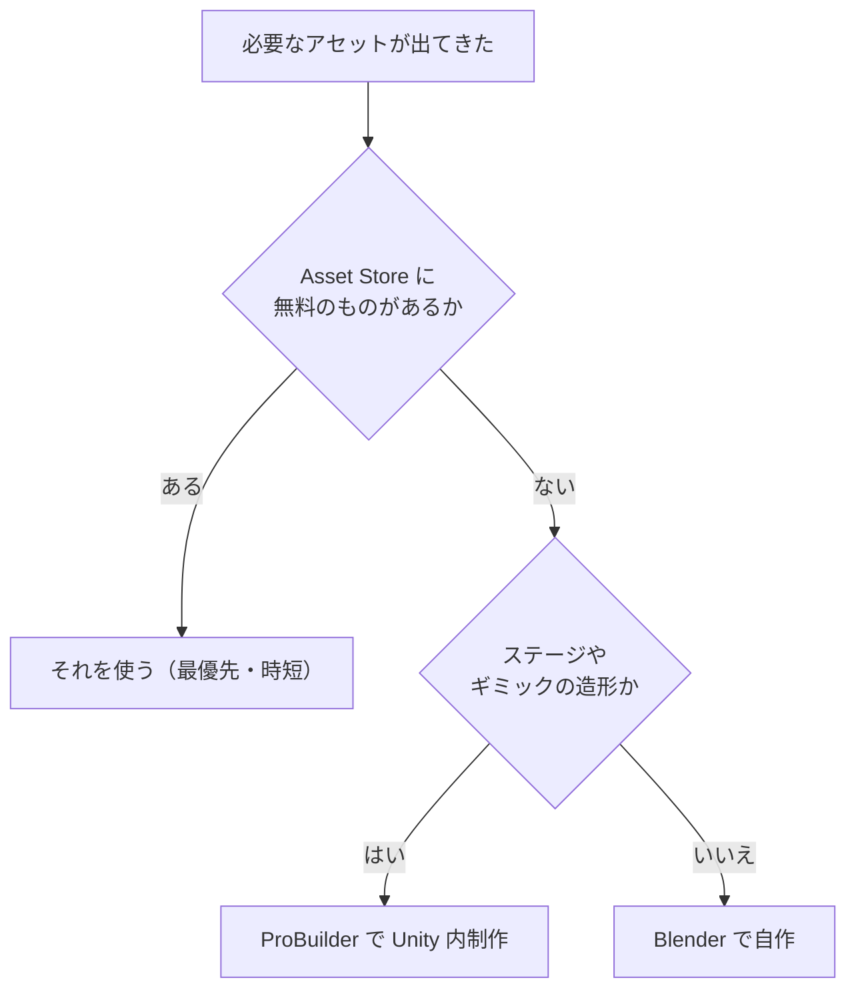

# 『LUMEN（仮題）』企画書

> **このドキュメントは非配布です。**
> 『LUMEN』というゲームそのものの企画書です。仕様の詳細は [02-spec.md](02-spec.md) を参照してください。
> **2026-10-02：舞台（塔 → 霧のフィールド）・攻略の順番（自由 → 固定）・攻撃（剣 → 杖と火焔玉）・Lumen を変えました。§3・§5 とずれる部分は [10-level-design.md](10-level-design.md) を正とします。**

| | |
|---|---|
| **仮題** | LUMEN（ルーメン） |
| **ジャンル** | 3D アクションアドベンチャー（軽い探索 ＋ ギミック ＋ ボス戦） |
| **プレイ時間** | 8〜10 分（1周・クリアまで） |
| **視点** | TPS / FPS 切り替え式 |
| **アート** | セルルック（トゥーンシェーディング ＋ アウトライン） |
| **プラットフォーム** | PC（Windows / macOS）スタンドアロン |

---

## 1. コンセプト

---

> **灯の消えた塔に入り、3つの灯を灯し直して、最奥の番人を鎮める。**

参考イメージは『ゼルダの伝説』『原神』の探索パートです。
戦闘の複雑さでは勝負せず、**「見て、気づいて、仕掛けを解く」**体験の密度で成立させます。

> 具体的な参考タイトルとリンクは **[§8 参考ゲーム](#8-参考ゲーム)** にまとめています。

---

## 2. 体験の芯

---

この3つが成立していれば、他が多少荒くても作品として成立します。
逆に、**この3つ以外に時間を使わない**というスコープ判断の基準でもあります。

| # | 芯 | 具体的に何が起きるか |
|---|---|---|
| 1 | **暗い塔に、光が戻っていく** | 灯を1つ灯すたびに、そのエリアの明るさと色が実際に変化する |
| 2 | **視点を変えると、気づく** | TPS では見えない高所の印が、FPS で見上げると見える |
| 3 | **仕掛けが、手応えとして解ける** | 箱を押す・敵を倒す・スイッチを踏む、が扉の開放に直結する |

> 「芯」を先に決めて、そこに入らないものを捨てる。

---

## 3. ゲームの流れ

---

### 3.1 進行順（プレイヤーが体験する順番）



**中央広間から3方向に分岐するハブ構造**にします。
灯の間 A / B / C は **互いに独立**していて、どの順番で解いてもかまいません。

### 3.2 各エリアの役割

---

| # | エリア | プレイヤーがすること | 主な要素 |
|---|---|---|---|
| ① | **目覚めの間** | 移動・視点切替・攻撃を試す。扉を開けて出る | 操作の習得 |
| ② | **中央広間** | 3方向の道と、灯が3つ嵌まる台座を見る | 目的の提示 |
| ③ | **灯の間 A** | 箱を押して足場を作り、高所の灯に届く | 物理・IK・インタラクト |
| ④ | **灯の間 B** | スイッチを踏むと扉が一定時間だけ開く。時間内に抜ける | 非同期・時間制御 |
| ⑤ | **灯の間 C** | 雑魚敵を全て倒すと灯が点く | 戦闘・AI |
| ⑥ | **最奥の間** | ボスと戦う。倒すとクリア | 総合 |

### 3.3 チュートリアルの方針

---

**テキストで説明しません。** 構造で教えます。

- 目覚めの間には**扉が1つしかない**（迷わない）
- 扉の前に**壊せる木箱**を置く（攻撃しないと進めない＝攻撃を必ず覚える）
- 扉の上に**FPS でしか読めない印**を置く（視点切替を必ず覚える）

> 「説明を読ませる」のではなく「やらないと進めない配置にする」。

---

## 4. アートディレクション

---

### 4.1 セルルック

| 要素 | 方針 |
|---|---|
| **陰影** | 2〜3 段のトゥーンシェーディング（グラデーションを階段状に） |
| **輪郭線** | アウトライン。画面空間（PostProcess）で描く（[05-graphics.md](05-graphics.md) §5） |
| **色数** | 1エリアあたり主要色3色まで。灯の色（暖色）を主役にする |
| **明暗** | 灯が消えている状態＝寒色・低照度／灯った状態＝暖色・高照度 |

**明るさの変化が、そのまま進行度の表示になります。** UI に頼らない状態表示です。

> セルルックの具体的なイメージは **§8 参考ゲーム** を見てください。
> 特に [Bless You Again](https://store.steampowered.com/app/3530630/Bless_You_Again/) が近いです。

### 4.2 使用アセット方針

---

| 要素 | 方針 | 状況 |
| --- | --- | --- |
| **プレイヤーモデル** | **ユニティちゃん（URP 対応版）を暫定使用。** 差し替え可能な構造にする | 暫定確定 |
| **プレイヤーの武器・攻撃モーション** | 既存の無料アセット3点を流用 | 確定 |
| **敵・ボスのモデル** | 無料アセットを優先。雑魚敵＝Monster Minion Survivor、ボス＝Rock Golem（[03-asset-candidates.md](03-asset-candidates.md) §0） | **選定済み・要検証** |
| **ステージ** | **ProBuilder で Unity 内で制作。** モジュールパーツ化して組み替え可能にする | 方針確定 |
| **シェーダー** | **自作。** HLSL 手書き（全オブジェクト共通の1本）。設計は [05-graphics.md](05-graphics.md) | 確定 |
| **エフェクト・BGM・SE** | 無料素材を優先 | **未選定** |

#### アセット選定の優先順位

制作を止めないため、次の順で判断します。



1. **Unity Asset Store の無料アセット** — 最優先。時間を買う
2. **ProBuilder による Unity 内制作** — ステージ・ギミックの造形
3. **Blender による自作** — 上記で足りない場合のみ

#### ユニティちゃんを選んだ理由

- 無償で入手できる（採用したのは **ユニティちゃん 3Dモデルデータ Ver 1.4.0**。マテリアルは DemoGame のものに貼り替えるので、URP 対応版でなくてよい）
- Humanoid リグなので、既存の Animator Controller と IK がそのまま動く

> ただし **ユニティちゃんライセンス（UCL）の順守が必要**です。
> 詳細と注意点は [使用アセット一覧](../assets.md) を参照してください。

---

## 5. 操作

---

| 入力 | TPS | FPS |
|---|---|---|
| WASD | 移動 | 移動 |
| マウス | カメラ回転 | 視点回転 |
| Tab | **FPS へ切替** | **TPS へ切替** |
| 左クリック | 攻撃 | 攻撃（※精度は落とす） |
| E | インタラクト（押す・調べる） | インタラクト |
| Space | ジャンプ | ジャンプ |
| Esc | ポーズ | ポーズ |

### 視点切替に意味を持たせる

---

切替が「ただの機能」にならないよう、**それぞれにしかできないこと**を用意します。

| | TPS | FPS |
|---|---|---|
| 得意 | 戦闘（周囲の敵が見える）、ジャンプ（足元が見える） | 遠くの印を読む、細かい仕掛けを調べる |
| 不得意 | 高所・遠方の細部が見えない | 周囲が見えず、囲まれると危険 |

> 「どちらが優れているか」ではなく「**場面によって持ち替える**」という設計。

---

## 6. スコープ

---

**規模を小さく保ちます。** 下の「作るもの」を超えません。

### 6.1 作るもの

---

| 項目 | 量 |
|---|---|
| エリア | 6 |
| ギミックの種類 | 3（押す / スイッチ / 撃破） |
| 敵の種類 | 雑魚 **1種** ＋ ボス **1体** |
| 収集物 | 灯 **3個**（種類は1つ、置き場所が3箇所） |
| プレイヤーの攻撃 | **1種**（コンボなし） |
| BGM / SE | BGM 2曲、SE 8種程度 |

### 6.2 作らないもの（重要）

---

```
・インベントリ、装備、アイテム管理
・会話システム、シナリオテキスト、カットシーンの分岐
・進行状況のセーブ＆ロード（設定値の保存のみ行う）
・複数ステージ、ステージ選択
・敵の種類を増やす、雑魚のバリエーション
・ジャンプアクションを要求する高難度地形
・マルチプレイ、ネットワーク
・ローカライズ、モバイル対応
```

> **「作らないもの」を先に決めるのが企画です。**
> 「時間が足りないから削る」のではなく「芯に入らないから最初から作らない」。

### 6.3 拡張しやすい構造にしておく

**「ここを増やせる」と分かる構造**にしておきます。

| 拡張ポイント | 内容 |
| --- | --- |
| **灯の間を増やす** | 中央広間から4本目の道を足せる。灯の間は並列の独立モジュール |
| **ギミックを差し替える** | 灯の点灯条件だけを変えれば、別の仕掛けにできる |
| **ボスの行動を足す** | フェーズを1つ増やしても、他のフェーズに影響しない |
| **アウトゲームを足す** | 設定画面やリザルトの項目を増やせる |

灯の間がハブから並列にぶら下がる独立モジュールなので、**1つ増やしても他が壊れません**。
これが 3.1 でハブ構造を選んだ理由です。

---

## 7. クリア条件と失敗条件

---

| | 条件 |
|---|---|
| **クリア** | ボスの HP を 0 にする |
| **失敗** | プレイヤーの HP が 0 になる |
| **失敗時の挙動** | 直前のエリア入口から再開（チェックポイント式）。ゲームオーバー画面は出さない |

> リトライの摩擦を最小化します。

---

## 8. 参考ゲーム

---

### 8.1 全体の方向性

---

| ゲーム | 参考にする点 |
| --- | --- |
| **[Bless You Again](https://store.steampowered.com/app/3530630/Bless_You_Again/)** | **いちばん近い。** セルルック調アニメ表現、TPS、ダンジョン探索＋ボス戦。3Dアクションローグライト（Gino Inc. / 2026年予定） |
| **ゼルダの伝説 ブレス オブ ザ ワイルド** | ギミックの設計。説明せずに導線だけで「こっちへ進め」を伝えるレベルデザイン |
| **原神** | セルルックの完成度。探索そのものが気持ちいい作り |

### 8.2 部分ごとに参考にするもの

---

| ゲーム | ここを見る |
| --- | --- |
| **[Hi-Fi RUSH](https://store.steampowered.com/app/1817230/HiFi_RUSH/)** | セルルックの質感、アウトラインの入れ方。演出と手触りが揃っている |
| **[Bomb Rush Cyberfunk](https://store.steampowered.com/app/1353230/Bomb_Rush_Cyberfunk/)** | **インディー規模でのセルルック。** 色数を絞って世界観を成立させている |
| **[TUNIC](https://store.steampowered.com/app/553420/TUNIC/)** | **説明せずに導線で伝える教科書。** テキストにほとんど頼らずに遊ばせる |
| **[NIGHTIN CAGE](https://store.steampowered.com/app/3755120/NIGHTIN_CAGE/)** | **個人開発のダンジョン探索。** 1人でどこまで作れるかの実例 |
| **[Honkai Impact 3rd](https://store.steampowered.com/app/1671200/Honkai_Impact_3rd/)** | セルルック3Dアクションを大規模に実装した例 |

## 9. 未決定事項

---

以下は制作を進めながら決めます。

- [ ] 正式タイトル（現在は仮題『LUMEN』）
- [x] アウトラインの実装手法 → PostProcess 側（[05-graphics.md](05-graphics.md) §5）
- [ ] BGM / SE の調達元
- [x] ボスのモデル → Rock Golem（[03-asset-candidates.md](03-asset-candidates.md) §0。要検証）
- [ ] 灯の間 B の制限時間（実際に遊んで調整）

---
