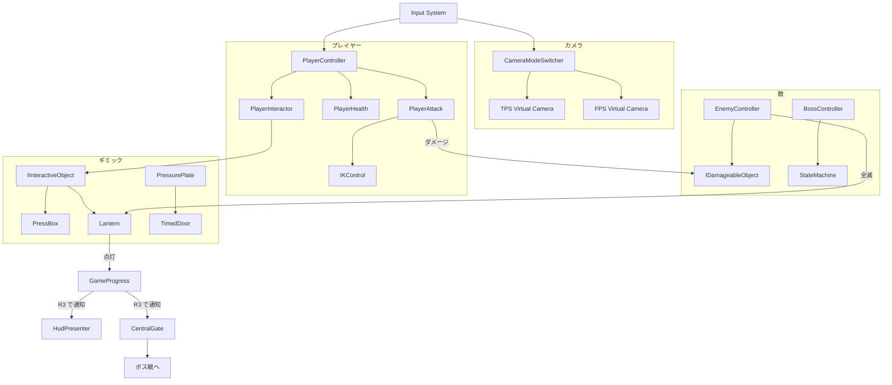
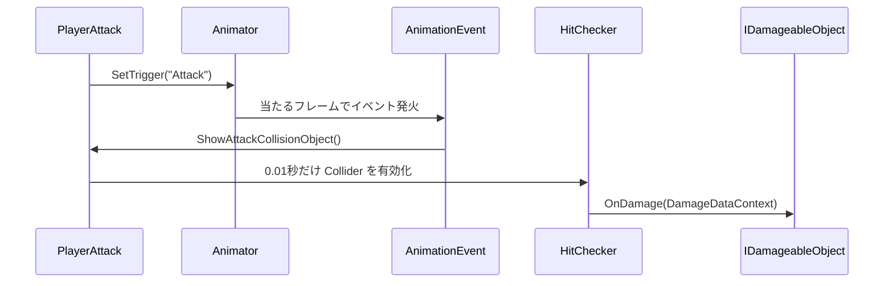
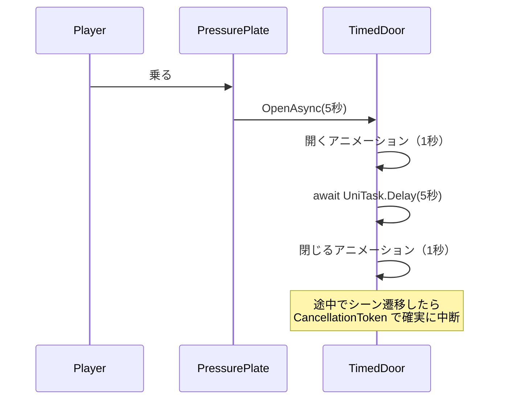
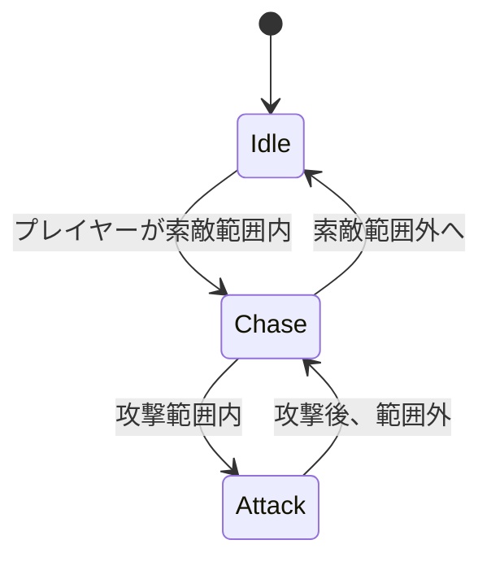
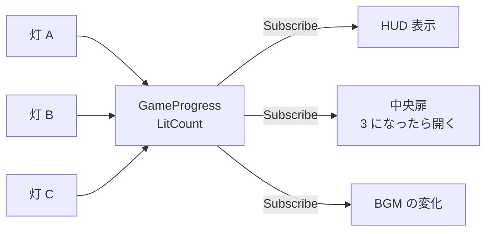

# 『LUMEN（仮題）』仕様書

> **このドキュメントは非配布です。**
> 企画の意図は [01-concept.md](01-concept.md) を参照してください。
> このファイルは **『LUMEN』の実装仕様** を扱います。個別の実装設計は 04 以降の設計書を正とします。
> **2026-10-02：プレイヤーの攻撃（§3）・灯の点け方（§5）・進行とクリア（§7）は [10-level-design.md](10-level-design.md) に置き換えました。** ライティングは [11-lighting.md](11-lighting.md)、エフェクトは [12-vfx.md](12-vfx.md)

---

## 1. 技術構成

---

| 項目 | 内容 |
| --- | --- |
| **Unity** | 6000.3.19f1 |
| **レンダーパイプライン** | URP 17.3.0 |
| **入力** | Input System 1.19.0（既存 `PlayerInputSystem.inputactions` を拡張） |
| **カメラ** | Cinemachine 2.10.7 |
| **演出** | Timeline 1.8.12 |
| **AI** | AI Navigation 2.0.13（NavMesh） |
| **非同期** | UniTask（Git URL 参照） |
| **シェーダー** | HLSL 手書き（[05-graphics.md](05-graphics.md)） |
| **ステージ制作** | ProBuilder（※未導入） |

### 1.1 追加したパッケージ

---

| パッケージ | 用途 |
| --- | --- |
| **R3** | ReactiveProperty による状態通知 |
| **ProBuilder** | ステージのモジュールパーツ制作 |

> R3 は NuGetForUnity 経由の `R3` ＋ `R3.Unity`（Git URL）が必要です。導入手順は [setup.md](../setup.md)。

### 1.2 エフェクトの実装方針

---

**VFX Graph は使いません。** Particle System と Shader の連携で実装します。

#### エフェクトで使う技術

| 手法 | 内容 |
| --- | --- |
| **Custom Vertex Streams** | パーティクルごとの情報（速度・寿命・乱数）をシェーダーへ渡す |
| **Custom Data モジュール** | パーティクル個別のパラメータをシェーダー側で受け取る |
| **Texture Sheet Animation** | 連番テクスチャによるアニメーション |
| **Soft Particles（深度フェード）** | 地面との交差線を目立たなくする |
| **パーティクル用シェーダー**（`DemoGame/Toon` のエフェクト経路） | ディゾルブ、UV スクロール、極座標変換 |
| **Trails / Noise** | 軌跡と揺らぎ |
| **PostProcess（Volume）** | Bloom、Vignette、Color Adjustments |

---

## 2. システム構成

---



**`GameProgress` が唯一の進行状態です。** ここを購読する形で UI と扉が反応します。
ギミック側が UI を直接触ることは禁止します。

---

## 3. プレイヤー仕様

---

### 3.1 パラメータ

| 項目 | 値 | 備考 |
| --- | --- | --- |
| **最大 HP** | 100 | |
| **移動速度** | 歩き 2.0 / 走り 5.0 | Blend Tree で補間 |
| **ジャンプ力** | 5.0 | 高難度地形は作らない |
| **攻撃力** | 10 | 既存 `DamageDataContext` を流用 |
| **攻撃の硬直** | 0.6 秒 | 既存 `_waitTimeForChangingAttackToIdleState` |
| **無敵時間** | 被弾後 1.0 秒 | |

### 3.2 主要クラス

---

| クラス | 責務 | 流用元 |
| --- | --- | --- |
| `PlayerController` | 移動・ジャンプ。視点モードによって移動の基準軸を切り替える | 新規 |
| `PlayerAttack` | 攻撃モーション再生、Animation Event でヒット判定を出す | 新規 |
| `PlayerHealth` | HP 管理、被弾、無敵時間 | 新規（`IDamageableObject` 実装） |
| `PlayerInteractor` | 近接オブジェクトの検出と E キーでの実行 | **既存**（`PlayerInteractiveController`） |
| `IKControl` | 箱を押すときに手を箱に添える | **既存** |

### 3.3 攻撃とヒット判定

---

既存実装をそのまま使います。



> **「攻撃が当たった瞬間」を Animation Event という"観測点"として取り出している**のがこの設計の要点です。

### 3.4 モデルの差し替え設計

---

プレイヤーは **ユニティちゃん（URP 対応版）を暫定で使用**します。
最終的なモデルは未定のため、**差し替えを前提とした構造**にします。

> **実装した構造は [04-character-prefab.md](04-character-prefab.md) を正とします。**
> 下の図から変えた点：Animator は Visual ではなく**モデル側**に置き、`CharacterVisual` が子から探す（同 §2.1）。敵も同じ3層構造にした。

#### Prefab 構造

```
Player（ルート）                    ← ロジック層。モデルに依存しない
├── CharacterController
├── PlayerController
├── PlayerAttack
├── PlayerHealth
├── PlayerInteractor
├── IKControl
└── Visual                         ← ★差し替えるのはここだけ
    ├── SkinnedMeshRenderer（モデル本体）
    ├── Animator（Humanoid）
    └── WeaponSocket               ← 右手ボーン配下に置いた空の GameObject
        └── Sword
```

#### 4つのルール

| # | ルール | 理由 |
| --- | --- | --- |
| 1 | ロジックはモデルを直接参照しない。`Animator` や `Transform` は `SerializeField` で外から差す | モデルが変わってもスクリプトを触らずに済む |
| 2 | リグは **Humanoid** に統一する | Avatar が Humanoid なら Animator Controller と IK がそのまま流用できる |
| 3 | 武器の装着先を**ボーン名で検索しない**。`WeaponSocket` という空の GameObject を手のボーン配下に置き、参照で持つ | ボーン名はモデルごとに違う。名前検索は差し替えで必ず壊れる |
| 4 | `Visual` 配下以外にモデル依存物を置かない | 差し替える範囲が一目でわかる |

#### 差し替え手順

```
1. Visual 配下の中身を新しいモデルに入れ替える
2. 新モデルの Rig を Humanoid に設定する
3. 右手ボーンの配下に WeaponSocket を作る
4. Player ルートの SerializeField（Animator / WeaponSocket）を差し直す
5. Animation Event（ShowAttackCollisionObject）を新しい攻撃モーションに設定する
```

> **5 だけは差し替えのたびに必ず必要です。** Animation Event はモーションファイル側に埋め込まれているためです。
> ここが「差し替え可能」の限界であり、仕様として認識しておきます。

#### ユニティちゃんを使う上での注意

- **ユニティちゃんライセンス（UCL）の順守が必要**です。詳細は [使用アセット一覧](../assets.md) を参照してください
- 採用したのは **ユニティちゃん 3Dモデルデータ Ver 1.4.0**（[03-asset-candidates.md](03-asset-candidates.md) §0.1）
- 付属のマテリアル（Unity Toon Shader）は使わず、DemoGame 共通のセルルックシェーダーに貼り替えます（[05-graphics.md](05-graphics.md) §8.1）
- **攻撃モーションは付属していません。** RPG Animations Pack FREE の `Enemy_Attack_1` を仮で流用しています（[04-character-prefab.md](04-character-prefab.md) §6.3）

---

## 4. カメラ仕様

---

### 4.1 2つの視点

| | TPS | FPS |
| --- | --- | --- |
| **Virtual Camera** | `CM_TPS`（3rd Person Follow） | `CM_FPS`（プレイヤー頭部に追従） |
| **Priority** | 切替時に入れ替える | 同左 |
| **FOV** | 40 | 60 |
| **移動の基準軸** | カメラ前方 | プレイヤー前方 |
| **キャラ表示** | あり | 非表示（腕のみ、または非表示） |

切替は **Priority の入れ替え**で行い、Cinemachine Brain の Blend（0.3秒）で繋ぎます。

### 4.2 演出用カメラ

---

| 名称 | 用途 |
| --- | --- |
| `CM_BossIntro` | ボス登場の Timeline で使用 |
| `CM_LanternLit` | 灯が点いた瞬間に一瞬寄る |
| `CM_Impulse` | 被弾・着地時の画面振動（Impulse Source） |

---

## 5. ギミック仕様

---

### 5.1 共通

すべてのギミックは既存の `IInteractiveObject` を実装するか、トリガーで自動発火します。

```csharp
namespace DemoGame
{
    public interface IInteractiveObject
    {
        int GetObjectID();
        void OnExecute(Transform player);
        void OnExit(Transform player);
    }
}
```

> 既存の `IInteractiveObject.cs` は現在 `Week01-Animation/`（namespace `Week01`）にあります。
> ギミックを `_DemoGame` 側で作る段階で、`DemoGame` namespace へ移設します。

### 5.2 灯（Lantern）

---

**進行の中核です。** 3つ点灯すると最奥の扉が開きます。

| 項目 | 内容 |
| --- | --- |
| **点灯条件** | 灯の間ごとに異なる（下記 5.3〜5.5） |
| **点灯時の挙動** | エミッシブ ON ／ Point Light 有効化 ／ VFX 再生 ／ `GameProgress.LitCount` を +1 |
| **エリアへの影響** | そのエリアのライティングが寒色 → 暖色へ変化 |

### 5.3 灯の間 A：箱を押す

---

| | 内容 |
| --- | --- |
| **仕掛け** | 灯が高所にあり、届かない |
| **解法** | `PressBox` を押して足場の位置まで運び、乗って E で点灯 |
| **使用実装** | **既存 `PressBox.cs` ＋ `IKControl.cs`** |
| **要追加実装** | 箱を実際に移動させる処理（既存はコメントアウト状態） |

> 既存 `PressBox.OnPressAsync()` は `AddForce` がコメントアウトされ、1秒待つだけになっています。

### 5.4 灯の間 B：時限扉

---

| | 内容 |
| --- | --- |
| **仕掛け** | スイッチを踏むと扉が開くが、一定時間で閉じる |
| **解法** | 時間内に通り抜けて灯へ到達する |
| **制限時間** | 5 秒（要調整） |
| **実装** | `PressurePlate` → `TimedDoor.OpenAsync()`（UniTask ＋ CancellationToken） |



> **「開いたものを必ず閉じる」「中断されたら後始末する」**という考え方が要ります。
> UniTask は単独の単元ではなく**付録**にしました（[appendix/unitask.md](../appendix/unitask.md)）。
> 基本は前期で扱い済みのため、後期で扱うのは**キャンセル周り**（演出のスキップなど）です。

### 5.5 灯の間 C：撃破

---

| | 内容 |
| --- | --- |
| **仕掛け** | 部屋に入ると扉が閉まり、雑魚敵が3体出現 |
| **解法** | 全て倒すと灯が点灯し、扉が開く |
| **実装** | `EnemySpawnArea` が生存数を監視し、0 になったら `Lantern.Lit()` |

---

## 6. 敵仕様

---

> **実装は [09-enemy.md](09-enemy.md) を正とします。** 状態は Init / Search / Pursue / Attack / Damage / Die（＋開発用 Debug）、ボスは Angry / Invincible を足す形にしました。下の表の数値・ボスのフェーズは、最初に考えた案です。

### 6.1 雑魚敵

| 項目 | 値 |
| --- | --- |
| **HP** | 30（プレイヤーの攻撃3発） |
| **攻撃力** | 10 |
| **移動速度** | 3.0（プレイヤーの走りより遅い＝逃げられる） |
| **索敵範囲** | 10m |
| **攻撃範囲** | 2m |
| **実装** | `NavMeshAgent` ＋ 3状態（Idle / Chase / Attack） |



### 6.2 ボス

---

| 項目 | 値 |
| --- | --- |
| **HP** | 300 |
| **フェーズ** | 3段階（HP 100% / 66% / 33% で移行） |

| フェーズ | 行動 | 備考 |
| --- | --- | --- |
| **Phase 1** | 近接攻撃のみ | 素直に戦える |
| **Phase 2** | 突進攻撃を追加。被弾すると怯む | |
| **Phase 3** | フェーズを足せる構造にしておく | 拡張ポイント（01-concept.md §6.3） |

State パターンで実装します。

```csharp
namespace DemoGame
{
    public interface IState
    {
        void OnEnter();
        void OnUpdate();
        void OnExit();
    }
}
```

---

## 7. 進行管理

---

### 7.1 GameProgress

**唯一の進行状態です。** シーンをまたいで存在します。

| プロパティ | 型 | 用途 |
| --- | --- | --- |
| `LitCount` | `ReactiveProperty<int>` | 点灯した灯の数（0〜3） |
| `PlayerHp` | `ReactiveProperty<int>` | プレイヤー HP |
| `CurrentArea` | `ReactiveProperty<AreaType>` | 現在エリア（チェックポイント用） |



> **灯は「自分が点いた」としか言いません。** 誰がそれを聞いて何をするかは、聞く側が決めます。

### 7.2 クリア / 失敗

---

| | 条件 | 挙動 |
| --- | --- | --- |
| **クリア** | ボス HP が 0 | リザルト画面へ |
| **失敗** | プレイヤー HP が 0 | `CurrentArea` の入口から再開（HP 全回復、灯の状態は維持） |

---

## 8. UI 仕様

---

| 画面 | 要素 |
| --- | --- |
| **HUD** | HP バー、灯カウンタ（3つのアイコン）、インタラクト表示（E） |
| **タイトル** | Start / Settings / Quit（[14-outgame.md](14-outgame.md)） |
| **ポーズ** | Resume / Settings / Title |
| **設定** | Graphics（解像度・画面モード・画質・VSync・フレームレート）／ Sound（Master・BGM・SE。音はまだ未接続）（[14-outgame.md](14-outgame.md) §2.1） |
| **リザルト** | クリアタイム、Title へ戻る |

### 8.1 HUD の設計方針

---

- **Canvas を2つに分ける**：静的部分（枠）と動的部分（HP バー・カウンタ）
- 動的部分だけが Rebuild されるようにする

---

## 9. データ保存

---

**進行状況は保存しません。** 設定値のみ、`Application.persistentDataPath/settings.json` に JSON で保存します。項目・既定値・形式は [14-outgame.md](14-outgame.md) §2.1・§5 を正とします。

---

## 10. Unity アセット構成

---

```
Assets/
├── _DemoGame/                ★『LUMEN』の本体（namespace DemoGame）
│   ├── Scenes/
│   │   ├── DemoTitle.unity
│   │   └── DemoInGame.unity  リザルトもこのシーン内に表示する
│   ├── Scripts/
│   │   ├── Input/            DemoGameInput.inputactions, InputReader
│   │   ├── Core/             GameProgress, SceneLoader, InGameController
│   │   ├── Player/           PlayerController, PlayerHealth, SimpleFollowCamera
│   │   ├── Gimmick/          Lantern, DamageZone, PressBox, TimedDoor
│   │   ├── UI/               TitleScreen, ResultScreen, Hud
│   │   └── Rendering/        輪郭線（OutlineVolume / OutlineRendererFeature / OutlinePass）
│   ├── Prefabs/
│   └── Graphics/             Shaders / Materials / Textures / Effects / Settings（05-graphics.md §9）
```

> **シーン構成は DemoTitle → DemoInGame の2つだけです。**
> リザルトは InGame の中にパネルとして出します。シーンをまたがないので、
> クリアタイムなどの受け渡しが不要になります。

### 10.1 依存のルール

---

- `_DemoGame/` は、`_DemoGame/` の外にあるゲームコードを参照しない（`DemoGame.asmdef` で閉じる）
- 外部パッケージを使うときは `DemoGame.asmdef` の references に足す

### 10.2 namespace

---

| 対象 | namespace | 理由 |
| --- | --- | --- |
| `_DemoGame/` | `DemoGame`（サブフォルダでも分けない） | プロジェクト内の同名クラスとの衝突を防ぐ |
| `_DemoGame/Scripts/Debug/` | `Demo.Debug` | デバッグ用。`Demo.Debug.asmdef`（`UNITY_EDITOR \|\| APP_DEBUG` のときだけ有効） |

---

## 11. 制作の進め方

---

### 11.1 作る順番

---

```
1. ✅ _DemoGame/ の骨組み（入力・プレイヤー・UI・シーン遷移・仮ギミック）
2. DemoTitle / DemoInGame を組んで、通しで動くことを確認する
3. ステージのモジュールパーツを ProBuilder で作る（床・壁・扉）
4. エリアを6つ組む（目覚めの間 → 中央広間 → 灯の間 A/B/C → 最奥）
5. 灯の間ごとのギミックを実装する（箱押し / 時限扉 / 撃破）
6. ボスを置いて完成させる
```

> **モデルはカプセルのまま進めます。** 差し替え可能な構造にしてあるため（§3.4）、
> アセットの選定が遅れても制作は止まりません。

---

## 12. 未決定事項

---

- [x] R3 の導入手順 → NuGetForUnity（`Assets/packages.config`）
- [x] アウトラインの実装方式 → PostProcess（自作 Volume ＋ Renderer Feature、Render Graph）。[05-graphics.md](05-graphics.md) §5
- [ ] ステージのモジュールパーツを自作するか、無料アセットを使うか
- [ ] 灯の間 B の制限時間（実プレイで調整）
- [x] 敵・ボスのモデル選定 → [03-asset-candidates.md](03-asset-candidates.md) §0（要検証）

---
