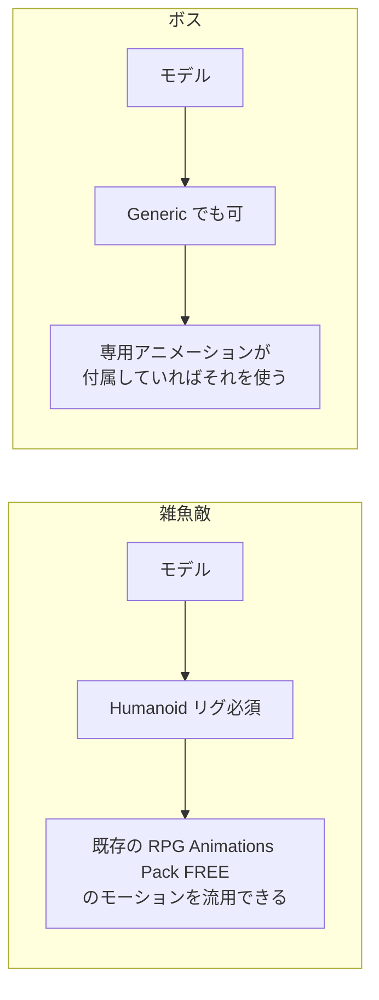

# アセット候補リスト（選定中）

> **このドキュメントは非配布です。**
> 企画書：[01-concept.md](01-concept.md) ／ 仕様書：[02-spec.md](02-spec.md)

---

## 0. 選定結果（2026-10-01 時点）

---

| 役割 | 採用 | 状態 | 差し替え先 Prefab |
| --- | --- | --- | --- |
| **プレイヤー** | **ユニティちゃん 3Dモデルデータ Ver 1.4.0**（暫定） | ✅ 導入・差し替え済み（2026-10-01） | `DemoPlayer.prefab` |
| **雑魚敵（1種）** | **Monster Minion Survivor PBR Polyart**（`Swarm08PA`） | ✅ 導入・差し替え済み | `DemoEnemyNormal.prefab` |
| **ボス（1種）** | **Mini Legion Rock Golem PBR HP Polyart**（`Polyart_Golem`） | ✅ 導入・差し替え済み | `DemoEnemyBoss.prefab` |

### 0.1 検証結果

---

| | リグ | 付属モーション | マテリアル | 採用したもの |
| --- | --- | --- | --- | --- |
| **ユニティちゃん** | Humanoid | 待機・歩き・走り・ジャンプ・被弾・負けなど 26 本。**攻撃モーションは無い** | Unity Toon Shader（未導入なのでピンク） | `Prefabs/unitychan.prefab`。テクスチャだけ流用 |
| **Monster Minion** | **Generic**（Avatar なし） | **あり**：Idle / MoveFWD・BWD・LFT・RGT / Attack / GetHit / Die | Built-in Standard（ピンク） | 2体（`Swarm08` / `Swarm09`）× PBR / Polyart のうち **`Swarm08PA`**。パレットテクスチャ1枚 |
| **Rock Golem** | Humanoid | **あり**：Idle / Walk / Attack01・02 / GetHit / Die / Victory | Built-in Standard（ピンク） | `Prefabs/Polyart_Golem.prefab`。パレットテクスチャ `PolyartStandard.png` |

- **Monster Minion は専用モーション付きの Generic** だったので、§「選定条件を1つ緩めた」の上の行に当たり、そのまま採用しました
- 3体とも**元のマテリアルは使っていません**。テクスチャだけを `DemoGame/Toon` のマテリアルに割り当てています
- ユニティちゃんは当初「サニーサイドアップ」を想定していましたが、入れたのは**従来モデルの Ver 1.4.0** です。マテリアルを貼り替えるので、URP 対応版でなくても問題ありません

- マテリアルは**すべて DemoGame 共通のセルルックシェーダーに貼り替えます**。
  アセット付属のマテリアル（UTS2 や PBR）はそのまま使いません。設計は [05-graphics.md](05-graphics.md)
- Prefab の構造と差し替え手順は [04-character-prefab.md](04-character-prefab.md)

### 雑魚敵とボスを同じ作者でそろえた理由

---

雑魚敵とボスは、どちらも **Dungeon Mason の「Polyart」シリーズ**から選びました。

| 観点 | 理由 |
| --- | --- |
| **絵柄がそろう** | 同じ作者・同じシリーズなので、頭身・面の割り方・色の塗り方が揃う。2体を並べても浮かない |
| **セルルックに映える** | Polyart は手描きのベタ塗りテクスチャと大きな平面でできている。トゥーン陰影の段がきれいに出る |
| **モーションが付いてくる** | Dungeon Mason の無料モデルは、専用のモーションが付いていることが多い（下記「要検証」） |
| **企画に合う** | 雑魚＝塔に湧く小型の魔物、ボス＝塔の番人の岩ゴーレム。どちらも「塔」の世界観に収まる |

### ⚠️ 選定条件を1つ緩めた

---

§1 では「雑魚敵は Humanoid 必須」としていました。これは **RPG Animations Pack FREE のモーションを流用するため**の条件です。
**専用モーションが付属しているなら、Generic でも採用できる**ように条件を緩めました。

| Monster Minion を検証した結果 | 対応 |
| --- | --- |
| **専用モーション付き（Idle / Move / Attack / Hit / Die 程度）** | そのまま採用。Generic のままでよい |
| **モーションなし、かつ Humanoid にできない** | 不採用。**Character Pack - Lowpoly FREE**（Humanoid）＋ RPG Animations Pack FREE に切り替える |

> Asset Store のページには、リグの種類もモーションの有無も書かれていませんでした。
> 製品版「Monster for Survival Game PBR Polyart」には 8体それぞれに約16モーションが付いていて、1体あたり 1,273〜7,523 三角形です。
> 無料版がその中の1体を切り出したものなら、モーション付きである可能性が高いと見ています（**未確認**）。

---

## 1. 選定条件

---

| # | 条件 | 必須度 | 理由 |
| --- | --- | --- | --- |
| 1 | **無料**（恒久無料。FreeTrial は不可） | 必須 | 外部依存は `.unitypackage` に含めず、配布先で各自導入するため |
| 2 | **URP 対応** | 必須 | プロジェクトが URP。Built-in 専用だとピンクになる |
| 3 | **ローポリ** | 必須 | セルルックと相性が良く、軽い |
| 4 | **Humanoid リグ** | **雑魚敵は必須** / ボスは任意 | 下記 1.1 参照 |
| 5 | **セルルックに映える形状** | 望ましい | ディテールが細かすぎると輪郭線が破綻する |

### 1.1 Humanoid が必須なのは雑魚敵だけ

---



- **雑魚敵**：Humanoid なら、既に導入済みの `RPG Animations Pack FREE` をそのまま流用できます。
  **モデル単体（アニメーションなし）のアセットでも採用できる**ため、選択肢が一気に広がります。
- **ボス**：専用アニメーション付きなら Generic で構いません。IK も使いません。
  むしろ異形のほうが「塔の番人」らしくなります。

---

## 2. 雑魚敵の候補

---

| アセット | 確認済み | 要検証 | リンク |
| --- | --- | --- | --- |
| **Character Pack - Lowpoly FREE** | 無料 ／ URP 互換 ／ 590.5KB ／ v1.1 ／ Unity 2021.3.2f1 | **リグ種別** ／ アニメーション有無 ／ キャラ数 ／ ポリ数 | [221766](https://assetstore.unity.com/packages/3d/characters/humanoids/character-pack-lowpoly-free-221766) |
| **FREE Low Poly Human - RPG Character** | 無料 ／ URP 互換 ／ 8.3MB ／ Unity 2019.4+ ／ 3,100 favorites | **リグ種別** ／ アニメーション有無 ／ ポリ数 | [219979](https://assetstore.unity.com/packages/3d/characters/humanoids/fantasy/free-low-poly-human-rpg-character-219979) |
| **Monster Minion Survivor PBR Polyart** | 無料リストに掲載 | 全項目 | [269515](https://assetstore.unity.com/packages/3d/characters/creatures/monster-minion-survivor-pbr-polyart-269515) |

> **Character Pack - Lowpoly FREE は 590KB しかありません。** アニメーション非同梱の可能性が高いです。
> ただし Humanoid でさえあれば既存モーションを流用できるので、**それでも第一候補になり得ます。**

---

## 3. ボスの候補

---

| アセット | 確認済み | 要検証 | リンク |
| --- | --- | --- | --- |
| **Mini Legion Rock Golem PBR HP Polyart** ★本命 | 無料 ／ ローポリ ／ **リグ＋アニメーション同梱** | URP 対応 ／ リグ種別 ／ ポリ数 | [94707](https://assetstore.unity.com/packages/3d/characters/humanoids/fantasy/mini-legion-rock-golem-pbr-hp-polyart-94707) |
| **[FREE] Fantasy Monster 01 (Rework)** | **完全無料**（トライアルではない）／ URP 互換 ／ Unity 2022.3.62f1 ／ リグ＋アニメーション同梱 | リグ種別 ／ アニメーション数 ／ ポリ数 | [322588](https://assetstore.unity.com/packages/3d/characters/creatures/free-fantasy-monster-01-rework-game-ready-rig-animation-pixelius-322588) |
| **Dragon for Boss Monster: HP** | 無料リストに掲載 | 全項目 | [79398](https://assetstore.unity.com/packages/3d/characters/creatures/dragon-for-boss-monster-hp-79398) |

### Rock Golem を本命にした理由

---

企画の **「灯の消えた塔の番人」** という設定に、岩のゴーレムがそのまま噛み合います。
さらに制作上の都合でも有利です。

- 岩＝**平面的な面構成**なので、セルルックのトゥーン段階陰影が綺麗に出る
- 人型（Humanoid カテゴリ）なので、**State パターンで作る3フェーズの行動**を組みやすい
- 「重い・遅い」動きはアニメーション枚数が少なくても成立する

---

## 4. ⚠️ 注意事項

---

| # | 注意 |
| --- | --- |
| 1 | **「FreeTrial」表記のものは採用不可。** 恒久無料ではありません（PixeliusVita の Fantasy Monster 08 / 09 など） |
| 2 | **「DEMO」表記のものは中身が限定的。** 製品版への導線であることが多い |
| 3 | **リグ種別とポリゴン数は、Asset Store のページからは取得できませんでした。** 必ず実機で確認してください |
| 4 | **セルルックに映えるかどうかは、テキストでは判断できません。** 実際にシェーダーを当てて目で見てください |
| 5 | 個別アセットは配信停止されることがあります。下記のキュレーションリストから探し直せるようにしておきます |

### キュレーションリスト（探し直し用）

---

- [Free Fantasy Creatures](https://assetstore.unity.com/lists/free-fantasy-creatures-11348)
- [Free Monsters](https://assetstore.unity.com/lists/free-monsters-14593)
- [Free Low-Poly and Voxel](https://assetstore.unity.com/lists/free-low-poly-and-voxel-10940)

---

## 5. 検証手順

---

候補を実際に確かめる手順です。**空のプロジェクトで試してください**（本体を汚さないため）。

```
1. マイアセットに追加 → 空の URP プロジェクトにインポート
2. モデルを選択 → Inspector → Rig タブ
   → Animation Type が「Humanoid」か確認
3. Humanoid でない場合、Humanoid に変更して Apply できるか試す
   （人型であれば変換できることが多い）
4. シーンに置いて、マテリアルがピンクにならないか確認
5. UTS2 または自作セルルックシェーダーを当てて、見た目を確認
   → 輪郭線が破綻しないか、陰影の段が綺麗に出るか
6. ポリゴン数を確認（Inspector 下部のプレビュー、または Stats）
```

### 判定基準

---

| 項目 | 合格ライン |
| --- | --- |
| リグ（雑魚敵） | Humanoid、または Humanoid へ変換可能 |
| リグ（ボス） | 問わない（専用アニメーションが付属していること） |
| ポリゴン数 | 1体あたり 5,000 三角形以下が目安 |
| マテリアル | URP でピンクにならない（変換で直るなら可） |

---

## 6. 決まったら

---

1. §0 の選定結果に記入する
2. インポートしたら、外部依存として [setup.md](../setup.md) の一覧に追記する

---

---

## 7. ステージ・小物・音の候補（無料。2026-10-02 調べ）

---

> 霧のかかった野外・遺跡・篝火・神殿に合う、**無料**の Asset Store アセットの候補です。価格は 2026-10-02 にストアのページで FREE を確かめた。**まだ何も入れていない**（入れたら §6 の手順で [setup.md](../setup.md) に書く）。
> マテリアルは `DemoGame/Toon` の `M_Toon_*` のバリアントに差し替えるので、見るのは**形とテクスチャがトゥーンに合うか**。「記載なし」は古い版で Built-in 用と思われ、変換が要る見込み。

### 7.1 第一候補

---

| 役割 | アセット | 作者 | パイプライン | ひとこと |
| --- | --- | --- | --- | --- |
| 神殿・遺跡の壁・床・柱 | [Dungeon Modular Pack](https://assetstore.unity.com/packages/3d/environments/dungeons/dungeon-modular-pack-295430) | logicalbeat | Built-in / URP | スタイライズドの石のモジュール。野外の遺跡にも流用し、岩と蔦で崩す |
| 木・岩・草 | [Low Poly Environment - Nature Free](https://assetstore.unity.com/packages/3d/environments/low-poly-environment-nature-free-lowpoly-medieval-fantasy-series-187052) | Polytope Studio | Built-in / URP | ローポリ。トゥーンと相性がよい |
| 篝火・ランタン | [Stylized Camping Pack - Low Poly Survival Pack \| URP](https://assetstore.unity.com/packages/3d/props/stylised-reality-stylized-camping-pack-low-poly-survival-pack-ur-322112) | Polygon Pilots | URP | 焚き火・火床・ランタンがある。炎は自前の Particle System |
| 杖 | [Stylized magic staff set](https://assetstore.unity.com/packages/3d/props/stylized-magic-staff-set-350990) | GreyratsLab | URP | 軽い（815KB）。ユニティちゃんに合わせやすい |
| 空 | [Fantasy Skybox FREE](https://assetstore.unity.com/packages/2d/textures-materials/sky/fantasy-skybox-free-18353) | Render Knight | Built-in / URP / HDRP | 手描き調。夜・夕暮れがあるかは未確認 |
| BGM | [Free Dungeon Music Pack](https://assetstore.unity.com/packages/audio/music/free-dungeon-music-pack-301447) | Kounine | — | 幻想的な環境曲。曲数は未確認 |
| SE | [RPG Essentials Sound Effects - FREE!](https://assetstore.unity.com/packages/audio/sound-fx/rpg-essentials-sound-effects-free-227708) | leohpaz | — | 魔法・打撃・UI |

### 7.2 ほかの候補

---

| 役割 | アセット | 作者 | パイプライン | ひとこと |
| --- | --- | --- | --- | --- |
| 遺跡 | [Stylized Hand Painted Dungeon (Free)](https://assetstore.unity.com/packages/3d/environments/stylized-hand-painted-dungeon-free-173934) | L2S ARTS | 記載なし | 手描き。トゥーンとの相性は一番よさそう |
| 遺跡 | [Stylized Dungeon - Free Pack](https://assetstore.unity.com/packages/3d/environments/dungeons/stylized-dungeon-free-pack-178268) | JoJo Studios | 記載なし | 小さい補助用 |
| 遺跡（野外） | [Altar Ruins Free](https://assetstore.unity.com/packages/3d/environments/fantasy/altar-ruins-free-109065) | Underhill Labz | 記載なし | リアル寄り・1.1GB と重い |
| アーチ・柱 | [Realistic Ruins - Free Sample](https://assetstore.unity.com/packages/3d/environments/realistic-ruins-free-sample-archway-pillar-403066) | Unity China Publisher Hub | 3 つとも | リアル。形だけ借りるなら |
| 岩・崖 | [Free Pack - Rocks Stylized](https://assetstore.unity.com/packages/3d/environments/free-pack-rocks-stylized-316250) | PolyOne Studio | 3 つとも | 軽い（8.4MB） |
| 岩・崖 | [Stylized Rocks Free Demo Pack](https://assetstore.unity.com/packages/3d/environments/landscapes/stylized-rocks-free-demo-pack-355500) | 3DMarcus | Built-in / URP | モジュール式の崖 |
| 木 | [Low Poly Trees Pack Lite](https://assetstore.unity.com/packages/3d/vegetation/trees/low-poly-trees-pack-lite-free-stylized-nature-environment-assets-295464) | Hiroba Games | 3 つとも | Unity 6000.2 で動くと明記 |
| 草 | [SMM - Stylized Grass](https://assetstore.unity.com/packages/3d/environments/smm-stylized-grass-184975) | SirMishMash | 記載なし | 草のメッシュだけ |
| 蔦 | [Real Ivy 2 Procedural Ivy Generator](https://assetstore.unity.com/packages/tools/modeling/real-ivy-2-procedural-ivy-generator-181402) | 3Dynamite | 記載なし | 蔦を生やすツール。Unity 6 で動くか未検証。無料の蔦メッシュのパックは見つからなかった |
| 篝火 | [The Free Medieval and War Props](https://assetstore.unity.com/packages/3d/props/the-free-medieval-and-war-props-174433) | Inguz Media | 記載なし | 篝火が入っているらしい（中身は未確認） |
| 灯籠 | [Stone Lantern Pack](https://assetstore.unity.com/packages/3d/environments/historic/stone-lantern-pack-139776) | Tanuki Digital | 記載なし | 石灯籠。330MB と重く古い |
| 杖 | [3D Items - Free Wand Pack](https://assetstore.unity.com/packages/3d/props/weapons/3d-items-free-wand-pack-46225) | Frost Forged | 記載なし | 短いワンド |
| 杖 | [Fantasy Staff Lite](https://assetstore.unity.com/packages/3d/props/weapons/fantasy-staff-lite-54999) | Adventure Forge | 記載なし | 長い杖 1 本。古い |
| 空 | [AllSky Free](https://assetstore.unity.com/packages/2d/textures-materials/sky/allsky-free-10-sky-skybox-set-146014) | rpgwhitelock | Built-in / URP | 10 種。写真寄り |
| 空 | [Skybox Series Free](https://assetstore.unity.com/packages/2d/textures-materials/sky/skybox-series-free-103633) | Avionx | 記載なし | キューブマップ |
| 霧 | [AERO - Volumetric Fog and Mist](https://assetstore.unity.com/packages/vfx/shaders/fullscreen-camera-effects/volumetric-fog-urp-277702) | Mirza Beig | URP | Unity 6000.3.15f1 以降と明記。自前の Toon・ポストプロセスと重ねて大丈夫かは要確認 |
| BGM | [RPG BGM - Dungeon](https://assetstore.unity.com/packages/audio/music/rpg-bgm-dungeon-37116) | B.G.M | — | ダンジョン曲 |
| BGM | [LUShvalleySound: Fantasy BGM – Free Pack Vol.01](https://assetstore.unity.com/packages/audio/music/lushvalleysound-fantasy-bgm-free-pack-vol-01-317527) | LUShvalleySound | — | 「Created with AI」の表記あり。使うか要判断 |
| SE | [Footsteps - Essentials](https://assetstore.unity.com/packages/audio/sound-fx/foley/footsteps-essentials-189879) | Nox_Sound | — | 足音 |

- 野外の廃墟でスタイライズドのものは、無料では見つからなかった（Stylized Temple Ruins・Low Poly Temple Ruins などは有料）
- 石灯籠のよいものも無料にはない → 灯火は自作か、ランタンで代える

