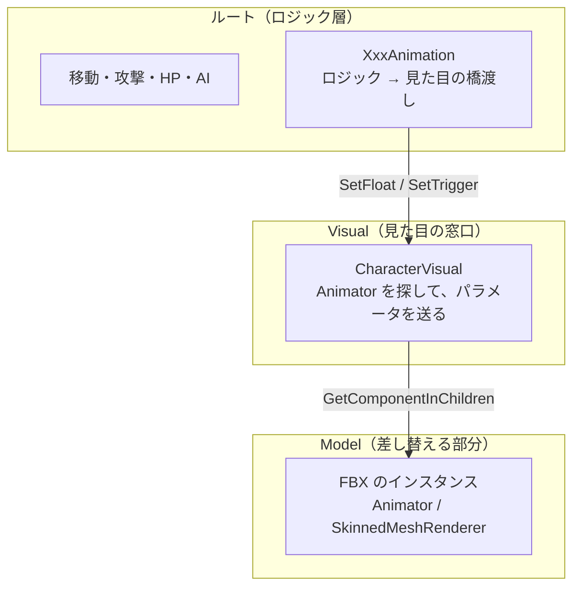
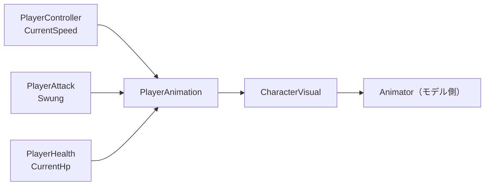
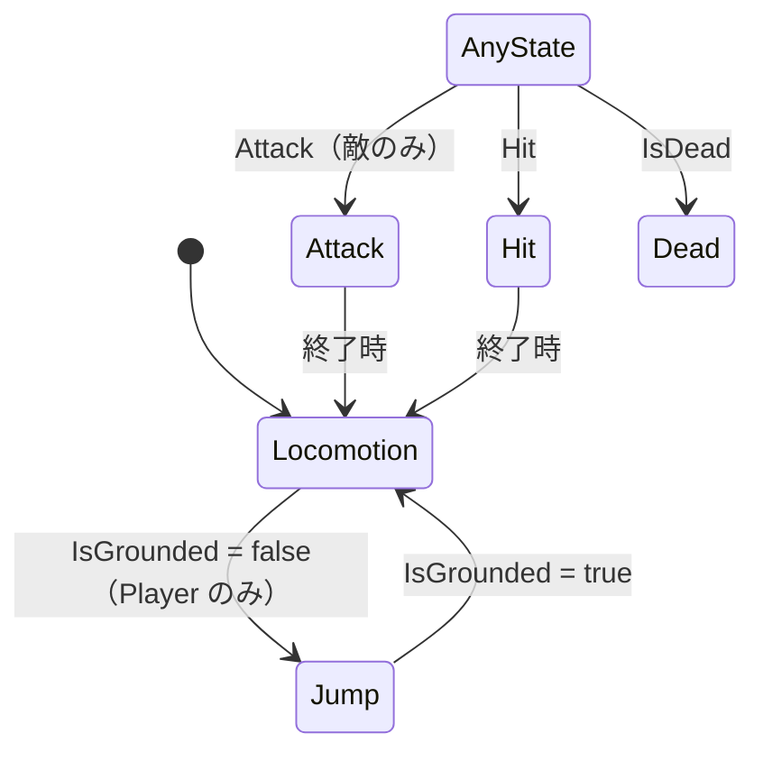

# キャラクター Prefab 実装設計書

> **このドキュメントは非配布です。**
> 仕様は [02-spec.md](02-spec.md) §3.4「モデルの差し替え設計」が元です。ここでは**実際に作った構造**を書きます。
> 採用モデルは [03-asset-candidates.md](03-asset-candidates.md) §0、マテリアルは [05-graphics.md](05-graphics.md)

---

## 1. 目的

---

**モデルを差し替えるだけで動く Prefab** にします。プレイヤーも敵も、まだ最終のモデルが決まっていないためです。

| Prefab | 元にしたモック | 入っているモデル（Visual/Model） | Animator Controller |
| --- | --- | --- | --- |
| `DemoPlayer.prefab` | `DemoPlayerTest.prefab` | ユニティちゃん（`unitychan.prefab`）／身長 約1.6m | `Animations/AC_Player.controller` |
| `DemoEnemyNormal.prefab` | `DemoEnemyNormalTest.prefab` | Monster Minion（`Swarm08PA.prefab`） | `Animations/AC_EnemyMinion.controller` |
| `DemoEnemyBoss.prefab` | `DemoEnemyBossTest.prefab` | Rock Golem（`Polyart_Golem.prefab`）× 1.8 倍 | `Animations/AC_EnemyGolem.controller` |

> 敵2体は、**アセット付属の Prefab を入れ子（Nested Prefab）で置き**、上書き（Override）で名前・マテリアル・Animator Controller を変えています。
> プレイヤーは `unitychan.prefab` を**展開（Unpack）した状態**で `Visual/unitychan` に置いています。アセット側の Prefab はどちらも編集していません。
>
> シーン（`DemoInGame.unity`）と `EncounterArea` はこの3つを参照しています。元のモック（`*Test.prefab`）は削除しました（2026-10-02）。

---

## 2. 3層の構造

---



| 層 | 置くもの | 差し替え時 |
| --- | --- | --- |
| **ルート** | ロジック（CharacterController / NavMeshAgent / 各スクリプト）、当たり判定のコライダー | 触らない（コライダーの大きさだけ合わせる） |
| **Visual** | `CharacterVisual`。プレイヤーはここを回転させて向きを変える | 触らない |
| **Model** | モデル本体。**Animator はモデル側に付いているものを使う** | **ここだけを入れ替える** |

### 2.1 Animator を Visual ではなく Model に置く理由

---

Humanoid の Avatar は、**Animator が付いている GameObject を起点に**ボーンの階層を探します。
Visual に Animator を置いてモデルを子にすると、階層が1段ずれてボーンが見つかりません。

FBX を置くと Animator がモデルのルートに自動で付きます。**それをそのまま使い、`CharacterVisual` が子から探す**形にしました。

---

## 3. 各 Prefab の中身

---

### 3.1 DemoPlayer

---

```
DemoPlayer（Tag: Player）
├── CharacterController   高さ 2 / 半径 0.5 / Center y=1（足元が原点）
├── PlayerController      _visualRoot = Visual
├── InputReader
├── PlayerHealth
├── PlayerAttack          _origin = Visual（★モックからの修正）
├── PlayerAnimation       ロジック → Animator
├── Visual
│   ├── CharacterVisual
│   └── Model             ★差し替える
└── LookAt                y=1（カメラの注視点）
```

### 3.2 DemoEnemyNormal / DemoEnemyBoss

---

```
DemoEnemyNormal
├── CapsuleCollider       高さ 2 / 半径 0.5 / Center y=1
├── NavMeshAgent          BaseOffset 0（足元が原点）
├── EnemyController       HP・状態・割り込み（ボスは BossController）。状態からアニメーションを送る
├── HpBar                 World Space の HP バー（雑魚敵だけ）
└── Visual
    ├── CharacterVisual   Animator と、マテリアルの見た目（被弾点滅・Dissolve）
    └── Model             ★差し替える
```

ボスは構造が同じで、数値だけが違います（コライダー 高さ 4.4 / 半径 1.1 など）。数値と状態は [09-enemy.md](09-enemy.md)。

> 2026-10-02 に `EnemyHealth` と `EnemyAnimation` を廃止し、`EnemyController` と各状態にまとめました（[09-enemy.md](09-enemy.md) §3）。§4 の表は、そのときまでの変更の記録です。

### 3.3 モック（*Test）から変えたところ

---

| # | 変更 | 理由 |
| --- | --- | --- |
| 1 | **原点を足元にした**（敵の NavMeshAgent BaseOffset 1 → 0、コライダーの Center を上げた） | モデルは足元が原点で作られている。原点が体の中心だと、差し替えるたびに位置合わせが要る |
| 2 | **ボスのルートの Scale 2.2 をやめた**。大きさはコライダーと Model の Scale で持つ | ルートを拡大すると、子のモデル・エフェクト・判定がすべて巻き込まれる |
| 3 | **`PlayerAttack._origin` に Visual を指定した** | モックは未設定で、回転しないルートが基準になっていた。向いている方向に攻撃が出ていなかった |
| 4 | **ルートの Animator を削除した** | 2.1 のとおり。Animator はモデル側のものを使う |
| 5 | **`OneHitKillOnTouch`（Debug）と、そのためのトリガーコライダーを外した** | Demo.Debug アセンブリは `APP_DEBUG` が無いビルドでは消える。本番の Prefab に置くと Missing Script になる |

---

## 4. スクリプトの変更

---

| ファイル | 種別 | 内容 |
| --- | --- | --- |
| `Scripts/Core/CharacterVisual.cs` | 新規 | 子から Animator を探す。`_controller` が設定されていれば Animator に入れる。**Controller に無いパラメータは送らない** |
| `Scripts/Core/CharacterAnimatorParams.cs` | 新規 | Animator パラメータ名を1か所にまとめる（下記 §5） |
| `Scripts/Player/PlayerAnimation.cs` | 新規 | 速度・接地・攻撃・被弾・死亡を Animator へ送る |
| `Scripts/Enemy/EnemyAnimation.cs` | 新規 | 雑魚敵とボスで共通。NavMeshAgent の速度・攻撃・被弾・死亡を送る |
| `Scripts/Enemy/EnemyController.cs` | 変更 | `event Action Attacked` を追加。`TryAttack` で攻撃を出したときに通知する |
| `Scripts/Enemy/EnemyHealth.cs` | 変更 | 被弾・消滅の対象を `Renderer` 1つから `Renderer[]` に変えた。**空なら子の Renderer をすべて集める**。被弾は `_HitFlash`、死亡は `_Dissolve` |

### 4.1 ロジックが見た目を知らない形にした

---



`PlayerController` や `EnemyController` は Animator を一切触りません。
**見た目が要らない場面（モデル未導入の今）でも、ロジックだけで動きます。**

### 4.2 被弾フラッシュと SRP Batcher

---

`CharacterVisual` は `renderer.materials` で**マテリアルを個体ごとに複製して**（初めて使うときに複製する）、`DemoGame/Toon` の `_HitFlash`（被弾）と `_Dissolve`（倒れてから消えるまで）を変えています。

| 方法 | SRP Batcher | 採用 |
| --- | --- | --- |
| `renderer.materials` で複製して値を変える | **崩れない**（同じシェーダーなら1つのバッチにまとまる） | ✅ |
| `MaterialPropertyBlock` | **崩れる**（その Renderer はバッチから外れる） | ❌ |

> 複製したマテリアルは自動では破棄されないので、`OnDestroy` で `Destroy` しています。
> プロパティは [05-graphics.md](05-graphics.md) §6.2。

---

## 5. Animator パラメータの約束

---

**Animator Controller はモデルごとに作ります。パラメータ名だけは全キャラで揃えます。**
`CharacterVisual` は Controller に無いパラメータを無視するので、**全部そろえる必要はありません**。

| 名前 | 型 | 送る側 | 意味 |
| --- | --- | --- | --- |
| `Speed` | float | Player / Enemy | 移動速度（m/s）。Blend Tree の閾値もこの単位で作る |
| `IsGrounded` | bool | Player | 接地しているか |
| `Attack` | trigger | Player / Enemy | 攻撃を出した瞬間 |
| `Hit` | trigger | Player / Enemy | HP が減った瞬間（死亡時は送らない） |
| `IsDead` | bool | Player / Enemy | HP が 0 |

> プレイヤーの `Speed` は、今は歩き 10 / 走り 20（モックのテスト用の値）です。
> モーションを入れるときに仕様どおりの 2.0 / 5.0 に戻します。

---

## 6. モデルの差し替え手順

---

```
1. FBX の Rig を設定する
   ・プレイヤー：Humanoid
   ・雑魚敵・ボス：付属モーションがあるならそのまま（Generic 可）。無いなら Humanoid
2. Prefab を開き、Visual の子の Model を削除する
3. FBX を Visual の子にドラッグする（位置 0,0,0 / 回転 0,0,0）
4. Visual の CharacterVisual の _controller に Animator Controller を入れる
   （_animator は空のままでよい。子から自動で探す）
5. マテリアルを DemoGame のセルルックマテリアルに貼り替える
6. ルートのコライダー（CharacterController / CapsuleCollider / NavMeshAgent）の高さと半径をモデルに合わせる
7. プレイヤーのみ：LookAt の高さを胸〜首の位置に合わせる
```

**スクリプトの参照を差し直す必要はありません。** これが「差し替えるだけで動く」の範囲です。

### 6.1 差し替えだけでは済まないもの

---

| 項目 | 理由 | 対応 |
| --- | --- | --- |
| **Animator Controller** | モーションはモデル（またはアセット）ごとに違う | モデルごとに作る。パラメータ名は §5 に合わせる |
| **武器の装着（WeaponSocket）** | 手のボーンはモデルの中にしか無い | モデルの右手ボーンの下に `WeaponSocket` を作る（[02-spec.md](02-spec.md) §3.4 ルール3） |
| **両手の IK（Rig）** | Two Bone IK は腕のボーンを直接参照する | モデルの Animator と同じ GameObject に RigBuilder、子に `Rig_Hands` を作り直し、`PlayerBoxPusher` に Rig と左右のターゲットを差し直す（[06-gimmick.md](06-gimmick.md) §5.3） |
| **コライダーの大きさ** | 体格がモデルごとに違う | 手順6で合わせる |

---

### 6.2 実際に差し替えた内容（2026-10-01）

---

| | Model の上書き | コライダー | 備考 |
| --- | --- | --- | --- |
| **Player** | マテリアル 23 個 → `M_Player_*`（元のマテリアルとの対応どおり）、Animator に `AC_Player`・Root Motion OFF。付属スクリプト（`IdleChanger` / `FaceUpdate` など）は付けていない（旧 Input Manager を使うため） | CharacterController 高さ 1.6 / 半径 0.3 / Center 0.8、LookAt 1.3 | 歩き 2.0 / 走り 5.0（仕様値に戻した） |
| **Minion** | マテリアル → `M_Enemy_Minion` | Capsule・Agent 高さ 1.5 / 半径 0.5 | Generic。Avatar なしで付属クリップがそのまま動く |
| **Golem** | マテリアル → `M_Enemy_Golem`、Scale 1.8 | 高さ 4.4 / 半径 1.1（変更なし） | Humanoid。付属の `.anim` を使用 |

### 6.3 Animator Controller

---

`Assets/_DemoGame/Animations/` に置きました。パラメータは §5 のとおりです。



| Controller | Locomotion（Blend Tree：Speed） | Attack | Hit | Dead | Jump |
| --- | --- | --- | --- | --- | --- |
| `AC_Player` | WAIT00 (0) / WALK00_F (2) / RUN00_F (5) | `Enemy_Attack_1`（RPG Animations Pack FREE） | DAMAGED00 | LOSE00 | JUMP00 |
| `AC_EnemyMinion` | Idle (0) / MoveFWD (3) | Attack | GetHit | Die | — |
| `AC_EnemyGolem` | Idle (0) / Walk (3.2) | Attack01 | GetHit | Die | — |

> **ユニティちゃんには攻撃モーションが無い**ので、RPG Animations Pack FREE の Humanoid クリップ `Enemy_Attack_1` を仮で入れています。
> **攻撃の仕様が決まったら、`AC_Player` の Attack ステートの Motion を差し替えるだけ**で切り替わります（パラメータ・遷移・スクリプトは変えなくてよい）。
> 候補は `_GitIgnore/DoubleL/FBX Unity/` にあります。モーションがキャラを前へ動かしてしまう場合は、同じフォルダの `InPlace/` 版（その場で動くもの）に替えます。
> Attack は連打すると頭から再生し直します（自分自身への遷移を許可）。

---

### 6.4 武器（WeaponSocket）

---

```
DemoPlayer/Visual/unitychan/…/Character1_RightHand
└── WeaponSocket                     握りこぶしの位置（手のローカル (-0.06, 0, 0.02)）
    └── PlayerAttackWeaponDefault    ← Prefab（入れ子）
        └── Model                    ← 見た目。差し替えるのはここだけ
```

| | 内容 |
| --- | --- |
| **Prefab** | `Assets/_DemoGame/Prefabs/Weapon/PlayerAttackWeaponDefault.prefab` |
| **原点** | 握る位置。**刃は +Y 方向**に伸ばす（ユニティちゃんの右手は、指が -X・人差し指側が +Y） |
| **今の見た目** | Cube を伸ばした棒（0.04 × 0.9 × 0.04、柄が 0.1 下に出る）。マテリアル `M_Weapon_Default` |
| **コライダー** | 付けていない。攻撃判定は `PlayerAttack` の OverlapSphere で出している |

**武器の見た目を替えるとき**は、`PlayerAttackWeaponDefault` の中の `Model` を替えます（原点＝握る位置、刃を +Y に合わせる）。

> **2026-10-02：剣を杖（`Prefabs/Weapon/Staff.prefab`）に差し替えました**（[10-level-design.md](10-level-design.md) §11）。杖も同じく原点＝握る位置・先端を +Y に。先端の `Muzzle` から火焔玉が出ます。`PlayerAttackWeaponDefault.prefab` はどこからも使っていません。
**武器そのものを替えるとき**は、別の Prefab を作って `WeaponSocket` の子を入れ替えます。

> ルール3（[02-spec.md](02-spec.md) §3.4）のとおり、武器の装着先はボーン名で検索せず、`WeaponSocket` という空の GameObject を置いています。
> 手の向きと握る位置は数値から見積もったものです。見た目がずれていたら `WeaponSocket` の位置・回転で合わせます（武器側は触らない）。

---

## 7. 未対応・次にやること

---

- [x] ユニティちゃん・Monster Minion・Rock Golem をインポートして差し替える
- [x] 各モデル用の Animator Controller を作る（§5 のパラメータ）
- [x] プレイヤーの速度を仕様値（2.0 / 5.0）に戻す
- [x] プレイヤーの攻撃モーション（仮：`Enemy_Attack_1`）
- [ ] 攻撃の仕様（モーション・当たるタイミング・硬直）を決める。今は入力した瞬間に判定が出る（Animation Event は未使用）。敵の攻撃は時間で当てる形にした（[09-enemy.md](09-enemy.md) §4.2）
- [x] 剣を持たせる（右手ボーンの下に WeaponSocket。§6.4）
- [ ] 見た目の調整（大きさ・向き・コライダー）を Scene で確認する
- [x] `DemoInGame.unity` と `EncounterArea` の参照を `*Test` から新しい Prefab に切り替える
- [x] 被弾フラッシュを `_HitFlash` に移す。死亡時に `_Dissolve` で消す
- [x] すべて移し終えたら `*Test.prefab` を削除する（2026-10-02）
