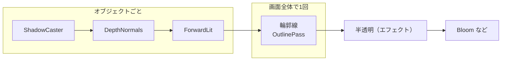
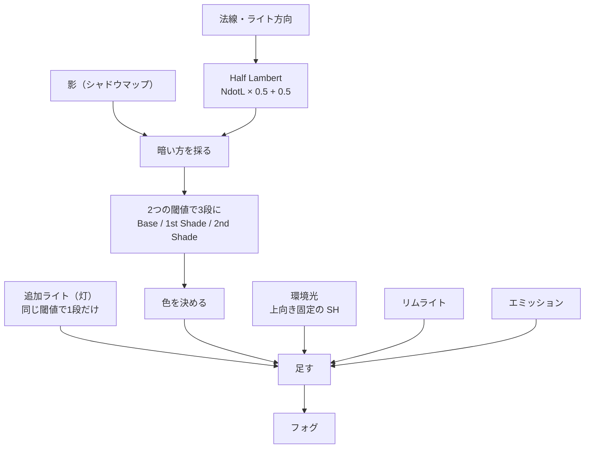
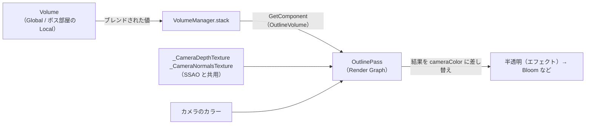
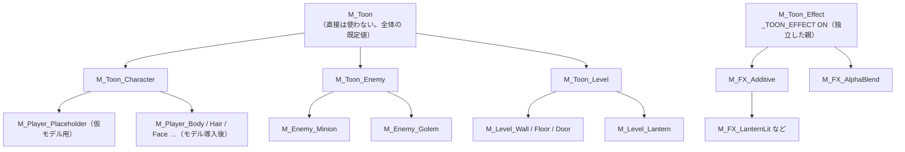

# グラフィックス設計書（セルルックシェーダー・マテリアル・輪郭線）

> **このドキュメントは非配布です。**
> **状態：実装済み・動作確認済み（2026-10-01）。** 確認項目は §10、残りの作業は §11。
> グラフィック関連のアセットはすべて `Assets/_DemoGame/Graphics/`、C# は `Assets/_DemoGame/Scripts/Rendering/` に置きます（§9）。
> 見た目の方針は [01-concept.md](01-concept.md) §4.1、キャラクターの構造は [04-character-prefab.md](04-character-prefab.md)
> ライティング・ベイク・視界（Lumen）は [11-lighting.md](11-lighting.md)、エフェクトの一覧は [12-vfx.md](12-vfx.md)

---

## 1. 目的と前提

---

### 1.1 目的

---

**プレイヤー・敵・レベルのオブジェクト・エフェクトのすべてで、1本のセルルックシェーダーを共有します。**
そのうえで、オブジェクトの種類ごとに固有の設定（マテリアル）を用意します。

| 要件 | 設計での答え |
| --- | --- |
| 全オブジェクトで共有 | シェーダーは `DemoGame/Toon` の1本だけ（**HLSL 手書き**。輪郭線のポストエフェクトは別。§5） |
| パスを少なく | オブジェクトごとのパスに**輪郭線のパスを足さない**。輪郭線は画面全体に1回だけ描く |
| URP のバッチを効かせる | **SRP Batcher** を前提にする。種類ごとの差は**キーワード最小限＋プロパティ**で出す |
| 種類ごとの固有設定 | **Material Variant**（Unity 2022.1〜）の親子で持つ |

### 1.2 プロジェクトの現状（2026-10-01 確認）

---

| 項目 | 値 | 設計への影響 |
| --- | --- | --- |
| URP | 17.3（Unity 6000.3） | |
| Rendering Path | **Forward+**（`PC_Renderer`） | 追加ライト（灯の Point Light）を数の制限なく受けられる |
| SRP Batcher | **ON**（`PC_RPAsset`） | |
| Depth Texture / Opaque Texture | **ON** | ソフトパーティクル・画面空間の輪郭線に使える |
| SSAO（Renderer Feature） | **あり** | **DepthNormals の事前パスがすでに毎フレーム走っている**。輪郭線の材料として流用できる（§5） |
| GPU Resident Drawer | OFF | §8.3 |

---

## 2. 確定した方針（2026-10-01）

---

### 2.1 HLSL 手書き

---

**確定：シェーダーは HLSL で手書きする。**
「パスを少なく」「バッチを効かせる」という要件に、Shader Graph は相性がよくないためです。

| | Shader Graph | **HLSL 手書き（採用）** |
| --- | --- | --- |
| パスの数 | URP が決めたパスが一式生成される（GBuffer / MotionVectors / 2D なども入る） | **必要な4〜5パスだけ**書ける |
| キーワード | Lit の多数のキーワードが入る。バリアント数を絞りにくい | **使うものだけ** `multi_compile` する |
| トゥーンの陰影 | 追加ライトのループに Custom Function が必要で、結局 HLSL を書く | 素直に書ける |
| エフェクト用の分岐 | 別の Graph になりやすい（＝シェーダーが2本になる） | 1本の中でキーワード1つで分けられる |

### 2.2 輪郭線は画面全体で1回（自作の Volume ＋ Renderer Feature）

---

| | 背面法（Inverted Hull） | **画面空間（採用）** |
| --- | --- | --- |
| 方法 | 法線方向に膨らませた裏面を、もう1パス描く | 深度と法線のテクスチャから、画面全体で輪郭を拾う |
| パス | **オブジェクトごとに +1 ドローコール** | **画面全体で1回だけ** |
| 材料 | 頂点の法線（ハードエッジで割れる。スムース法線の焼き込みが要る） | DepthNormals（**SSAO のためにすでに描いている**） |
| モデル差し替え | 法線の焼き込みをやり直す必要がある | **何もしなくてよい** |
| 線の太さ | オブジェクトごとに変えられる | 画面全体で同じ（距離で変えることはできる） |
| 内側の線（服のしわなど） | 出ない | 法線の差が大きい所に出る |

**確定：画面空間。自作の VolumeComponent ＋ ScriptableRendererFeature（Render Graph）で描く（§5）。** 「パスを少なく」と「モデルを差し替えるだけで動く」の両方に合います。
Hi-Fi RUSH のような「全体に線が入る」絵とも相性がよいです。

---

## 3. パス構成

---

`DemoGame/Toon` が持つパスは次の5つです。**輪郭線のパスは持ちません。**

| Pass | LightMode | いつ描かれるか | エフェクト（§7）で使うか |
| --- | --- | --- | --- |
| **ForwardLit** | `UniversalForward` | 毎フレーム | ✅（唯一のパス） |
| **ShadowCaster** | `ShadowCaster` | 影を落とす Renderer だけ | ❌（パーティクルは Cast Shadows OFF） |
| **DepthOnly** | `DepthOnly` | 深度の事前パスが必要なとき | ❌（半透明は事前パスに入らない） |
| **DepthNormals** | `DepthNormals` | SSAO・輪郭線のため毎フレーム | ❌ |
| **Meta** | `Meta` | ライトマップのベイク時だけ | ❌ |



> 背面法にした場合は、ここに**オブジェクトごとの Outline パス**が増えます。

---

## 4. ライティングモデル

---

**「2〜3段の階段状の陰影」**（[01-concept.md](01-concept.md) §4.1）を、計算の少ない形で作ります。



| 要素 | 作り方 | 理由 |
| --- | --- | --- |
| **主光源の陰影** | Half Lambert に影の減衰を掛けてから、`_ShadeThreshold` / `_Shade2Threshold` の2つの閾値で3段にする。境目は `_ShadeSoftness` の smoothstep | 影と陰影を**同じ段**にそろえると、影の縁だけ別の色になる破綻が起きない |
| **陰の色** | 乗算ではなく**指定色に差し替える**（`_ShadeColor` / `_Shade2Color`、テクスチャがあればそれ） | セルルックは「暗くする」のではなく「影色で塗る」 |
| **追加ライト** | Forward+ のライトループで回し、**1段（明るい／明るくない）だけ**で足す | 灯の光は「当たっているか」がわかれば十分。段を増やすほど重くなる |
| **環境光** | 法線ではなく**上向き固定**で SH を取る | 法線で取るとグラデーションが出て、セルルックが崩れる |
| **SSAO** | `_OcclusionStrength` で効きを弱める（既定 0.3） | 全く効かせないと接地感が消える。強いと汚れて見える |
| **リムライト** | `pow(1 - NdotV, _RimPower)` を step で切る | キャラが暗い背景から浮くように。レベルでは 0 |
| **スペキュラ** | なし（キャラの髪の天使の輪が必要になったら追加を検討） | 段が増えると要素が散る |
| **エミッション** | `_EmissionColor`（HDR）× `_EmissionMap` | 灯・ボスの亀裂。Bloom で光らせる |

---

## 5. 輪郭線（画面空間）

---

**自作の VolumeComponent（値を持つ）と、自作の Renderer Feature（描く）の2つで作ります。**
URP には HDRP のような「Volume を足せば描かれる」カスタムポストプロセスの仕組みが無いため、描く側を自分で用意します。



### 5.1 部品

---

| 部品 | 種類 | 役割 |
| --- | --- | --- |
| `OutlineVolume` | `VolumeComponent` | 値だけを持つ。Volume の Add Override から追加する。**`Intensity` が 0 なら描かない** |
| `OutlineRendererFeature` | `ScriptableRendererFeature` | `PC_Renderer.asset` に1つ足す。マテリアルの生成と、Pass の登録 |
| `OutlinePass` | `ScriptableRenderPass` | **Render Graph（`RecordRenderGraph`）で書く**。旧来の `Execute` は使わない |
| `DemoOutline.shader` | HLSL（全画面） | 輪郭の検出と合成 |

### 5.2 OutlineVolume のパラメータ

---

| パラメータ | 型 | 既定 | 意味 |
| --- | --- | --- | --- |
| `Intensity` | ClampedFloat(0,1) | 0 | 線の濃さ。**0 は無効**（Override していない Volume では描かない） |
| `Color` | Color | (0.15, 0.1, 0.2) | 下の色に掛ける色。黒一色ではなく**下の色を暗くする**（色数を絞った絵になじむ） |
| `Thickness` | ClampedFloat(0.5,4) | 1.5 | サンプル間隔（px）。1080p 基準で換算し、解像度で太さが変わらないようにする |
| `DepthThreshold` | ClampedFloat | 0.1 | 深度差の閾値（線形深度の比で判定。遠景で線が出すぎないように） |
| `NormalThreshold` | ClampedFloat(0,1) | 0.4 | 法線差の閾値。下げると服のしわなど内側の線が増える |
| `FadeDistance` | MinFloat | 40 | この距離から先は線を薄くする |

> Volume でブレンドできるので、**エリアごとに線を変えられます**（例：ボス部屋だけ太く、灯が点いたら線色を暖色に寄せる）。

### 5.3 OutlinePass（Render Graph）

---

| 項目 | 内容 |
| --- | --- |
| **差し込む位置** | `RenderPassEvent.BeforeRenderingTransparents`（不透明の後、エフェクトの前）→ **エフェクトには線が入らない** |
| **入力の要求** | `ConfigureInput(Depth と Normal)`。SSAO が既に DepthNormals を要求しているので**追加の事前パスは発生しない** |
| **パスの組み方** | `AddRasterRenderPass` を1つ。`UseTexture` で深度・法線・カメラカラーを読み、新しく作ったテクスチャに書く |
| **書き戻し** | 結果のテクスチャを `UniversalResourceData.cameraColor` に**差し替える**（コピーで書き戻さない） |
| **スキップ** | `Intensity` が 0、またはプレビュー・リフレクションのカメラでは Pass を登録しない |
| **検出** | Roberts Cross（4点）で深度差・法線差を取り、どちらかが閾値を超えたら線 |

> **全画面のパスはこの1回だけ**です。オブジェクトがいくつ増えても、輪郭線のコストは変わりません。

### 5.4 アセンブリ

---

`OutlineVolume` / `OutlineRendererFeature` は `DemoGame` 名前空間に置くため、
`DemoGame.asmdef` の references に **`Unity.RenderPipelines.Universal.Runtime` と `Unity.RenderPipelines.Core.Runtime`** を足します。
どちらもプロジェクトに入っている URP 本体なので、外部依存は増えません。

### 5.5 オブジェクトごとに線の強さを変える（2026-10-02 実装）

---

画面空間の弱点は「このオブジェクトだけ線を弱める・消す」ができないことです。
**ユニティちゃんの目のまわり（目・まつ毛・目の線）に線が入りすぎる**ので、マテリアルごとに強さを変えられるようにします。

**法線テクスチャの空いているアルファに、線の強さを書きます。**

| 項目 | 内容 |
| --- | --- |
| 空きの確認 | URP の `_CameraNormalsTexture` は `R8G8B8A8_SNorm`（使えない環境では 16bit / 32bit の RGBA）。**RGB が法線で、A は使われていない**（URP の Lit も 0 を書いている）。SSAO は RGB しか読まない |
| マテリアル | `_OutlineStrength`（Range 0〜1、既定 1）を `UnityPerMaterial` に足す。**プロパティなので SRP Batcher は崩れない**（§6.1） |
| DepthNormals | `outNormalWS.a = 1 - _OutlineStrength` を書く。**0 が「線を全部出す」になる向きにする** → `DemoGame/Toon` 以外のシェーダー（A に 0 を書く）は今までどおり線が出る |
| `DemoOutline.shader` | Roberts Cross の4点と中心の A を読み、**いちばん大きい A**（＝いちばん線を弱めたい物）で線を薄くする：`edge *= 1 - maxA` |
| 線を完全に消す | `_OutlineStrength` を 0 |

| 設定する所（案） | `_OutlineStrength` |
| --- | --- |
| 目・まつ毛・目の線（`M_Player_EyeL / EyeR / EyeBase / Eyeline`） | 0 |
| 顔（`M_Player_Face`）・頬 | 0.5 |
| ボス（大きいので線が太く見える） | 0.7 |
| エフェクト | 関係ない（輪郭線より後に描く） |

> Rendering Layers（Renderer の Rendering Layer Mask）でも消せますが、**オンかオフ**しかできず、強さを段階で変えられないので使いません。
> 「画面全体の線の太さ・濃さ」は今までどおり Volume（§5.2）で変えます。

---

## 6. プロパティ設計

---

### 6.1 SRP Batcher のための3つのルール

---

| # | ルール | 破るとどうなるか |
| --- | --- | --- |
| 1 | **`UnityPerMaterial` の CBUFFER は全パス・全バリアントで同じ中身にする**。使わないパスでも宣言する | そのシェーダーは SRP Batcher 非対応になる（Inspector に表示される） |
| 2 | **`MaterialPropertyBlock` を使わない**。個体ごとに値を変えるときはマテリアルを複製する | その Renderer がバッチから外れる |
| 3 | **キーワードは「種類」の区別だけに使う。個体の違いはプロパティで出す** | バリアントが分かれると、バッチも分かれる |

> SRP Batcher は「**マテリアルが同じ**ならまとめる」ではなく「**シェーダーのバリアントが同じ**ならまとめる」仕組みです。
> だから**マテリアルが何十個あっても、バリアントが同じなら1つのバッチ**になります。
> これが「マテリアルは種類ごとに分けてよい、キーワードは増やさない」の根拠です。

### 6.2 プロパティ一覧（`UnityPerMaterial`）

---

| グループ | プロパティ | 型 | 既定 | 使う種類 |
| --- | --- | --- | --- | --- |
| **基本色** | `_BaseMap` / `_BaseColor`（`[MainColor]`） | Tex / Color | 白 | 全部 |
| | `_Cutoff` | Range(0,1) | 0.5 | `_ALPHATEST_ON` のとき |
| **陰影** | `_ShadeMap` / `_ShadeColor` | Tex / Color | 白 / (0.6,0.6,0.75) | 不透明すべて |
| | `_ShadeMapBlend` | Range(0,1) | 0 | 0 なら陰の元色に `_BaseMap` を使う。1 なら `_ShadeMap`（UTS の 1st Shade Map を流用するとき） |
| | `_Shade2Color` | Color | (0.4,0.4,0.55) | 不透明すべて |
| | `_ShadeThreshold` / `_Shade2Threshold` | Range(0,1) | 0.5 / 0.25 | 不透明すべて |
| | `_ShadeSoftness` | Range(0,0.2) | 0.02 | 不透明すべて |
| | `_ReceiveShadowStrength` | Range(0,1) | 1 | 不透明すべて |
| | `_AdditionalLightStrength` | Range(0,2) | 1 | 不透明すべて |
| | `_AdditionalLightThreshold` | Range(0,1) | 0.1 | 不透明すべて（追加ライトが「当たっている」とみなす閾値） |
| | `_OcclusionStrength` | Range(0,1) | 0.3 | 不透明すべて |
| **輪郭線** | `_OutlineStrength` | Range(0,1) | 1 | 不透明すべて（§5.5） |
| **リム** | `_RimColor` / `_RimPower` / `_RimStrength` | Color / Float / Range | 白 / 4 / 0 | キャラ・敵 |
| **発光** | `_EmissionMap` / `_EmissionColor`（HDR） | Tex / Color | 黒 | 灯・ボス・エフェクト |
| **被弾** | `_HitFlashColor` / `_HitFlash` | Color / Range(0,1) | 白 / 0 | キャラ・敵（**実行時にスクリプトから変える**） |
| **消滅** | `_NoiseMap` / `_Dissolve` / `_DissolveEdgeColor` / `_DissolveEdgeWidth` | Tex / Range / Color / Range | `T_Noise` / 0 / 橙 / 0.05 | 敵・エフェクト（**実行時に変える**） |
| **エフェクト** | `_ToonEffect`（`_TOON_EFFECT` の Toggle） | Float | 0 | エフェクト |
| | `_ScrollSpeed`（xy: Base, zw: Noise） | Vector | 0 | エフェクト |
| | `_SoftParticleDistance` | Float | 0（`M_Toon_Effect` では 0.5） | エフェクト。0 で無効 |
| **描画状態** | `_SrcBlend` / `_DstBlend` / `_ZWrite` / `_Cull` | Enum | One / Zero / On / Back | 全部（CBUFFER ではなくレンダーステート） |

> **`_HitFlash` / `_Dissolve` は全員が持ちます。** 使わない種類では 0 のままにしておけば、計算は `lerp` 1回で済みます。
> 種類ごとにキーワードで消すと、§6.1 のルール3を破ることになります。

### 6.3 キーワード

---

| 種類 | キーワード | 用途 |
| --- | --- | --- |
| `shader_feature_local` | `_TOON_EFFECT` | **エフェクト用の経路**（ライティングを通らない Unlit。頂点カラー・ソフトパーティクル） |
| `shader_feature_local_fragment` | `_ALPHATEST_ON` | ユニティちゃんのまつ毛・髪の先など、抜きが必要な部分 |
| `multi_compile`（URP） | `_MAIN_LIGHT_SHADOWS(_CASCADE)` / `_ADDITIONAL_LIGHTS` / `_CLUSTER_LIGHT_LOOP`（Forward+） / `_LIGHT_LAYERS` / `_ADDITIONAL_LIGHT_SHADOWS` / `_SHADOWS_SOFT*` / `_SCREEN_SPACE_OCCLUSION` / `LIGHTMAP_ON` / フォグ / インスタンシング | URP の機能を受けるのに最低限必要なものだけ。Screen Space Shadows・動的ライトマップ・APV・Decal は入れていない（使うときに足す） |

**ローカルキーワードは2つだけ**です。組み合わせは4通りで、実際に使うのは3通り
（不透明 / 不透明＋抜き / エフェクト）です。

---

## 7. オブジェクトの種類と、種類ごとのマテリアル

---

### 7.1 Material Variant の親子

---



- **`M_Toon_Effect` だけは `M_Toon` の子にしていません。** キーワード（`_TOON_EFFECT`）・描画キュー（3000）・無効パス（ShadowCaster / DepthOnly / DepthNormals）が他と全部違うため、独立した親にしました
- **親で値を変えると、子に伝わります**（子が上書きしていない項目だけ）
- 種類ごとに**「ここは触らせない」項目を親で Lock** します（例：Level で `_RimStrength` を 0 に固定）。**Lock はまだ設定していません**（Inspector で行う。§11）
- 1つのモデルの見た目は、**一番下の子マテリアルの Base / Shade テクスチャ**で決まります

### 7.2 種類ごとの設定

---

| 種類 | 親 | 固有の設定 | 実行時に変える値 |
| --- | --- | --- | --- |
| **Character**（プレイヤー） | `M_Toon_Character` | 陰影 3段、リム ON（弱め）、影は自分にも落とす | `_HitFlash`（無敵時間の点滅） |
| **Enemy**（雑魚敵） | `M_Toon_Enemy` | 陰影 2段（`_Shade2Threshold` = 0）、リム ON（赤みの色） | `_HitFlash`、`_Dissolve`（倒れたとき） |
| **Boss** | `M_Toon_Enemy` の子 | Enemy ＋ エミッション（岩の亀裂） | `_EmissionColor`（怒ると赤く光る。[09-enemy.md](09-enemy.md) §5）、`_HitFlash`、`_Dissolve` |
| **Level**（壁・床・扉） | `M_Toon_Level` | 陰影 2段、リム OFF（Lock）、**影色は寒色**、ライトマップ対応 | なし |
| **Lantern**（灯） | `M_Toon_Level` の子 | エミッション。消灯時は黒 | `_EmissionColor`（点灯で暖色の HDR に） |
| **Effect** | `M_Toon_Effect` | `_TOON_EFFECT`、Cull Off、ZWrite Off、加算 or アルファ | パーティクルの頂点カラー・Custom Data で変える（**マテリアルは変えない**） |

> **「寒色から暖色へ」（灯の点灯）はシェーダーでは扱いません。** Light の色と Volume で変えます。
> シェーダーは「影色を寒色に寄せておく」ことで、それを引き立てる側に回ります。

### 7.3 エフェクトでの使い方

---

エフェクトは**1つのマテリアルを多くのパーティクルで共有**し、個体差は Particle System 側から渡します。

| 渡し方 | シェーダーで受ける場所 | 用途 |
| --- | --- | --- |
| Start Color / Color over Lifetime | 頂点カラー | 色・フェード |
| Custom Vertex Streams（Custom1.x） | `TEXCOORD0.z` | パーティクルごとの `_Dissolve` |
| Custom Vertex Streams（Custom1.y） | `TEXCOORD0.w` | 発光の強さ |
| Depth Texture | ソフトパーティクル | 地面との交線を消す |

> **パーティクルごとの値をマテリアルではなく頂点で渡す**ことで、マテリアルの複製が要らず、全部が1つのバッチに入ります。

---

## 8. 個別の注意

---

### 8.1 ユニティちゃん（3Dモデルデータ Ver 1.4.0）

---

| 項目 | 対応 |
| --- | --- |
| 付属マテリアル（Unity Toon Shader） | 使わない。テクスチャ（`_MainTex`）だけを `_BaseMap` に流用する |
| マテリアルの割り当て | 元のマテリアル9種 → `M_Player_Body / Hair / Face / Skin / Cheek / Eyeline / EyeBase / EyeL / EyeR`。Prefab の入れ子の上書き（23 個の Renderer）で差し替えている |
| 顔の陰影 | 顔は法線が細かく、陰影が汚く出やすい。**顔まわり（Face / Skin / 目 / 頬）は `_ShadeThreshold` 0.3・2段・受ける影 0.5・リムなし**（キーワードは足さない） |
| 頬・目・目の線 | `_ALPHATEST_ON`（頬は Cutoff 0.2、他は 0.5） |
| 付属スクリプト | `IdleChanger` / `FaceUpdate` は旧 Input Manager を使うので、入れ子の Prefab から外した。`AutoBlink`（まばたき）は残している |
| ライセンス | UCL の表記が必要（[assets.md](../assets.md)） |

### 8.2 Polyart（Monster Minion / Rock Golem）

---

| 項目 | 対応 |
| --- | --- |
| 付属の PBR マテリアル | 使わない。Albedo テクスチャだけを `_BaseMap` に入れる |
| Normal / Metallic マップ | 使わない（セルルックでは段が崩れる） |
| ボスの亀裂 | Emission マップが付属していればそれを使う。なければ亀裂部分のマスクを描く |

### 8.3 GPU Resident Drawer

---

今は OFF です。レベルに同じ部品を大量に並べて重くなったら、ON にして試します。
そのときは各パスに `#include_with_pragmas "…/DOTS.hlsl"` と、プロパティの DOTS インスタンシング宣言が必要です。
**今は入れていません**（使わないバリアントを増やさないため）。

---

## 9. ファイル構成

---

**グラフィック関連のアセットは `Assets/_DemoGame/Graphics/` にまとめます。C# だけは `Scripts/Rendering/` に置きます。**

```
Assets/_DemoGame/
├── Graphics/
│   ├── Shaders/
│   │   ├── DemoToon.shader              ★唯一のオブジェクト用シェーダー（DemoGame/Toon）
│   │   ├── DemoToonInput.hlsl           CBUFFER とテクスチャの宣言、消滅の判定（全パスで include）
│   │   ├── DemoToonLighting.hlsl        §4 のライティング
│   │   ├── DemoToonForwardPass.hlsl     ForwardLit（_TOON_EFFECT で不透明 / エフェクトに分岐）
│   │   ├── DemoToonShadowDepthPass.hlsl ShadowCaster / DepthOnly / DepthNormals（消滅で抜けた所を影・深度からも抜く）
│   │   └── DemoOutline.shader           §5 の輪郭線（Hidden/DemoGame/Outline）
│   ├── Materials/
│   │   ├── M_Toon.mat                   全体の親
│   │   ├── Character/   M_Toon_Character / M_Player_Placeholder / M_Player_*（ユニティちゃん用 9 種） / M_Weapon_Default
│   │   ├── Enemy/       M_Toon_Enemy / M_Enemy_Minion / M_Enemy_Golem
│   │   ├── Level/       M_Toon_Level / M_Level_Wall / Floor / Door / Lantern
│   │   └── Effect/      M_Toon_Effect / M_FX_Additive / M_FX_AlphaBlend
│   ├── Textures/        T_Noise.png（消滅用。リニア・リピート・タイル可能）
│   ├── Effects/         パーティクルの Prefab（これから）
│   └── Settings/        DemoGameVolumeProfile.asset（Outline ＋ Bloom）/ DemoGlobalVolume.prefab
└── Scripts/Rendering/
    ├── OutlineVolume.cs                 §5.2（VolumeComponent）
    ├── OutlineRendererFeature.cs        §5.1（ScriptableRendererFeature）
    └── OutlinePass.cs                   §5.3（Render Graph）
```

> `M_Enemy_*` / `M_Level_*` は旧 `Materials/` の `EnemyMat` / `BossMat` / `WallMat` / `TestGroudMat` / `DoorMat` / `LanternMat` を
> **GUID を引き継いだまま**移動・改名したものです。シーンと `*Test.prefab` の参照はそのまま新しいマテリアルを指します。

### 9.1 `_DemoGame` の外で変えたもの

---

| ファイル | 変更 | `.unitypackage` |
| --- | --- | --- |
| `Assets/Settings/PC_Renderer.asset` | `OutlineRendererFeature` を追加（SSAO の後） | 含まれる（`Settings/`） |

> 品質設定は PC（`PC_RPAsset` → `PC_Renderer`）を使っています。`Mobile_Renderer` には足していません。
> `ProjectSettings/` は変えていません。

---

## 10. 確認方法

---

| 確認すること | 方法 | 合格ライン |
| --- | --- | --- |
| SRP Batcher に対応しているか | シェーダーを選択 → Inspector の「SRP Batcher」 | compatible |
| バッチがまとまっているか | Frame Debugger → `RenderLoop.Draw` の中の「SRP Batch」 | 不透明の ForwardLit が**バリアントの数だけ**のバッチになる |
| まとまらない理由 | Frame Debugger の各バッチの「Why this draw call can't be batched」 | 「different shader keywords」以外が出ていない |
| バリアント数 | Project Settings → Graphics → Shader Stripping のログ、またはビルドログ | 実用の組み合わせ × URP の multi_compile 分に収まる |

---

## 11. 実装状況

---

| # | 項目 | 状態 |
| --- | --- | --- |
| 1 | `DemoToon.shader`（ForwardLit / ShadowCaster / DepthOnly / DepthNormals / Meta） | ✅ 実装 |
| 2 | `M_Toon` → 種類ごとの親マテリアル（Material Variant） | ✅ 実装（Lock は未設定） |
| 3 | 既存のレベル・仮モデルのマテリアルを差し替え | ✅ 実装（GUID を引き継いで置き換え） |
| 4 | 輪郭線（`OutlineVolume` / `OutlineRendererFeature` / `OutlinePass`） | ✅ 実装。`PC_Renderer` に追加済み |
| 5 | `_TOON_EFFECT`（エフェクト経路）と `M_FX_*` | ✅ 実装（パーティクル本体はまだ無い） |
| 6 | 敵の被弾を `_HitFlash`、死亡時の `_Dissolve` | ✅ 実装（2026-10-02 に `EnemyHealth` から `CharacterVisual` へ移した。[09-enemy.md](09-enemy.md)） |
| 7 | `Lantern` の点灯で `_EmissionColor` を上げる | ✅ 実装 |
| 8 | DemoInGame に Global Volume を置く | ✅ 講師が配置 |
| 9 | DemoInGame のカメラの Post Processing を ON（Bloom を効かせる） | ✅ 講師が設定 |
| 10 | Frame Debugger でバッチを確認（§10） | ⏳ 未 |
| 11 | モデルを入れて、種類ごとの子マテリアルを作る | ✅ 実装（`M_Player_*` 9 種、`M_Enemy_Minion` / `M_Enemy_Golem` にパレットテクスチャ） |
| 12 | プレイヤーの被弾点滅（`_HitFlash`） | ⏳ 未 |
| 13 | オブジェクトごとの線の強さ（`_OutlineStrength`。§5.5） | ✅ シェーダー・`DemoOutline` に実装。目まわり 0・顔と頬 0.5・ボス 0.7 を設定。**見た目の確認はまだ** |
| 14 | ライティング（Mixed・ベイク）と視界（Lumen の Volume） | → [11-lighting.md](11-lighting.md) |
| 15 | Particle System のエフェクト | → [12-vfx.md](12-vfx.md) |
| 16 | ステージ用のマテリアル・シェーダー | ⏳ ステージ制作が終わってから |
