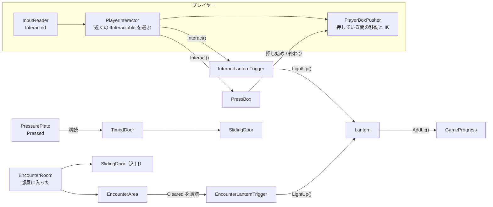
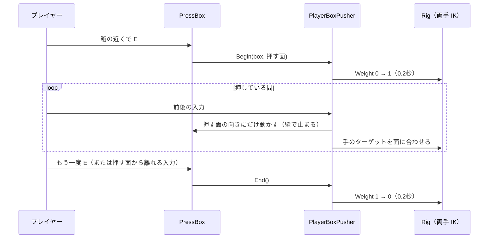
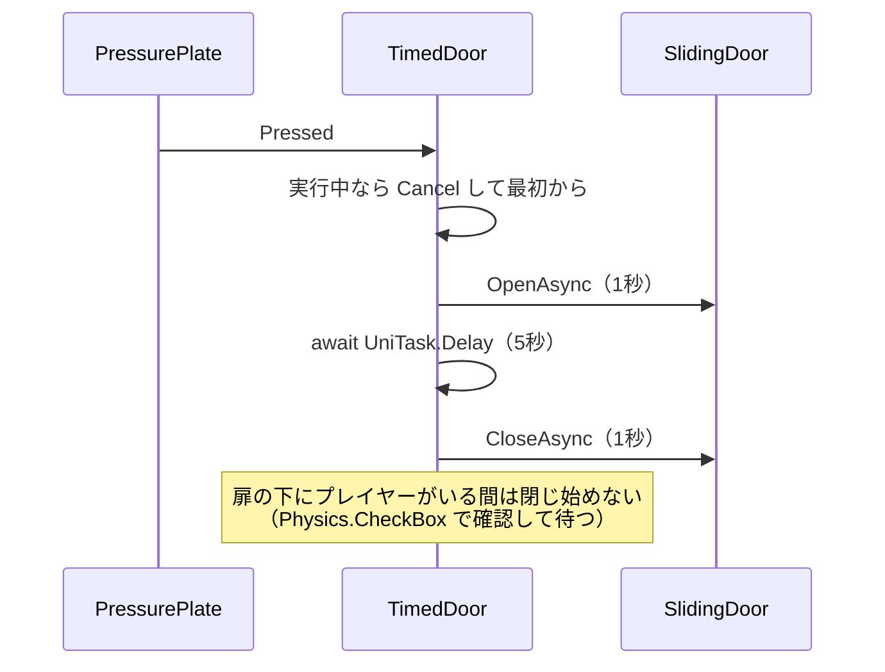

# 灯のギミック設計書（インタラクト・箱押し・時限扉・撃破）

> **このドキュメントは非配布です。**
> **状態：実装済み（2026-10-01）・Unity 上で動作確認済み（2026-10-02）。数値の調整は未。** 配置は §11。
> 元の仕様は [02-spec.md](02-spec.md) §5、プレイヤーの構造は [04-character-prefab.md](04-character-prefab.md)
> **2026-10-02：灯の点け方（杖の火で E）、時限扉（スイッチに乗っている間だけ開く・箱でも押せる）、撃破（灯火に火をつけたら敵が出る）を変えました。[10-level-design.md](10-level-design.md) §4.3・§4.4・§11 を正とします。**

---

## 1. 範囲と現状

---

### 1.1 この設計書で作るもの

---

| # | もの | 内容 |
| --- | --- | --- |
| 1 | **インタラクト** | 近くの対象に E キーで働きかける共通の仕組み |
| 2 | **灯の点灯条件** | 灯そのものと「何をしたら点くか」を分ける |
| 3 | **灯の間 A：箱押し** | 箱を押して足場にし、高所の灯に E で点灯。**押している間、両手を箱に IK で添える** |
| 4 | **灯の間 B：時限扉** | スイッチを踏むと扉が一定時間だけ開く。奥の灯に E で点灯 |
| 5 | **灯の間 C：撃破** | 部屋に入ると扉が閉まり雑魚敵が出る。全滅で灯が点き、扉が開く |

### 1.2 今の状態（モック）

---

- `LanternArea_A / B / C` の3つとも同じ作り：**灯に触れると `EncounterArea` が始まり、全滅で点灯**
- `Lantern` が `EncounterArea` を直接持っていて、点灯条件が灯の中に埋まっている
- インタラクト（E キー）は入力（`InputReader.Interacted`）だけあり、受け手がいない

---

## 2. 全体構成

---



**依存の向きのルール**

| ルール | 理由 |
| --- | --- |
| **`Lantern` は「点く」ことしか知らない。** 何をしたら点くかは `XxxLanternTrigger` が持つ | 点灯条件だけを差し替えれば別の仕掛けにできる（[01-concept.md](01-concept.md) §6.3「ギミックを差し替える」） |
| **踏まれる側（`PressurePlate`）は扉を知らない。** 扉がスイッチを購読する | `BossDoor` が `GameProgress` を購読しているのと同じ向き |
| **`EncounterArea` は灯も扉も知らない**（今のまま） | 全滅を知らせるだけ |

---

## 3. インタラクト

---

### 3.1 IInteractable

---

```csharp
namespace DemoGame
{
    public interface IInteractable
    {
        // 今このプレイヤーが働きかけられるか（点灯済みの灯・押している最中の箱などは false）
        bool CanInteract(PlayerInteractor interactor);

        // E キーで呼ばれる
        void Interact(PlayerInteractor interactor);

        // HUD に出す文言（「灯す」「押す」「離す」など）
        string Prompt { get; }
    }
}
```

> Week01 の `IInteractiveObject`（`OnExecute` / `OnExit`）は移設せず、DemoGame 側で作り直します。
> 「範囲から出たとき」の処理を対象に持たせず、**選ばれているかどうかはプレイヤー側だけが管理する**形にします。

### 3.2 PlayerInteractor

---

| 項目 | 内容 |
| --- | --- |
| **置き場所** | DemoPlayer のルート |
| **探し方** | 0.1 秒ごとに、Visual の前方 0.8m を中心に半径 1.0m の `Physics.OverlapSphere`。`CanInteract` が true のうち**一番近いもの**を選ぶ |
| **トリガーを使わない理由** | CharacterController とトリガーの組み合わせは、出入りの取りこぼしで「範囲を出たのに選ばれたまま」になりやすい。毎回探し直せば状態がずれない |
| **通知** | `ReadOnlyReactiveProperty<IInteractable> Current`。HUD はこれを購読して「E：灯す」を出す |
| **E キー** | `Current` があれば `Interact(this)` |
| **レイヤー** | 対象は `Interactable` レイヤーに置き、探す範囲をそれだけに絞る（**レイヤーの追加は `ProjectSettings/TagManager` の変更 → setup.md に書く**） |

---

## 4. 灯と点灯条件

---

### 4.1 Lantern（作り直し）

---

| 変更 | 内容 |
| --- | --- |
| **消す** | `_encounter`、`OnTriggerEnter`（触れたら点く／戦闘が始まる） |
| **残す** | `LightUp()`、`LitUp`、`IsLit`、`GameProgress.AddLit()`、見た目（`_BaseColor`・`_EmissionColor`・Point Light） |

### 4.2 点灯条件（Trigger）

---

灯と同じ GameObject か子に付け、条件がそろったら `Lantern.LightUp()` を呼ぶだけの小さなコンポーネントです。

| コンポーネント | 使う部屋 | 条件 |
| --- | --- | --- |
| `InteractLanternTrigger` | A / B | **E キー**（`IInteractable`）。灯の近くで押すと点く |
| `EncounterLanternTrigger` | C | 指定した `EncounterArea` の `Cleared` |

> 新しい仕掛けを足すときは、`Lantern` を触らず `XxxLanternTrigger` を1つ足します。

---

## 5. 灯の間 A：箱押し

---

### 5.1 遊び方

---



| 項目 | 値 |
| --- | --- |
| 箱の大きさ | 1.0 × 1.0 × 1.0 m（ジャンプ 1.2 m で乗れる高さ） |
| 押す速さ | 1.5 m/s（前進のみ。引かない） |
| 動く向き | **押し始めた面の法線の逆向き1本だけ**（斜めに動かさない） |
| 壁との当たり | 動かす前に `Rigidbody.SweepTest` で調べ、ぶつかる手前で止める |
| 灯の位置 | **高さ 2.0 m** の段差（Ledge）の上。地面からは届かず（ジャンプ 1.2 m）、箱に乗れば届く高さにした |

### 5.2 押している間のプレイヤー

---

| 項目 | 内容 |
| --- | --- |
| **担当** | 新規 `PlayerBoxPusher`（DemoPlayer のルート） |
| **移動** | `PlayerController` に `IsMovementLocked` を足し、押している間は `PlayerController` は動かさない。`PlayerBoxPusher` が箱とプレイヤーを同じ量だけ動かす |
| **向き** | Visual を押す面に向けて固定 |
| **ジャンプ・攻撃** | 押している間は受け付けない |
| **モーション** | 押すモーションは無いので、歩きの Blend Tree（Speed）をそのまま使う。**手は IK で箱に添える** |

### 5.3 両手の IK（Animation Rigging）

---

**Unity 公式パッケージ `com.unity.animation.rigging` を追加します**（外部依存 → setup.md と `DemoGame.asmdef` に追記）。

```
DemoPlayer
└── Visual
    └── unitychan                      Animator ＋ RigBuilder
        ├── Rig_Hands                  Rig（Weight 0。押している間だけ 1）
        │   ├── LeftHandIK             TwoBoneIKConstraint（LeftArm → LeftForeArm → LeftHand）
        │   │   ├── Target
        │   │   └── Hint               肘の向き
        │   └── RightHandIK            同上（右）
        └── Character1_Reference …     （ボーン）
```

| 項目 | 内容 |
| --- | --- |
| **FK と IK の切り替え** | 普段は Rig の Weight 0（＝アニメーションの FK のまま）。押し始めで 0→1、離すときに 1→0 を 0.2 秒で補間 |
| **手のターゲット** | `PlayerBoxPusher` が毎フレーム、押す面の中心から左右 ±0.3m・高さ 0.9m（手の届く高さ）に置く。回転は手のひらが面を向くように |
| **ボーンへの依存** | Rig はモデル（`unitychan`）の中に置く。**モデルを替えたら Rig も作り直す**（[04-character-prefab.md](04-character-prefab.md) §6.1 の「差し替えだけでは済まないもの」に足す） |
| **武器** | 押している間は `WeaponSocket` を非表示にする（両手がふさがるため） |

---

## 6. 灯の間 B：時限扉

---

| 部品 | 責務 |
| --- | --- |
| `SwitchBase` | 「押された」を流すだけの基底。**扉を知らない**。押し方の違いは派生が持つ |
| `PressurePlate` | `SwitchBase` の派生。プレイヤー（Tag `Player`）が乗ったら押される。見た目は 0.05m 沈む |
| `SlidingDoor` | `OpenAsync` / `CloseAsync`（指定オフセットへ1秒で動く）。部屋 C の入口扉でも使う |
| `TimedDoor` | `PressurePlate.Pressed` を購読し、`SlidingDoor` を「開く → 待つ → 閉じる」 |



| 項目 | 内容 |
| --- | --- |
| **開いている時間** | 5 秒（要調整。`TimedDoor` の SerializeField） |
| **途中でもう一度踏んだら** | タイマーを最初から（`CancellationTokenSource` を作り直す） |
| **キャンセル** | `destroyCancellationToken` とつなぐ。シーン遷移・破棄で確実に止まる |
| **挟まない** | 閉じる直前と閉じている最中に、扉の範囲にプレイヤーがいたら止めて待つ |
| **残り時間の見せ方** | 最後の 1 秒は扉の `_EmissionColor` を点滅させる |

---

## 7. 灯の間 C：撃破

---

| 部品 | 責務 |
| --- | --- |
| `EncounterRoom` | 部屋の中のトリガーにプレイヤーが入ったら、入口の `SlidingDoor` を閉じて `EncounterArea.Begin()`。全滅したら入口を開ける |
| `EncounterArea` | 今のまま（敵を出して、全滅を知らせる） |
| `EncounterLanternTrigger` | `EncounterArea.Cleared` で `Lantern.LightUp()` |

> 今の「灯に触れたら戦闘開始」は、「部屋に入ったら戦闘開始」に変えます（[02-spec.md](02-spec.md) §5.5 のとおり）。

---

## 8. ファイルと Prefab

---

```
Assets/_DemoGame/
├── Scripts/
│   ├── Gimmick/
│   │   ├── IInteractable.cs
│   │   ├── Lantern.cs                     作り直し（点くことだけ）
│   │   ├── InteractLanternTrigger.cs
│   │   ├── EncounterLanternTrigger.cs
│   │   ├── PressBox.cs
│   │   ├── SwitchBase.cs
│   │   ├── PressurePlate.cs
│   │   ├── SlidingDoor.cs
│   │   ├── TimedDoor.cs
│   │   └── EncounterRoom.cs
│   └── Player/
│       ├── PlayerInteractor.cs
│       └── PlayerBoxPusher.cs             押している間の移動と IK
└── Prefabs/Gimmick/
    ├── Lantern.prefab                     灯（Point Light ＋ InteractLanternTrigger）
    ├── PressBox.prefab
    ├── PressurePlate.prefab
    └── SlidingDoor.prefab
```

- 見た目は仮で Cube（`M_Level_*` マテリアル）。**ギミックの Prefab も「ロジック／Visual」の2層**にして、見た目だけ差し替えられるようにする
- `DemoInGame` の `LanternArea_A / B / C` を、この Prefab で組み直す（**シーンを閉じてもらってから**）
- HUD の「E：灯す」は `PlayerInteractor.Current` を `HudPresenter` で購読して出す

### 8.1 外部依存・設定の変更

---

| 変更 | 書く場所 |
| --- | --- |
| `com.unity.animation.rigging` を追加（`Packages/manifest.json`） | setup.md §2.2、`DemoGame.asmdef` の references に `Unity.Animation.Rigging` |
| レイヤー `Interactable` を追加（`ProjectSettings/TagManager.asset`） | setup.md §6 |

---

## 9. 確認したいこと

---

| # | 内容 | 案 |
| --- | --- | --- |
| 1 | 箱は**押すだけ**（引かない）でよいか | ✅ 押すだけ。詰み防止の `PressBox.ResetPosition()` は用意だけしてある（呼び出し方はマップデザイン時に決める） |
| 2 | 灯の間 B の扉を通り抜けたあとの灯は **E キー**でよいか | ✅ E キー。**スイッチを「手で押すボタン（IK）」にするかはマップデザイン時に決める**。扉は `SwitchBase` を購読するので、床スイッチ（`PressurePlate`）と差し替えられる |
| 3 | `Interactable` レイヤーを足してよいか | ✅ User Layer 8 に追加 |
| 4 | BossDoor も `SlidingDoor` を使う形にそろえるか | ✅ 今回はそろえない |

---

## 10. 実装状況

---

| # | 項目 | 状態 |
| --- | --- | --- |
| 1 | スクリプト（§8 の一覧＋ `SwitchBase`）。`PlayerController.IsMovementLocked`、`PlayerAttack.IsLocked`、HUD の「E：○○」 | ✅ |
| 2 | Prefab：`Prefabs/Gimmick/` の `Lantern` / `PressBox` / `PressurePlate` / `SlidingDoor`（ロジック／Visual の2層） | ✅ |
| 3 | DemoPlayer に `PlayerInteractor`（探す対象は `Interactable` レイヤー）と `PlayerBoxPusher` | ✅ |
| 4 | `com.unity.animation.rigging` 1.4.1・`Interactable` レイヤー・`DemoGame.asmdef` の参照、setup.md への追記 | ✅ |
| 5 | DemoPlayer の両手 IK（RigBuilder ＋ `Rig_Hands` ＋ Two Bone IK）を作り、`PlayerBoxPusher` に割り当てる | ✅ 回転の重みは 0（位置だけ合わせる）。Hint は肘の外・後ろ |
| 6 | DemoInGame の `LanternArea_A / B / C` を組み直す。HUD に `InteractText` を足す | ✅（§11） |


---

## 11. DemoInGame での配置（仮のレイアウト）

---

**マップデザイン前の仮配置です。** 位置は今のモックのエリア位置（A：x -18 / B：x 0 / C：x 18）をそのまま使い、地面の高さ（y 0.5）に合わせました。

| エリア | 置いたもの |
| --- | --- |
| **A（箱押し）** | `Ledge`（4 × 2 × 3 の段差）、その上に `Lantern`、手前 6 m に `PressBox` |
| **B（時限扉）** | 3 方を壁で囲んだ小部屋の奥に `Lantern`（触れる範囲を半径 0.7 に絞り、扉越しに点かないようにした）。入口に `TimedDoor`（`SlidingDoor`）、10 m 手前に `PressurePlate`。`TimedDoorController` がスイッチと扉をつなぐ |
| **C（撃破）** | 12 × 12 m の部屋。西側の入口に `Entrance`（`SlidingDoor`、最初は開いている）。中央の `Lantern` は `InteractLanternTrigger` を外し、`LanternTrigger_Encounter` で全滅時に点く。`EncounterRoom` のトリガーに入ると入口が閉まって戦闘開始 |

**HUD**：Canvas に `InteractText`（画面下中央。普段は非表示）を足し、`HudView` / `HudPresenter` とつないだ。UI のフォントが英字のみなので、文言は `[E] Light` / `[E] Push` / `[E] Release`。

**参照の修復**：Prefab の差し替えで切れていた `InGameController` の `_input` / `_boss` / `_playerHealth`、`BossRoomTrigger._boss`、`HudPresenter._playerHealth` をつなぎ直した。
