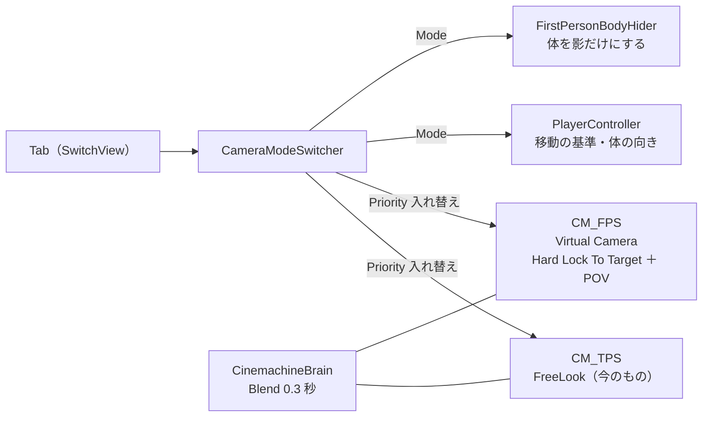

# カメラ設計書（TPS / FPS 切替・入力・Impulse）

> **このドキュメントは非配布です。**
> **状態：実装済み（2026-10-02）・Unity 上で動作確認済み（2026-10-02）。数値の調整は未。**
> 元の仕様は [02-spec.md](02-spec.md) §4、視点切替の狙いは [01-concept.md](01-concept.md) §5

---

## 1. 範囲と現状

---

### 1.1 作るもの

---

| # | もの | 内容 |
| --- | --- | --- |
| 1 | **入力の受け方の置き換え** | 自作の `PlayerCameraController` をやめ、Cinemachine 2.x 標準の `CinemachineInputProvider` で Input System の Look を直接つなぐ |
| 2 | **TPS / FPS 切替** | Tab で切り替える。Priority の入れ替えと Brain の Blend（0.3 秒）でつなぐ |
| 3 | **FPS 中の見え方と動き方** | 体は影だけ残して見えなくする。移動の基準はカメラの向き、体の向きはカメラの水平方向に合わせる |
| 4 | **画面の揺れ（Impulse）** | 被弾と、高いところからの着地で揺らす |

### 1.2 今の状態

---

| 項目 | 今 |
| --- | --- |
| カメラ | `CinemachineFreeLook` 1台（Priority 10、FOV 40、Binding Mode = Simple Follow With World Up、3段の Orbit） |
| 入力 | `PlayerCameraController` が FreeLook の軸名を空にし、`InputReader.Look` を毎フレーム `m_InputAxisValue` に流し込んでいる。カーソルの固定もここ |
| Brain | Default Blend 2 秒（Ease In Out） |
| 入力アクション | Player マップに Move / Look / Jump / Sprint / Attack / Interact。**視点切替のアクションは無い** |

---

## 2. 入力：CinemachineInputProvider に置き換える

---

**Cinemachine 2.10.7 には、Input System 用の `CinemachineInputProvider` が入っています**（Input System があるときだけ有効になる `CINEMACHINE_UNITY_INPUTSYSTEM`）。
`AxisState` を使うカメラ（FreeLook・POV）に、`InputActionReference` から直接値を渡せます。

| | 今（`PlayerCameraController`） | 置き換え後（`CinemachineInputProvider`） |
| --- | --- | --- |
| 入力の渡し方 | 軸名を空にして、スクリプトから毎フレーム値を代入 | カメラと同じ GameObject に付け、XY Axis に `Player/Look` を指定するだけ |
| 感度・反転・加減速 | 起動時にスクリプトで上書き | **カメラの Axis の設定（Inspector）にそのまま書く** |
| 入力を止める | `InputReader.SetInputEnabled(false)` | 同じ（アクションマップを止めれば 0 が返る） |

- マウスの delta は「そのフレームで動いた量」なので、Axis の **Speed Mode は `Input Value Gain`**（速度として扱わず、増分として足す）。今のスクリプトと同じ考え方を Inspector に移す
- `PlayerCameraController` は**削除**し、カーソルの固定だけを新しい `CursorLock` に残す
- Cinemachine 3.x には同じ役割の `CinemachineInputAxisController` があるが、このプロジェクトは 2.x 固定（CLAUDE.md）なので使わない

> ⚠️ Look にはゲームパッドの右スティックも割り当ててあります。スティックは「量」ではなく「速さ」なので、Input Value Gain だと遅くなります。
> **今回はマウスを優先**し、ゲームパッドは Look の右スティックに Scale の Processor を足して合わせる程度にとどめます。

---

## 3. TPS / FPS の2台構成

---

| | TPS | FPS |
| --- | --- | --- |
| **カメラ** | `CM_TPS`：今の FreeLook をそのまま使う（名前だけ変える） | `CM_FPS`：Virtual Camera。Body = Hard Lock To Target、Aim = POV |
| **追従先** | プレイヤーのルート（今のまま） | **`FPSCameraRoot`**：プレイヤーのルートの子、目の高さ（1.45m）に置く空の GameObject |
| **FOV** | 40 | 60 |
| **入力** | `CinemachineInputProvider`（Look） | 同じ |
| **移動の基準** | カメラの前方（今のまま） | カメラの前方（＝体の前方） |
| **体の向き** | 進む方向へ回る（今のまま） | **常にカメラの水平方向**。横移動では向きを変えない |
| **体の表示** | 表示 | **影だけ**（`ShadowCastingMode.ShadowsOnly`）。剣も同じ |

### 3.1 追従先を頭のボーンにしない理由

---

- 頭のボーンはモーションで上下に揺れる。FPS で揺れると酔いやすい
- ボーンはモデルの中にしか無い。**モデルを差し替えたら作り直しになる**（[04-character-prefab.md](04-character-prefab.md) の「Visual 以外にモデル依存物を置かない」に反する）

→ ルートの子に固定の高さで置きます。ユニティちゃんの目の高さ（約 1.45m）に合わせ、モデルを替えたら高さだけ直します。

### 3.2 切り替えたときに視線が飛ばないようにする

---

切り替える直前のカメラの向き（水平・上下）を、切り替え先の軸に写してから Priority を入れ替えます。

| 切替 | 写すもの |
| --- | --- |
| TPS → FPS | 今のカメラの水平角 → POV の Horizontal、上下角 → POV の Vertical（±70° に制限） |
| FPS → TPS | POV の Horizontal → FreeLook の X Axis。Y Axis は中段（0.5）に戻す |

### 3.3 CameraModeSwitcher

---

| 項目 | 内容 |
| --- | --- |
| **置き場所** | Scene の `CameraManager`（今 FreeLook を持っている GameObject の親） |
| **入力** | `InputReader` に `SwitchViewPressed` を足す（アクション `SwitchView`：Tab ／ ゲームパッド右スティック押し込み） |
| **状態** | `ReadOnlyReactiveProperty<CameraMode> Mode`（`Tps` / `Fps`）。**プレイヤー側はカメラを知らず、Mode を受け取るだけ** |
| **プレイヤーへの伝え方** | `PlayerController.ViewMode` を Switcher が設定する（プレイヤーは Switcher を知らない） |
| **切り替えない場面** | 箱を押している間（`PlayerController.IsMovementLocked`）・ゲーム終了後 |

### 3.4 Brain の Blend

---

Default Blend を **2 秒 → 0.3 秒（Ease In Out）**にします（仕様どおり）。ボス登場の Timeline など、演出側は個別の Blend を持たせます。

---

## 4. FPS 中のプレイヤー

---

| 項目 | 変更 |
| --- | --- |
| `PlayerController` | `ViewMode` を追加。FPS では体（Visual）の向きを毎フレーム**カメラの水平方向に固定**し、移動はカメラ基準（向きは変えない） |
| `FirstPersonBodyHider`（新規） | Visual の下の Renderer をすべて `ShadowsOnly` にする／戻す。モデルを替えても子を集め直すだけ |
| 攻撃 | `PlayerAttack` の判定の基準は Visual の前方なので、FPS では自動でカメラの向きに出る（変更なし） |
| 箱押し | 押している間は FPS に切り替えない。FPS 中に押し始めたら TPS に戻す |

---

## 5. 画面の揺れ（Impulse）

---

| 揺れ | 起点 | 強さ |
| --- | --- | --- |
| **被弾** | `PlayerHealth.CurrentHp` が減った | 0.3 |
| **着地** | 落下速度が 6 m/s を超えて接地した | 落下速度に比例（上限 0.6） |

| 部品 | 内容 |
| --- | --- |
| `CinemachineImpulseSource` | プレイヤーに1つ。形は Bump |
| `CinemachineImpulseListener` | `CM_TPS` と `CM_FPS` の両方に Extension として付ける |
| `PlayerCameraShake`（新規） | `PlayerHealth` と `PlayerController.Landed`（新規イベント。落下速度を渡す）を購読して `GenerateImpulse` を呼ぶ |

> 仕様にある `CM_Impulse` は、独立したカメラではなく「Impulse の仕組み一式」として扱います。

---

## 6. ファイルと変更

---

| ファイル | 種別 | 内容 |
| --- | --- | --- |
| `Scripts/Camera/CameraModeSwitcher.cs` | 新規 | §3.3 |
| `Scripts/Camera/CursorLock.cs` | 新規 | カーソルの固定（`PlayerCameraController` から移す） |
| `Scripts/Player/FirstPersonBodyHider.cs` | 新規 | §4 |
| `Scripts/Player/PlayerCameraShake.cs` | 新規 | §5 |
| `Scripts/Player/PlayerCameraController.cs` | **削除** | `CinemachineInputProvider` に置き換え |
| `Scripts/Player/PlayerController.cs` | 変更 | `ViewMode`、FPS の向きの固定、`Landed` イベント |
| `Scripts/Input/InputReader.cs` ／ `DemoGameInput.inputactions` | 変更 | `SwitchView`（Tab） |
| `Prefabs/DemoPlayer.prefab` | 変更 | `FPSCameraRoot`、`FirstPersonBodyHider`、`CinemachineImpulseSource`、`PlayerCameraShake` |
| `Scenes/DemoInGame.unity` | 変更 | FreeLook → `CM_TPS`（InputProvider・Speed Mode・Impulse Listener）、`CM_FPS` を追加、`CameraModeSwitcher`、Brain の Blend |

> 外部依存は増えません（Cinemachine 2.10.7 と Input System は導入済み）。

---

## 7. 決まっていないもの（あとで調整）

---

- 感度（TPS / FPS 別にするか）、FPS の上下の制限角、Impulse の強さ
- 高所の印を FPS でしか読めないようにする仕掛け（マップデザイン時）

---

## 8. 確認したいこと

---

| # | 内容 | 案 |
| --- | --- | --- |
| 1 | TPS は今の FreeLook のままでよいか | ✅ FreeLook のまま |
| 2 | FPS で体を消す（影は残す）でよいか | ✅ 影だけ |
| 3 | 切替キーは Tab でよいか | ✅ Tab（ゲームパッドは右スティック押し込み） |

---

## 9. 実装状況

---

| # | 項目 | 状態 |
| --- | --- | --- |
| 1 | `SwitchView` アクション（Tab ／ 右スティック押し込み）。Look の右スティックに `ScaleVector2(4, 4)` | ✅ |
| 2 | `InputReader.SwitchViewPressed` ／ `LookAction` | ✅ |
| 3 | `CameraMode`・`CameraModeSwitcher`・`CursorLock`（`Scripts/Camera/`） | ✅ |
| 4 | `PlayerController.ViewMode`・FPS の向きの固定・`Landed` | ✅ |
| 5 | `FirstPersonBodyHider`・`PlayerCameraShake` | ✅ |
| 6 | `PlayerCameraController` の削除 | ✅ |
| 7 | DemoPlayer：`FPSCameraRoot`（y 1.45）・`FirstPersonBodyHider`・`CinemachineImpulseSource`（Bump / Uniform / 0.2 秒）・`PlayerCameraShake` | ✅ |
| 8 | DemoInGame：FreeLook を `CM_TPS` に（InputProvider・Input Value Gain・X 1.0 / Y 0.02・Impulse Listener）、`CM_FPS`（POV：水平 1.0 / 垂直 0.7、±70°）、`CameraSystem`（`CameraModeSwitcher` ＋ `CursorLock`）、Brain の Blend 0.3 秒 | ✅ |

> **InputProvider の XY Axis（Look）は、シーンには書かずに実行時につなぎます**（`CameraModeSwitcher` が `InputActionReference.Create(InputReader.LookAction)` を入れる）。
> `.inputactions` の中のアクション参照は、ファイルの外から ID を決められないためです。Inspector で `Player/Look` を指定すれば、そちらが優先されます。
