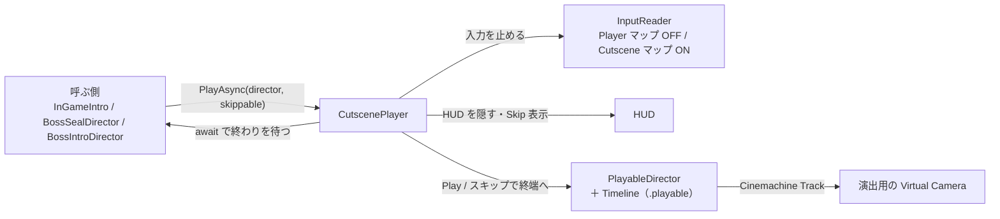
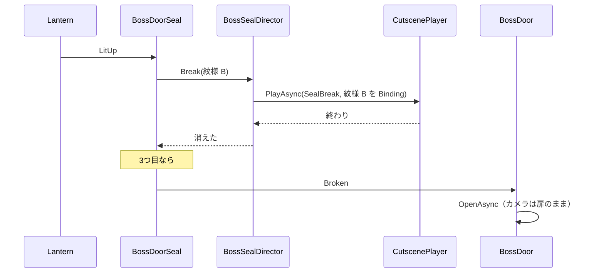

# 演出（Timeline）設計書

> **このドキュメントは非配布です。**
> **状態：実装済み（2026-10-02）・Unity 上で動作確認済み（2026-10-02）。数値の調整は未。**
> カメラは [07-camera.md](07-camera.md)、灯とボス扉は [06-gimmick.md](06-gimmick.md)
> **2026-10-02：ボス撃破の演出 `BossDefeat`（6 秒・カメラ1台）を足しました。導入演出が終わったら杖を拾います（拾うカットはまだ）。[10-level-design.md](10-level-design.md) §8・§11**

---

## 1. 作るもの

---

| # | 演出 | いつ | スキップ | 終わったあと |
| --- | --- | --- | --- | --- |
| 1 | **導入（Intro）** | InGame に入った直後 | ✅ 画面タップ | 操作できるようになり、経過時間を数え始める |
| 2 | **紋様が消える（SealBreak）** | 灯を1つ点けるたび（計3回） | ❌（短いので） | 3回目のあとは、そのまま扉が開くところまで見せる |
| 3 | **ボス戦前（BossIntro）** | ボス部屋に入ったとき | ✅ 画面タップ | ボスが動き出す |

**素材は今あるものだけで作り、あとで尺（長さ）とアセットを差し替えられるようにします**（§7）。

---

## 2. 共通の仕組み

---



### 2.1 CutscenePlayer

---

| 項目 | 内容 |
| --- | --- |
| **使い方** | `await _cutscenePlayer.PlayAsync(director, skippable, ct)`。終わるまで待てる |
| **始まるとき** | Player マップを止める（移動・攻撃・視点切替が効かない）、Cutscene マップを有効にする、HUD を隠す、スキップできるなら「CLICK TO SKIP」を出す |
| **スキップ** | `director.time = director.duration` → `Evaluate()` → `Stop()`。**途中を飛ばして最後の状態にする**（途中で止めると、出したまま・動かしたままのものが残るため） |
| **終わるとき** | HUD を戻す。**スキップに使ったクリックが離されてから** Player マップを戻す（同じクリックで攻撃しないように） |
| **キャンセル** | 呼ぶ側の `CancellationToken`（シーン遷移）で止まる。止まったときもスキップと同じく最後の状態にする |
| **同時再生** | しない。再生中に別の演出が呼ばれたら、前の演出の終わりを待ってから再生する |

### 2.2 スキップの入力

---

`DemoGameInput.inputactions` に **Cutscene マップ**を足し、`Skip` アクションを1つ置きます。

| 入力 | バインド |
| --- | --- |
| 画面タップ／クリック | `<Pointer>/press`（マウス左クリックとタッチの両方） |
| ゲームパッド | `<Gamepad>/buttonSouth`（決定）・`<Gamepad>/start` |

> Player マップとは別のマップにするので、演出中にクリックしても攻撃にはなりません。

### 2.3 Timeline とシーンの分け方

---

| 置き場所 | 置くもの | 差し替えるとき |
| --- | --- | --- |
| `Assets/_DemoGame/Timeline/*.playable` | **トラックとクリップ（尺・カメラの切り替え・アニメーション・表示切替）** | 尺や構成を変えるときは、この .playable を編集する |
| シーンの `Cutscenes/<名前>` | `PlayableDirector`、演出用の Virtual Camera、UI の文字 | カメラの位置や画角はここで変える |
| PlayableDirector の Bindings | トラックとシーンの物（プレイヤー・ボス・扉）の対応 | 物を替えたら Binding を差し直す |

- 演出用の Virtual Camera は Priority 0 のまま置く。**Cinemachine Track で使われている間だけ映る**（Priority は使わない）
- 演出が終わると Brain がゲームのカメラ（`CM_TPS` / `CM_FPS`）に戻る。戻りの Blend は Cinemachine Track の最後のクリップのブレンドで決める

---

## 3. 導入（Intro）

---

**塔の全景 → ボス扉の3つの紋様 → プレイヤー**の順に見せ、「ここで何をするか」を一度で伝えます。

| 時間（仮） | カメラ | ほか |
| --- | --- | --- |
| 0.0〜3.0 秒 | `CM_Intro_Wide`：中央広間を高い位置から見下ろす。`CM_Intro_Wide2` へ 3 秒かけてブレンドし、ゆっくり動いて見せる | タイトル「LUMEN」を 0.5〜2.5 秒に表示 |
| 3.0〜5.5 秒 | `CM_Intro_Door`：ボス扉の正面。3つの紋様が映る | |
| 5.5〜7.5 秒 | `CM_Intro_Player`：プレイヤーの背後。最後の 1.0 秒で `CM_TPS` にブレンドして操作に戻る | |

| トラック | 中身 |
| --- | --- |
| Cinemachine Track | 上の4台のカメラ |
| Activation Track | タイトルの文字（UI） |

---

## 4. 紋様が消える（SealBreak）

---

### 4.1 灯と紋様の対応

---

ボス扉の正面に**紋様を3つ**置き、それぞれに対応する灯を持たせます。**色と形は1種類**（灯と同じ暖色・同じ形）で、**灯の位置関係のとおりに三角形の頂点に並べる**ことで対応を見せます。

| 灯 | 灯の位置（中央広間から見て） | 扉の紋様の位置 |
| --- | --- | --- |
| 灯の間 A | 左手前（x -18） | 左下 |
| 灯の間 B | 奥（z 26） | 上 |
| 灯の間 C | 右手前（x 18） | 右下 |

```
        ●  ← B
   ●         ●
   ↑A        ↑C
```

- 紋様のマテリアルは `M_Level_Emblem`（`M_Toon_Level` の子。暖色で発光。消えるときの縁も暖色）
- 仮の形は薄い円盤（Cylinder）。あとで紋様のテクスチャやモデルに差し替える

### 4.2 流れ

---

| 部品 | 責務 |
| --- | --- |
| `BossDoorSeal`（新規） | 紋様3つと、それぞれに対応する `Lantern` を持つ。灯の `LitUp` を購読し、`BossSealDirector` に「この紋様を消して」と頼む。3つ消えたら `Broken` を流す |
| `BossSealDirector`（新規） | `SealBreak` の演出を再生する。**紋様ごとに Dissolve Track の Binding を差し替えて**同じ Timeline を使い回す |
| `BossDoor` | 今は `GameProgress.AllLit` で開く → **`BossDoorSeal.Broken` で開く**に変える（紋様が全部消えてから開く）。3回目の演出のカメラは、扉が開ききるまで残す |



### 4.3 Timeline

---

| 時間（仮） | カメラ | ほか |
| --- | --- | --- |
| 0.0〜3.0 秒 | `CM_Seal`：ボス扉の正面（3つの紋様が入る画角） | 0.5〜2.0 秒で紋様が溶けて消える（Dissolve Track） |

### 4.4 Dissolve Track（自作の Timeline トラック）

---

紋様を `DemoGame/Toon` の `_Dissolve` で消します。**Animation Track ではなく、自作のトラックにします。**

| | Animation Track でマテリアルを動かす | **自作 Dissolve Track（採用）** |
| --- | --- | --- |
| しくみ | Animator が MaterialPropertyBlock で値を書く | クリップの中で、Renderer のマテリアル（複製）に `_Dissolve` を書く |
| SRP Batcher | **MaterialPropertyBlock で外れる** | 外れない（[05-graphics.md](05-graphics.md) §6.1） |
| 差し替え | アニメーションクリップを作り直す | クリップの長さを変えるだけ。曲線は Ease In Out 固定 |

| ファイル | 内容 |
| --- | --- |
| `DissolveTrack` | Binding は `GameObject`。**その下の Renderer すべて**に効く（モデルを差し替えても追従する） |
| `DissolveClip` / `DissolveBehaviour` | クリップの間に `_Dissolve` を From → To（消す：0 → 1、現す：1 → 0）。クリップの後は To のまま |

---

## 5. ボス戦前（BossIntro）

---

**ボスは部屋に入るまで見えません。** 部屋に入ると演出が始まり、ボスが溶けた状態から姿を現して咆哮し、演出が終わるとそのまま戦闘に入ります。

| 時間（仮） | カメラ | ほか |
| --- | --- | --- |
| 0.0〜3.0 秒 | `CM_Boss_Wide`：入口側の低い位置から、ボスを見上げる | 0.6〜2.6 秒でボスが現れる（Dissolve Track：1 → 0） |
| 3.0〜5.8 秒 | `CM_Boss_Face`：ボスの顔に寄る | 咆哮（ゴーレム付属の `Victory` を仮で使う）。タイトル「GUARDIAN」を 3.3〜5.6 秒に表示 |

| トラック | 中身 |
| --- | --- |
| Cinemachine Track | 上のカメラ |
| Dissolve Track | ボスの GameObject（`BossAppear`。現す） |
| Animation Track | ボスの Animator（`Victory`） |
| Activation Track | タイトルの文字（UI） |

| 変更 | 内容 |
| --- | --- |
| `BossRoomTrigger` | 今はすぐ `BossController.Activate()` → **`BossIntroDirector` に「演出を始めて」と頼むだけ**にする |
| `BossIntroDirector`（新規） | 開始時にボスを溶けた状態にしておく。演出を再生し、終わったら（スキップでも）見える状態にそろえて `Activate()` |

---

## 6. 変えるもの・足すもの

---

| ファイル | 種別 | 内容 |
| --- | --- | --- |
| `Scripts/Cutscene/CutscenePlayer.cs` | 新規 | §2.1 |
| `Scripts/Cutscene/InGameIntro.cs` | 新規 | InGame の開始時に Intro を再生し、終わったら経過時間を数え始める |
| `Scripts/Cutscene/BossSealDirector.cs` ／ `Scripts/Gimmick/BossDoorSeal.cs` | 新規 | §4 |
| `Scripts/Cutscene/BossIntroDirector.cs` | 新規 | §5 |
| `Scripts/Timeline/DissolveTrack.cs` ほか | 新規 | §4.4 |
| `Scripts/Input/InputReader.cs` ／ `DemoGameInput.inputactions` | 変更 | Cutscene マップ（`Skip`）、`SkipPressed`、マップの切り替え |
| `Scripts/Core/InGameController.cs` | 変更 | 経過時間を「導入が終わってから」数える（`BeginTimer()`） |
| `Scripts/Gimmick/BossDoor.cs` | 変更 | `GameProgress.AllLit` → `BossDoorSeal.Broken`。`OpenAsync()` を await できるように |
| `Scripts/Gimmick/BossRoomTrigger.cs` | 変更 | §5 |
| `Assets/_DemoGame/Timeline/Intro.playable` ／ `SealBreak.playable` ／ `BossIntro.playable` | 新規 | Timeline |
| `Graphics/Materials/Level/M_Level_Emblem` | 新規 | 紋様（1色） |
| `DemoGame.asmdef` | 変更 | `Unity.Timeline` を参照に足す |
| `Scenes/DemoInGame.unity` | 変更 | `Cutscenes/`（Director・演出用カメラ・UI の文字）、ボス扉の紋様、HUD の「CLICK TO SKIP」 |

> 外部依存は増えません（Timeline 1.8.12・Cinemachine 2.10.7 は導入済み）。

---

## 7. あとで差し替えるとき

---

| 変えたいもの | 触る場所 |
| --- | --- |
| **尺** | `Timeline/*.playable` を Timeline ウィンドウで開き、クリップの長さ・位置を変える |
| **カメラの位置・画角** | シーンの `Cutscenes/<名前>/CM_*` |
| **ボスの動き** | `BossIntro.playable` の Animation Track のクリップを差し替える |
| **タイトルの文字** | シーンの `Cutscenes/<名前>/Title`（TextMeshPro） |
| **紋様の見た目** | ボス扉の `Emblem_A / B / C` の Visual とマテリアル |
| **演出そのものを足す** | `PlayableDirector` ＋ `.playable` を作り、`CutscenePlayer.PlayAsync` を呼ぶ |

---

## 8. 今回は入れないもの

---

- 音（BGM・SE）。BGM / SE が未選定のため。入れるときは Audio Track を足す
- 字幕・会話
- 演出中の時間停止（演出中に動いている敵はいない前提）

---

## 9. 確認したいこと

---

| # | 内容 | 案 |
| --- | --- | --- |
| 1 | 灯と紋様の対応の見せ方 | ✅ 色は1種類。灯の位置関係のとおり三角形の頂点に並べる（§4.1） |
| 2 | 3つ目のあと、扉が開ききるまで見せるか | ✅ 見せる |
| 3 | 経過時間を導入演出のあとから数えるか | ✅（リザルトの仕様自体はまだ仮） |
| 4 | スキップの入力 | ✅ 基本操作は一般的なゲームの入力に合わせる |

---

## 10. 実装状況

---

| # | 項目 | 状態 |
| --- | --- | --- |
| 1 | Cutscene マップ（`Skip`）・`InputReader.SetCutsceneMode` / `SkipPressed` / `IsSkipHeld`。あわせてゲームパッドの攻撃（West）・インタラクト（North）を追加 | ✅ |
| 2 | `CutscenePlayer`・`InGameIntro`・`BossIntroDirector`・`BossSealDirector`・`BossDoorSeal` | ✅ |
| 3 | `DissolveTrack` / `DissolveClip` / `DissolveBehaviour` | ✅ |
| 4 | `BossDoor`（封印を購読。`IsFullyOpen`）・`BossRoomTrigger`（演出を呼ぶ）・`InGameController`（`BeginTimer`） | ✅ |
| 5 | `Timeline/Intro.playable`（7.5 秒）・`SealBreak.playable`（3.0 秒）・`BossIntro.playable`（5.8 秒） | ✅ |
| 6 | `M_Level_Emblem` | ✅ |
| 7 | シーン：`Cutscenes/`（`CutscenePlayer`、`Intro` / `SealBreak` / `BossIntro` の Director と演出用カメラ）、ボス扉の `Emblem_A / B / C`（扉の子）と `BossArea/BossDoorSeal`、Canvas の `HudGroup`（CanvasGroup）・`SkipHint`・`Title_Intro`・`Title_Boss` | ✅ |

### 10.1 シーンでのつなぎ方

---

| Director | Binding（シーンに保存） | 再生直前に差すもの |
| --- | --- | --- |
| `Cutscenes/Intro` | Camera → Main Camera の CinemachineBrain、Title → `Title_Intro` | なし |
| `Cutscenes/SealBreak` | Camera → CinemachineBrain | Emblem（Dissolve Track）→ 消す紋様の Renderer（`BossSealDirector`） |
| `Cutscenes/BossIntro` | Camera → CinemachineBrain、Title → `Title_Boss` | BossAppear（Dissolve Track）→ ボス、Boss（Animation Track）→ ボスのモデルの Animator（`BossIntroDirector`。モデルを替えても追従する） |

- 演出用カメラは**映す対象を Follow / LookAt で追う**（下表）。位置・画角はシーンの `Cutscenes/<名前>/CM_*` で調整する

| カメラ | Follow（Body） | LookAt（Aim） |
| --- | --- | --- |
| `CM_Intro_Wide` / `CM_Intro_Wide2` | なし（置いた位置） | `Cutscenes/Intro/LookTarget_Hub`（広間の中央）／ Composer |
| `CM_Intro_Door` ／ `CM_Seal` | なし | `BossDoor`／ Composer |
| `CM_Intro_Player` | プレイヤー／ Transposer（World Space、後ろ 3.6 m・上 1.6 m） | プレイヤーの `LookAt`／ Composer |
| `CM_Boss_Wide` | なし | ボス（高さ 2.6 m）／ Composer |
| `CM_Boss_Face` | ボス／ Transposer（ボスの前方 5.5 m・上 3.2 m。ボスの向きについていく） | ボス（高さ 3.6 m）／ Composer |
- `InGameController._beginTimerOnStart` を OFF にし、`InGameIntro` が導入のあとで `BeginTimer()` を呼ぶ

> 演出が終わったあとのゲームカメラへの戻りは、Brain の Default Blend（0.3 秒）になります。戻りを長くしたいときは Brain の Custom Blends で演出用カメラ → `CM_TPS` を指定します。
