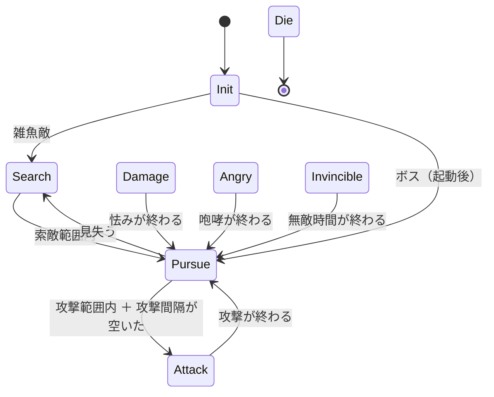
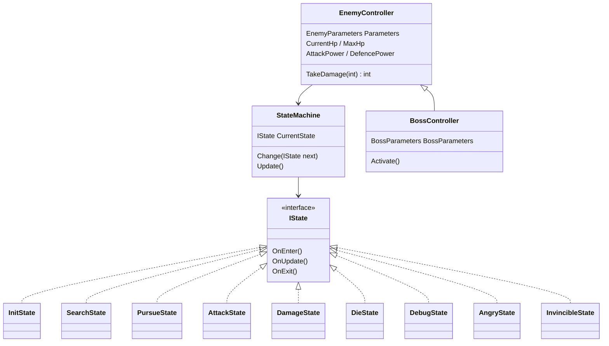

# 敵 実装設計書

> **このドキュメントは非配布です。**
> 仕様は [02-spec.md](02-spec.md) §6「敵仕様」が元です。**ずれた部分はこの設計書を正とします**（ボスの「フェーズ3段階」は、§5 の怒り・無敵に置き換えました）。
> 見た目（`_HitFlash` / `_Dissolve`）は [05-graphics.md](05-graphics.md)、Prefab の2層構造は [04-character-prefab.md](04-character-prefab.md)

---

## 1. 目的

---

- 雑魚敵とボスを **NavMesh ＋ State パターン**で動かす。状態は共通の6つ（＋開発用1つ）を基本にし、ボスは状態を足して拡張する
- 敵の数値は**1か所（`EnemyParameters`）にまとめる**。状態ごとの細かい調整値は、その状態の設定にまとめる
- 雑魚敵は頭上に HP バー、ボスは HUD の上部に HP バーを出す。プレイヤーの攻撃が当たったら、当たった位置にダメージ数を出す

---

## 2. 状態の一覧

---

| 状態 | 役割 | 次の状態 |
| --- | --- | --- |
| **InitState** | 初期化。NavMesh に乗せ、追う相手（プレイヤー）を探す。動き出してよくなるまで待つ | 雑魚敵：Search ／ ボス：起動（`Activate()`）されたら Pursue |
| **SearchState** | 周回ルートを歩いてプレイヤーを探す | 索敵範囲に入ったら Pursue |
| **PursueState** | プレイヤーを追いかける | 攻撃範囲に入り、攻撃間隔が空いていたら Attack ／ 見失ったら Search |
| **AttackState** | 振りかぶり → 当たる → 戻り | 終わったら Pursue |
| **DamageState** | 被弾して怯む | 怯みが終わったら Pursue |
| **DieState** | 倒れて、溶けて消える | なし（GameObject を破棄） |
| **DebugState**（開発用） | 棒立ち。どんな攻撃でも一撃で倒れる | デバッグを OFF にしたら Init |
| **AngryState**（ボス） | 咆哮して、攻撃力・防御力を上げる。上がった値は最後まで続く | 咆哮が終わったら Pursue |
| **InvincibleState**（ボス） | その場で構えて、一定時間ダメージを受けない | 時間が過ぎたら Pursue |

**割り込み**（どの状態からでも入る）は、状態ではなく制御クラス（`EnemyController`）が決めます。

| 優先 | 割り込み | 条件 |
| --- | --- | --- |
| 1 | **Die** | HP が 0 |
| 2 | **Debug** | デバッグモードが ON（§6） |
| 3 | **Angry**（ボス） | HP が `AngryStateTargetHp` 以下になった（一度だけ） |
| 4 | **Invincible**（ボス） | `_hitWindow` 秒の間に `_hitCountToGuard` 回被弾した |
| 5 | **Damage** | 被弾した。前回の怯みから `_staggerCooldown` 秒たっている |

- Die / Debug / Angry / Invincible の最中は、Damage の割り込みを受けない（咆哮や構えが被弾で途切れない）

---

## 3. 構造

---

- **状態は MonoBehaviour を継承しない普通のクラス**。コンストラクタで「持ち主の `EnemyController`」と「その状態の設定」を受け取る
- 持ち主は、状態が使う操作（移動・停止・向き・攻撃判定・アニメーション）と、ほかの状態のインスタンスを公開する。状態どうしは持ち主を通して切り替える（`owner.ChangeState(owner.PursueState)`）
- `StateMachine.CurrentState` が今の状態。初期値は `InitState`（`Start` で入る）
- **`EnemyHealth` と `EnemyAnimation` は廃止**して、HP は `EnemyController`、アニメーションは各状態が `CharacterVisual` 経由で送る
- 被弾の点滅・溶けて消える見た目は `CharacterVisual` に移す（プレイヤーの被弾点滅にもそのまま使える）

### 3.1 ファイル

---

| ファイル | 中身 |
| --- | --- |
| `Scripts/Core/IState.cs` / `StateMachine.cs` | 状態の型と切り替え（`CurrentState`） |
| `Scripts/Core/IDamageable.cs` | `int TakeDamage(int attackPower)`。**実際に減った HP を返す**（ダメージ数の表示に使う） |
| `Scripts/Core/CharacterVisual.cs` | Animator に加えて、マテリアルの見た目（被弾点滅・常時の色・発光・Dissolve） |
| `Scripts/Core/Billboard.cs` | いつもカメラの方を向く（HP バー・ダメージ数） |
| `Scripts/Core/DebugShapes.cs` | 開発用の線（円・扇形・球）を Scene / Game ビューに描く（§8） |
| `Scripts/Enemy/EnemyParameters.cs` | 共通の数値（§4） |
| `Scripts/Enemy/EnemyController.cs` | 共通の制御・HP・割り込み |
| `Scripts/Enemy/BossController.cs` / `BossParameters.cs` | ボスの拡張（§5） |
| `Scripts/Enemy/States/*.cs` | 状態9つと、状態ごとの設定クラス |
| `Scripts/UI/InGame/EnemyHpBar.cs` | 雑魚敵の頭上の HP バー |
| `Scripts/UI/InGame/DamageNumber.cs` / `DamageNumberSpawner.cs` | ダメージ数の表示と生成 |
| `Scripts/Debug/EnemyDebugToggle.cs` | F1 で全敵のデバッグモードを切り替える（`Demo.Debug`） |

---

## 4. パラメータ

---

### 4.1 共通（`EnemyParameters`）

---

| 名前 | 意味 | 雑魚敵 | ボス |
| --- | --- | --- | --- |
| `CurrentHp` | 今の HP（実行時の値。`ReactiveProperty`） | — | — |
| `MaxHp` | 最大 HP | 30 | 300 |
| `AttackPower` | 攻撃力。相手に渡すダメージの元 | 10 | 20 |
| `DefencePower` | 防御力。受けた攻撃力から引く | 0 | 0 |
| `SearchWalkSpeed` | Search 中の歩く速さ（m/s） | 1.5 | 2.0 |
| `PursueSpeed` | Pursue 中の速さ（m/s） | 3.0 | 3.2 |
| `AttackIntervalTime` | 攻撃を始めてから、次の攻撃を始められるまでの時間（秒） | 1.5 | 3.2 |

**ダメージの計算**：`受けるダメージ = max(1, 攻撃力 − 防御力)`。プレイヤーの攻撃力は 10 なので、雑魚敵は3発で倒れる。

### 4.2 状態ごとの設定

---

| 状態 | 設定 | 雑魚敵 | ボス |
| --- | --- | --- | --- |
| Search | 索敵範囲（m） | 10 | 45 |
| | 周回の半径（周回ポイントが無いとき。m） | 6 | — |
| | 地点で立ち止まる時間（秒） | 1.5 | — |
| Pursue | 見失う距離（m） | 15 | 100 |
| | 攻撃範囲（攻撃を始める距離。m） | 2.0 | 3.8 |
| Attack | 当たり判定を出す時間帯（`HitStartTime`〜`HitEndTime`。秒） | 0.15〜0.45 | 1.55〜2.05 |
| | 攻撃全体の長さ（`Duration`。秒） | 0.6 | 2.4 |
| | 当たり判定の球を付けるボーン（`HitBoneNames`）・半径（m） | `Head` / 0.6 | `Hand_L`・`Hand_R` / 0.9 |
| | ボーンが無いときの扇形（距離 m・前方 ±度） | 2.6 / 60 | 4.6 / 70 |
| Damage | 怯む時間（秒） | 0.5 | 0.6 |
| | 次に怯めるまでの時間（秒） | 0 | 6 |
| Die | 倒れてから溶け始めるまで（秒）・溶ける時間（秒） | 0.8 / 0.6 | 1.5 / 1.2 |

- **周回ルート**：`EnemyController` の周回ポイント（Transform の配列）を順に回る。空なら、出現位置のまわり（周回の半径）から NavMesh 上の点をランダムに選んで回る。`EncounterArea` から出す敵はポイントを持たないので、ランダムになる
- **索敵**は距離だけで判定する（視線・視野角は見ない）
- **攻撃**は Animation Event を使わず、時間で区切る。**判定はボーン（手・頭）に付けた球**なので、位置はモーションに追従する。時間帯の間は毎フレーム判定し、一度当たったらその攻撃では終わり
- ボーンが見つからない（モデルを差し替えて名前が変わった）ときは、警告を出して足元の扇形で判定する
- 時間帯と長さは攻撃モーションから決めた

| モデル | 攻撃モーション | 決め方 |
| --- | --- | --- |
| Rock Golem | `Attack01`（2.67 秒） | 0.8〜1.5 秒で振りかぶり、1.6〜2.1 秒で左腕を振り下ろして体が前に出る（いちばん前は約 1.9 秒）。Animator は 90%（2.4 秒）で移動に戻る |
| Monster Minion | `Swarm08_Attack`（16 フレーム ≒ 0.53 秒） | 短いので中ほどを時間帯にした。Animator は 90%（0.48 秒）で移動に戻る |

---

## 5. ボスの拡張

---

### 5.1 パラメータ（`BossParameters`）

---

| 名前 | 意味 | 値 |
| --- | --- | --- |
| `AngryStateTargetHp` | この HP 以下になったら怒る | 150 |
| `InvincibleTime` | 無敵の長さ（秒） | 4 |

| 調整値 | 意味 | 値 |
| --- | --- | --- |
| 怒りの攻撃力・防御力の上がり幅 | `AttackPower` / `DefencePower` に足す | +10 / +4 |
| 咆哮の長さ（秒） | AngryState にいる時間（咆哮モーション Victory が戻り始めるまで） | 2.4 |
| 無敵に入る被弾数・数える時間 | この秒数の間にこの回数当てられたら構える | 5 回 / 3 秒 |

- 怒ったあとは、プレイヤーの攻撃（10）が `max(1, 10 − 4) = 6` になる
- 怒りは**一度だけ**。上がった値は倒されるまで続く。怒っている間は体がうっすら赤く光る（`_EmissionColor`）
- 無敵の間は、体を白っぽく光らせる（`_HitFlash` を常時かける）。攻撃は当たるが、ダメージ数は `0` と出る
- ボスは Search を使わない。部屋に入った時点でプレイヤーを知っている

### 5.2 起動と決着

---

- `BossController.Activate()`（ボス登場の演出のあと）で Init → Pursue
- `Activated` / `Defeated` は今までどおり。`Defeated` は HP が 0 になった瞬間に流れる
- 前の `Phase`（3段階）は廃止。かわりに `IsAngry` を公開する
- 攻撃が当たる時間帯に入った瞬間に `EnemyController.AttackImpact` が流れる（当たったかどうかに関係なく）。ボスでは「地面叩きつけ」として、ボス戦の篝火を弱くする（[10-level-design.md](10-level-design.md) §7）

---

## 6. デバッグモード（DebugState）

---

| 切り替え方 | 範囲 |
| --- | --- |
| `EnemyController` の Inspector の **Debug Mode** | その敵だけ |
| **F1 キー** | 全部の敵（`EnemyController.DebugModeForAll`） |

- どちらかが ON なら Debug に入る。両方 OFF に戻ったら Init からやり直す（HP はそのまま）
- F1 は `Demo.Debug` アセンブリの `EnemyDebugToggle` が読む。**Editor と `APP_DEBUG` のビルドでだけ動く**。シーンには置かず、起動時に自分で作られる
- 前のテスト用部品 `OneHitKillOnTouch`（触れると即死）は削除

---

## 7. HP バー・ダメージ数

---

### 7.1 雑魚敵の HP バー

---

- `DemoEnemyNormal` の子に World Space の Canvas（`HpBar`）を置く。`Billboard` でカメラを向く
- 高さは `Start` で**モデルの見た目（Visual の Renderer の範囲）のてっぺん ＋ 0.35 m** に合わせる。モデルを差し替えても頭の上に出る
- 中身は背景と中身の2枚の Image。中身の横幅（`localScale.x`）を `CurrentHp / MaxHp` にする（Image の Filled はスプライトが要るので使わない）
- 倒れたら消す

### 7.2 ボスの HP バー

---

- HUD の Canvas の上部中央に `BossHpGroup`（名前・背景・中身）を置く
- `HudPresenter` がボスを購読し、`Activated` で出し、`CurrentHp` で中身を合わせ、`Defeated` で消す

### 7.3 ダメージ数

---

- `PlayerAttack.Hit` が `AttackHit`（相手・当たった位置・実際のダメージ）を流す
- DemoPlayer の `DamageNumberSpawner` がそれを聞いて、`Prefabs/UI/DamageNumber.prefab`（TextMeshPro の3D文字 ＋ `Billboard`）を当たった位置に生成する
- 生成した文字は上に浮かびながら薄くなり、消える（0.8 秒）。ダメージ 0（無敵）は灰色

---

## 8. 開発用の表示

---

状態が切り替わる距離と、攻撃の当たり判定を**再生中に線で描きます**。描くのは `DebugShapes`（`Scripts/Core/`）です。

- **Scene ビューと Game ビューの両方に出る**。Gizmos ボタンやスクリプトごとの表示設定に左右されない。壁の向こうでも見える
- Editor と `APP_DEBUG` のビルドだけで動く（`[Conditional]`。それ以外のビルドでは呼び出しごと消える）
- 敵は `EnemyController` の **Draw Debug**、プレイヤーは `PlayerAttack` の **Draw Gizmo** で消せる
- 再生していないときは、敵・プレイヤーを選ぶと Gizmos で範囲を確かめられる

### 8.1 状態が切り替わる距離（敵の足元の円）

---

| 色 | 距離 | 切り替わり |
| --- | --- | --- |
| 黄 | `Search` の索敵範囲 | Search → Pursue |
| 橙 | `Pursue` の見失う距離 | Pursue → Search |
| 赤 | `Pursue` の攻撃範囲 | Pursue → Attack |
| 水色（Search 中だけ） | `Search` の周回の半径 | 周回ルートが空のときの、ランダムに選ぶ範囲 |

- **いま判定に使っている円だけ濃く**、ほかは薄く描く（Search 中は黄、Pursue / Attack 中は橙と赤）
- Scene ビューでは、足元に今の状態の名前（`SearchState` など）も出す

### 8.2 攻撃の当たり判定

---

| | 形 | 描き方 |
| --- | --- | --- |
| **敵**（ボーンあり） | ボーンに付いた球（`HitRadius`） | 攻撃中だけ描く。薄い橙：まだ判定を出していない ／ 濃い橙：判定中 ／ 当たったら、その位置に赤い球（0.3 秒） |
| **敵**（ボーンなし） | 足元の扇形（`HitRange` ・前方 ±`HitAngle` 度） | 薄い赤：普段 ／ 濃い橙：判定中 ／ 当たったら赤い球 |
| **プレイヤー**（`PlayerAttack`） | 球（`_radius`。Visual の前方 `_forwardOffset`・上 `_heightOffset`） | 薄い橙：いま攻撃したら出る位置 ／ 攻撃した直後：当たったら赤、外れたら白 |

- **敵の判定を合わせるとき**は、球がモーションのどこで濃い橙になるかを見て `HitStartTime` / `HitEndTime` を動かす。届かないときは `HitRadius`、または近づく距離（`Pursue` の `AttackRange` と NavMeshAgent の Stopping Distance）を変える
- プレイヤーの判定の基準（Visual）は足元にあるので、`_heightOffset`（0.9 m）で球を胸の高さに上げた。前は球の中心が地面にあった
- プレイヤーの判定を合わせるときは `PlayerAttack` の `_radius` / `_forwardOffset` / `_heightOffset`

> 線は `Hidden/Internal-Colored`（組み込みの単色シェーダー）で、1フレームぶんを1つのメッシュにまとめて `Graphics.RenderMesh` で描く。一時停止中は消える。

---

## 9. 確認したいこと

---

| # | 内容 | 案 |
| --- | --- | --- |
| 1 | ボスの無敵の条件 | ✅ 連続被弾（3 秒に 5 発）で構えて無敵 |
| 2 | ボスの怒りの条件 | ✅ HP 50%（150）で一度。以降ずっと |
| 3 | デバッグモードの切り替え | ✅ Inspector（個体）＋ F1（全体） |
| 4 | `OneHitKillOnTouch` | ✅ 削除 |

---

## 10. 実装状況

---

| # | 項目 | 状態 |
| --- | --- | --- |
| 1 | 状態9つ・`EnemyController` / `BossController`・`EnemyParameters` / `BossParameters`・状態ごとの設定 | ✅ |
| 2 | `CharacterVisual` に見た目を移す・`EnemyHealth` / `EnemyAnimation` / 旧状態4つ / `OneHitKillOnTouch` の削除 | ✅ |
| 3 | `IDamageable.TakeDamage` が実際のダメージを返す・`PlayerAttack.Hit` が `AttackHit` を流す | ✅ |
| 4 | `EnemyDebugToggle`（F1）。`Demo.Debug.asmdef` の references に `Unity.InputSystem` | ✅ |
| 5 | `EnemyHpBar`・`Billboard`・`DamageNumber` / `DamageNumberSpawner`・`HudView` / `HudPresenter` のボス HP バー | ✅ |
| 6 | Prefab：`DemoEnemyNormal`（`HpBar` を追加）・`DemoEnemyBoss`・`DemoPlayer`（`DamageNumberSpawner`）・`Prefabs/UI/DamageNumber` | ✅ |
| 7 | `AC_EnemyGolem` に `Roar`（トリガー）と `Roar` ステート（`Victory`）を追加 | ✅ |
| 8 | DemoInGame：`HudGroup/BossHpGroup`（`BossName`・`Background/Fill`）、`HudView` / `HudPresenter` の参照 | ✅ |
| 9 | 実際に遊んで確認 | ✅ 動作は確認。HP バーを頭の上に合わせ、開発用の表示（§8）を追加し、判定をボーンの球に変えた。**攻撃モーションの振り下ろしと判定の出るタイミングはまだ合っていない**（ブラッシュアップで直す） |

### 10.1 シーン・Prefab の中身

---

| 場所 | 中身 |
| --- | --- |
| `DemoEnemyNormal/HpBar` | World Space Canvas（100 × 12、Scale 0.01 → 1 m × 0.12 m、高さは実行時に頭の上へ合わせる）＋ `Billboard` ＋ `EnemyHpBar`。子に `Background`（黒 60%）→ `Fill`（赤。Pivot x 0） |
| `Prefabs/UI/DamageNumber` | TextMeshPro（3D 文字、Font Size 4、影なし）＋ `Billboard` ＋ `DamageNumber` |
| `Canvas/HudGroup/BossHpGroup` | 上部中央（900 × 74）。最初は非表示。`BossName`（ROCK GOLEM）と `Background/Fill`。演出中は `HudGroup` ごと隠れる |
