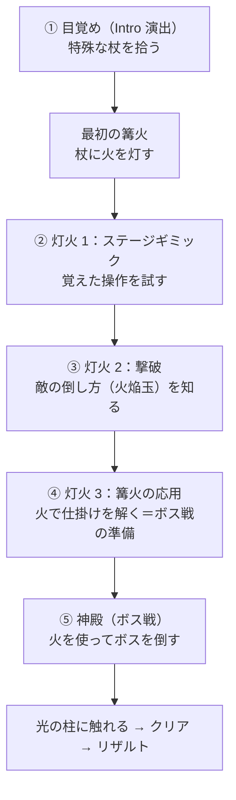
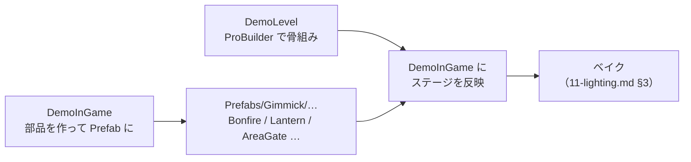
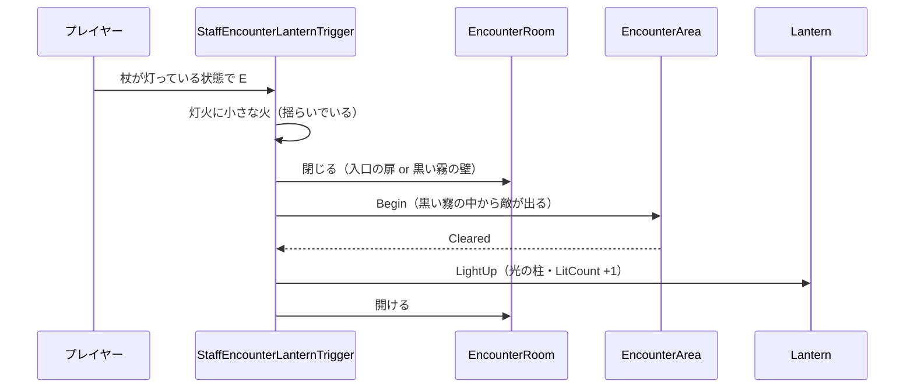
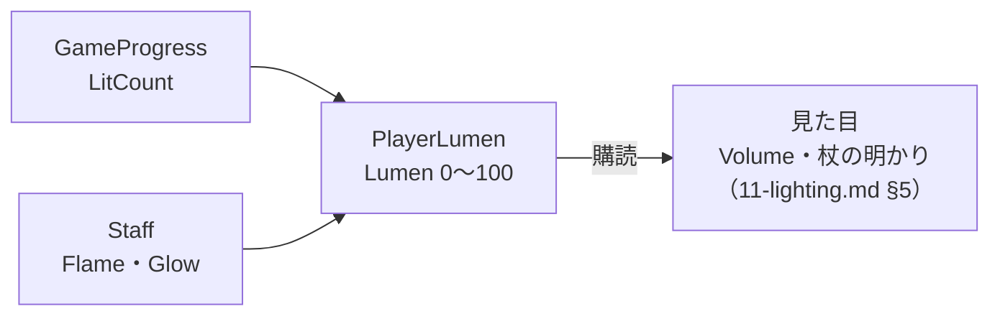
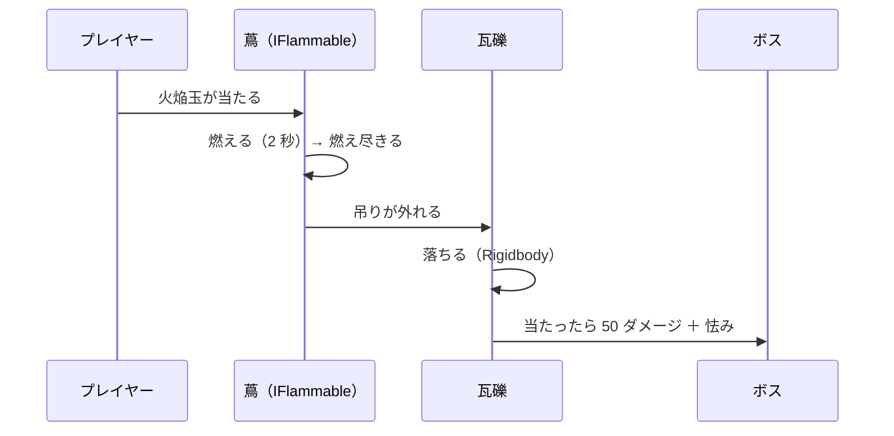
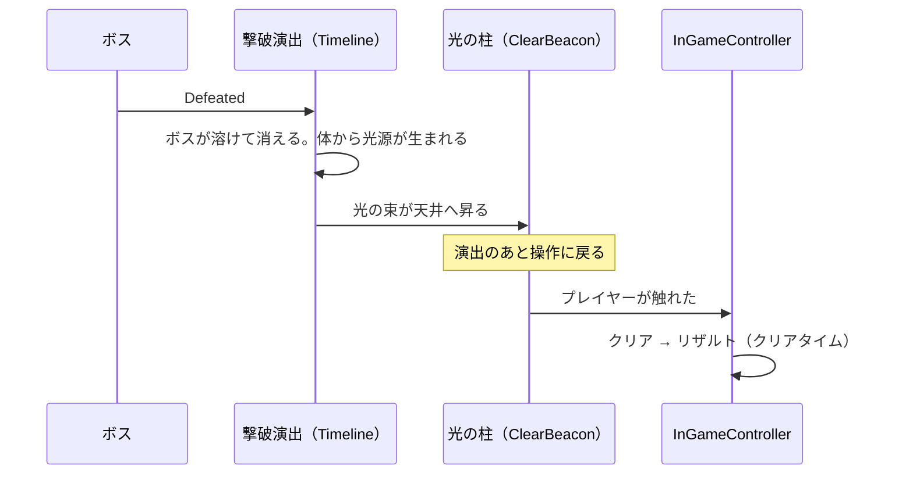
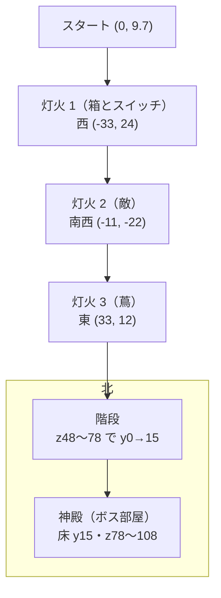

# レベルデザイン設計書（ステージ構成・杖と火焔玉・Lumen）

> **このドキュメントは非配布です。**
> **状態：実装（2026-10-02）。エフェクトは仮。通しの動作確認はまだ（§11）。** 決まっていないものは §10。
> 企画書 [01-concept.md](01-concept.md) §3（塔・ハブ構造）と仕様書 [02-spec.md](02-spec.md) §3・§5・§7 から**大きく変えました。ずれた部分はこの設計書を正とします。**
> 明るさの描き方（Volume・霧・ライト）は [11-lighting.md](11-lighting.md)、エフェクトの一覧は [12-vfx.md](12-vfx.md)

---

## 1. 変えたこと

---

| | 前（[01-concept.md](01-concept.md)） | **今（この設計書）** |
| --- | --- | --- |
| **舞台** | 灯の消えた塔（屋内・部屋の連なり） | **少し暗く、霧のかかった野外のフィールド**（オープンワールド風）。最奥のボス部屋だけ屋内 |
| **攻略の順番** | ハブから3方向。どの順でもよい | **順番が決まっている**（§3） |
| **灯の点け方** | ギミックを解くと点く（または E） | **篝火から杖に火を移し、その火で灯火を点ける** |
| **攻撃** | 剣を振る（1種） | **杖で殴る（弱い）＋ 火焔玉（強い・チャージ3段階）** |
| **明るさ** | 灯が点くとエリアが暖色に | **Lumen（視界の明るさ）という値を持つ。** 灯火・杖の火・チャージで上がり、火焔玉で下がる |
| **クリア** | ボスの HP が 0 | ボスを倒すと光の柱が立ち、**それに触れたらクリア** |

**芯は変えません。** 「暗い場所に光が戻っていく」が、エリアの明るさ（灯火）と、手元の明るさ（杖の火）の2つに分かれただけです。

---

## 2. 用語

---

| 用語 | 中身 | 今の実装との対応 |
| --- | --- | --- |
| **杖**（Staff） | 導入で拾う特殊な杖。武器であり、火を運ぶ道具 | 今の剣（`WeaponSocket` の `PlayerAttackWeaponDefault`）を置き換える |
| **杖の火**（Flame） | 杖に灯っている火の量。0 なら消えている | 新規 |
| **篝火**（Bonfire） | ステージの各地に置かれた、いつも燃えている火。視界の確保と、杖に火を移す場所 | 新規 |
| **灯火**（Lantern） | 3つある進行の目標。杖の火で点ける。点くと光の柱が天に昇り、霧が少し晴れる | 今の `Lantern` |
| **火焔玉**（Fireball） | 杖が灯っているときに振ると出る弾。チャージできる | 新規 |
| **Lumen** | プレイヤーの視界の明るさ（0〜100） | 新規 |

---

## 3. 進行

---

### 3.1 流れ

---

| # | 場所 | プレイヤーが覚えること | 主な要素 |
| --- | --- | --- | --- |
| ① | **目覚めの地** | 移動・視点切替・杖で殴る | Intro 演出で杖を拾う。殴って壊す障害物 |
| ② | **灯火 1** | 覚えた操作を組み合わせる。篝火 → 杖 → 灯火 の流れ | 箱をスイッチに載せて扉を開けたままにする（§4.4） |
| ③ | **灯火 2** | 敵には殴りより火焔玉が効く。撃ちすぎると暗くなる | 灯火に火をつけると敵が出てくる。全滅で灯火が完成する（§4.4）。近くに篝火 |
| ④ | **灯火 3** | 火は武器以外にも使える（燃やす・運ぶ） | 蔦を燃やして道を開く・遠くの篝火から火を運ぶ |
| ⑤ | **神殿** | ③④で覚えたことを使ってボスを倒す | ボス戦の篝火・蔦と瓦礫（§7） |

### 3.2 順番を固定する方法

---

**次のエリアへの道は、前の灯火を点けると開きます。** 霧の濃さと道の開き方の両方で見せます。

| 灯火を点けた数 | 開く道 | 見せ方 |
| --- | --- | --- |
| 0 | 目覚めの地 → 灯火 1 | 最初から開いている |
| 1 | 灯火 1 → 灯火 2 | 霧が晴れて、道の先の篝火が見えるようになる |
| 2 | 灯火 2 → 灯火 3 | 同上 |
| 3 | 灯火 3 → 神殿 | 神殿の扉の紋様が3つとも消えて開く（今の `BossDoorSeal`。[08-timeline.md](08-timeline.md) §4） |

- 道をふさぐのは **`AreaGate`**（新規）。`GameProgress.LitCount` を購読し、指定の数になったら開く。ふさぐ物の見た目（倒木・岩・魔法の壁など）はステージ制作のときに決める
- 「霧で見えない」だけで道をふさがない（霧はすり抜けられるので、迷う原因になる）

### 3.3 フィールドの形

---

- **一本道を太くしたフィールド**にする。広場（灯火のあるエリア）を道でつなぎ、道の途中に篝火を置く
- 広場どうしは**遠くから見える**位置関係にする。点いた灯火の光の柱が、次に向かう方向の目印になる
- 大きさの目安：1エリア 30〜40 m 四方、道 15〜25 m。全体で 1周 8〜10 分（[01-concept.md](01-concept.md) の表）に収める
- ステージの造形（モジュールパーツ・地形）は [00-tasks.md](00-tasks.md) §3.6 で決める

### 3.4 ステージの作り方（シーンの分け方）

---

| シーン | 何をする所か |
| --- | --- |
| **`DemoLevel.unity`** | **ステージの骨組み（地形・道・建物）を ProBuilder で作る所。** 遊びの部品は置かない |
| **`DemoInGame.unity`** | 遊びの部品（篝火・灯火・ギミック・敵・道をふさぐ物）を作って動かす所。**部品は1つずつ Prefab にする** |

- **部品は、ステージのどこに置いても動くように作る**（Prefab を置いて、参照を数個つなぐだけで動く）。シーンの物を名前で探さない
- 最後に、DemoLevel の骨組みを DemoInGame の `LevelRoot` の下に移し、今の仮配置（Cube のモック）と置き換える。部品の Prefab をステージに合わせて置き直す
- ステージの動かない物は Layer `Level` にしておく（[11-lighting.md](11-lighting.md) §2）。**DemoLevel の中でも `LevelRoot` の下に作っておく**と、移すときにそのまま持っていける

---

## 4. 杖と篝火

---

### 4.1 杖

---

| 項目 | 内容 |
| --- | --- |
| **入手** | 導入演出（Intro）の中で拾う。拾うまでは攻撃できない |
| **状態** | **消えている**（Flame = 0）／ **灯っている**（Flame > 0） |
| **杖の火の量**（Flame） | 0〜100。篝火で 100 に戻る。火焔玉を撃つと減る（§5.3）。**時間では減らない** |
| **杖の光の段**（Glow） | 0〜3。**篝火で「点けた灯火の数」まで強く光る。** チャージショットで使った段だけ下がる（§5.2）。灯火を点ける前は 0 のまま |
| **杖の明かり** | 杖の先に Point Light（Realtime）。明るさ・届く距離は Lumen で変わる（[11-lighting.md](11-lighting.md) §5） |
| **見た目** | 杖の先の火のエフェクトが、火の量で大きさを、**光の段で明るさと色**（橙 → 黄 → 白）を変える（[12-vfx.md](12-vfx.md) #2） |

### 4.2 篝火

---

| 項目 | 内容 |
| --- | --- |
| **置き場所** | ステージの各地。**道の途中と、各エリアの入口**。「暗くて見えない」区間が長く続かない間隔で置く |
| **役割** | ① まわりを照らす（視界の確保） ② **近くで E（Kindle）を押すと、杖を持った右腕を炎へ伸ばし（IK）、届いた瞬間に火が移る**：Flame を 100 に、Glow を「点けた灯火の数」に（§4.5） |
| **いつも燃えている** | ステージに置く篝火は消えない。ライトは Mixed でベイクする（[11-lighting.md](11-lighting.md) §4） |
| **ボス戦の篝火** | ボスの行動・ギミックで**途中から出てくる**篝火。**ボスの地面叩きつけで1段ずつ弱くなり、3回で消える**。ライトは Realtime（§7） |
| **実装** | `Bonfire`（`IInteractable`）。杖を持っていて、まだ満タン・最大の光でないときだけ E が出る。ボス戦の篝火は `Strength`（3〜0）を持ち、0 で消える |

### 4.3 灯火の点け方

---

| 項目 | 内容 |
| --- | --- |
| **条件** | **杖が灯っている状態で、灯火の近くで E（Light）。** 腕を灯火へ伸ばし、届いた瞬間に点く（§4.5） |
| **杖の火** | 減らない（灯火に「移す」のではなく「分ける」） |
| **点いたとき**（灯火 2 は全滅したとき。§4.4） | 光の柱が天まで昇る（[12-vfx.md](12-vfx.md) #9）。霧が少し晴れ、フィールド全体が少し明るく暖色に寄る（[11-lighting.md](11-lighting.md) §5）。`GameProgress.LitCount` を +1 |
| **エリアのギミックとの関係** | ギミックは「灯火のそばに行ける／触れられるようにする」ところまで。**点けるのは毎回、杖の火**にする |
| **実装** | 新しい点灯条件 `StaffLanternTrigger`（`IInteractable`）。`Lantern` は「点く」ことしか知らないまま（[06-gimmick.md](06-gimmick.md) §4） |

### 4.4 灯火ごとの仕掛け

---

| 灯火 | 仕掛け | 点け方 |
| --- | --- | --- |
| **1** | 灯火は扉の奥。**スイッチを踏んでいる間だけ扉が開く。** 降りると短い時間（1 秒）で閉じるので、人が乗って走っても間に合わない。**箱を押してスイッチに載せる**と開いたままになる | 扉を抜けて、杖の火で点ける |
| **2** | 灯火に杖の火をつけると、**火が揺らいで敵が出てくる**（まわりが閉じて逃げられない）。全滅させると灯火が燃え上がる | 杖の火で点ける → 全滅で完成（ここで光の柱・`LitCount` +1） |
| **3** | 灯火が蔦で覆われている。**杖が灯った状態で蔦に近づいて E（Burn）か、火焔玉を当てる**と燃える。遠くの篝火から火を運ぶ区間を入れる | 蔦が燃え尽きたら、杖の火で点ける |

**灯火 1：スイッチと扉**

| 項目 | 内容 |
| --- | --- |
| スイッチ | `PressurePlate` を「乗っている間は押されている」にする。**プレイヤーと箱の両方**で押される（今はプレイヤーだけ） |
| 扉 | 押されたら開く。**離されたら 1 秒で閉じ始める**（今の `TimedDoor` は押されてから 5 秒で閉じる → 変える） |
| 解き方 | 箱をスイッチまで押す → 扉が開いたままになる → 扉を抜ける |
| 今の部品 | `PressBox`・`PlayerBoxPusher`（箱押しと両手 IK）・`SlidingDoor`・`PressurePlate`・`TimedDoor` を流用する（[06-gimmick.md](06-gimmick.md) §5・§6） |

**灯火 2：火をつけると敵が出る**

- 部品：`StaffEncounterLanternTrigger`（新規）。今の `EncounterLanternTrigger`（全滅で点く）と `EncounterRoom`（部屋に入ったら戦闘）を、「**火をつけたら戦闘**」につなぎ直す
- 敵が出てくる見た目は [12-vfx.md](12-vfx.md) #26

### 4.5 火を移すアクション（腕を伸ばす）

---

篝火から杖へ・杖から灯火へ・杖から蔦へ、**火を移すときは毎回同じアクション**にします。「つけた」手応えを出すためです。

| 項目 | 内容 |
| --- | --- |
| **入力** | E（インタラクト）。HUD に `[E] Kindle`（篝火）／ `[E] Light`（灯火）／ `[E] Burn`（蔦） |
| **動き** | 対象の方を向き、杖を持った右腕を 0.3 秒で対象の TargetPoint（篝火の炎・灯火の中心・蔦の表面）まで伸ばす → 届いた瞬間に火が移る → 0.25 秒止めて、0.3 秒で戻す |
| **その間** | 歩けない・攻撃できない |
| **実装** | `PlayerStaffReach`（DemoPlayer のルート）が、右腕だけの Rig（`Rig_Reach`。Two Bone IK）の Weight を 0 → 1 → 0。箱押しの `Rig_Hands` とは別の Rig |
| **TargetPoint** | 篝火は `_reachPoint`（未設定なら炎）、灯火は `_reachPoint`（未設定なら見た目の中心）、蔦はプレイヤーの胸に一番近い表面 |

---

## 5. 攻撃（殴る・火焔玉）

---

### 5.1 入力

---

**攻撃ボタン1つで、杖の状態によって出るものが変わります。**

| 杖 | 押してすぐ離す | 押し続けて離す |
| --- | --- | --- |
| 消えている | **殴る**（今の剣の振りと同じ） | 殴る（チャージしない） |
| 灯っている | **火焔玉（チャージなし）** | **チャージして火焔玉（1〜3段）**。溜められるのは杖の光の段（Glow）まで |

- 入力は今の `Attack`（左クリック・ゲームパッド West）のまま。押した・離したを取れるようにする（Hold は Input System の Interaction ではなく、押していた時間で数える）
- TPS では**カメラの向き**に撃つ。FPS では画面の中央に撃つ
- 押している間は歩ける（走れない）

### 5.2 チャージ

---

| 段 | 押していた時間 | 解放の条件 |
| --- | --- | --- |
| 0（チャージなし） | 〜0.4 秒 | 最初から |
| 1 | 0.4〜0.8 秒 | 灯火を **1つ** 点けたあと |
| 2 | 0.8〜1.2 秒 | 灯火を **2つ** 点けたあと |
| 3 | 1.2 秒〜 | 灯火を **3つ** 点けたあと |

- **溜められるいちばん上の段 = 杖の光の段（Glow）。** Glow は篝火で「点けた灯火の数」まで上がる。最初（灯火 0）はチャージできない
- **撃つと、使った段だけ Glow が下がる**（Glow 3 で 2段を撃つと Glow 1 が残る）。強い攻撃を撃つほど杖の光が弱まり、視界が暗くなる（§6）→ 篝火に戻って光らせ直す
- 段が上がるたびに、杖の先のエフェクトと、**画面の周りの炎**が強くなる（[11-lighting.md](11-lighting.md) §5.3、[12-vfx.md](12-vfx.md) #5）
- 押している間に杖の火（Flame）が足りなくなったら、その段で止める

### 5.3 数値（仮。実際に遊んで調整）

---

| 攻撃 | ダメージ | 杖の火を使う量 | 弾の大きさ・速さ |
| --- | --- | --- | --- |
| 殴る | **5** | 0 | （近接。今の判定） |
| 火焔玉（チャージなし） | **15** | 10 | 小・速い |
| 火焔玉 1段 | **22** | 15 | 小 |
| 火焔玉 2段 | **30** | 20 | 中 |
| 火焔玉 3段 | **60** | 35 | 大・着弾で範囲（半径 2 m） |

- 雑魚敵（HP 30）：殴ると6発、火焔玉（チャージなし）で2発、2段で1発。**「殴るより火焔玉」が数字でもわかる**
- ボス（HP 300）：火焔玉を当て続けるだけだと杖の火が足りない → 篝火とギミックを使う（§7）
- 今の `PlayerAttack._damage`（10）は殴りの 5 に下げる
- 敵の「火に弱い」は数値だけで表す（属性の仕組みは作らない）

### 5.4 実装の分け方（案）

---

| クラス | 責務 |
| --- | --- |
| `Staff`（新規） | 杖の火（`ReactiveProperty<float> Flame`）・光の段（`ReactiveProperty<int> Glow`）・`Refill(glow)`／`Use(flame, glow)`。持っているか（`IsOwned`） |
| `PlayerAttack`（変更） | 押した・離したを受けて、殴る／チャージ／火焔玉を出す。チャージの段（`ReactiveProperty<int> ChargeLevel`）を公開 |
| `Fireball`（新規） | 弾。まっすぐ飛び、当たったら `IDamageable` にダメージ。燃える物（`IFlammable`）に当たったら燃やす |
| `IFlammable`（新規） | 火焔玉・杖の火で燃える物（蔦など）。`Ignite()` |

---

## 6. Lumen（視界の明るさ）

---

### 6.1 決め方

---

**Lumen = 灯火の分 ＋ 杖の火の分 ＋ 杖の光の分**（0〜100）

| 要素 | 値 | 内容 |
| --- | --- | --- |
| **灯火の分**（ふだんの明るさ） | 0灯：20 ／ 1灯：35 ／ 2灯：50 ／ 3灯：65 | 灯火を点けるほど、**ふだんの視界**が上がる |
| **杖の火の分** | 0〜20（Flame / 100 × 20） | 杖が灯っていると上がる。火焔玉で減る |
| **杖の光の分** | Glow × 5（0〜15） | 篝火で強く光らせると上がる。チャージショットで使うと下がる |

- **最大の 100 は「灯火3つ ＋ 杖の火が満タン ＋ 杖が3段まで光っている」とき**（＝3段チャージを撃てる状態）
- 杖の火も光も時間では減らない（撃ったときだけ減る）。「撃ちすぎると暗くなる」を、撃った本人がわかるようにする
- 値の変化は 0.5 秒かけて追いかける（急に明るさが跳ねない）

### 6.2 どこに置くか

---

| 項目 | 内容 |
| --- | --- |
| **クラス** | `PlayerLumen`（新規。DemoPlayer のルート）。`ReadOnlyReactiveProperty<float> Lumen` を公開するだけ |
| **`GameProgress` に入れない理由** | `GameProgress` は「世界の進み具合」（灯火の数）。Lumen は**プレイヤーの今の状態**（杖の火・チャージ）を含むので、プレイヤー側に置く |
| **見た目は購読する側が決める** | `PlayerLumen` は Volume もライトも知らない（灯が「点いた」としか言わないのと同じ向き。[02-spec.md](02-spec.md) §7.1） |

---

## 7. ボス戦（神殿）

---

**火を使ってボスを倒す**場所です。火焔玉だけで押し切れない量にし、篝火とギミックを使わせます。

| 仕掛け | 内容 |
| --- | --- |
| **出てくる篝火** | 戦いの途中（開始時・怒ったとき）に、床から篝火が出てくる。**杖を近づけると必ずフルチャージ**（Flame 100・Glow 3）。**ボスが地面を叩きつけるたびに、部屋の篝火がすべて1段ずつ弱くなり、3回で消える**（炎とライトが段ごとに小さくなる）。消えたら次の篝火が出てくるのを待つ |
| **燃える蔦と瓦礫** | 天井から蔦で瓦礫が吊られている。**蔦を火焔玉で燃やすと瓦礫が落ちる。** ボスに当たると大ダメージ（50）＋ 怯み。ボスを下に誘い込むのが攻略 |
| **地面叩きつけ** | ボスの攻撃。前の地面に予兆の印が出てから、叩きつけて衝撃波が広がる（[12-vfx.md](12-vfx.md) #14） |
| **怒り** | HP 150 以下で怒る（[09-enemy.md](09-enemy.md) §5）。体のまわりに炎のオーラ（[12-vfx.md](12-vfx.md) #15） |

- 蔦と瓦礫の組は 3〜4 か所。使い切っても倒せるように、火焔玉と殴りでも削れる量にする
- 部品：`BurnableVine`（`IFlammable`）・`FallingRubble`・`BossBonfireSpawner`（新規）

---

## 8. クリア

---

- 撃破演出は新しい Timeline（`BossDefeat`）。[08-timeline.md](08-timeline.md) の仕組み（`CutscenePlayer`）にそのまま乗せる
- **クリアの瞬間が「ボスの HP が 0」から「光に触れた」に変わる。** クリアタイムは触れた時点で止める
- リザルトは今のまま（クリアタイム）。何を出すかは作ってみて決める（[00-tasks.md](00-tasks.md) §3.5）

---

## 9. 今の実装への影響

---

| 今あるもの | 変えること |
| --- | --- |
| `PlayerAttack` | 押した・離した、チャージ、火焔玉の発射。殴りのダメージを 5 に |
| `InputReader` | `Attack` の押した・離したを両方流す |
| 剣（`PlayerAttackWeaponDefault`） | 杖のモデルに差し替え（モデルは未選定。仮は Cylinder ＋ 先端の球） |
| `Lantern` ／ `InteractLanternTrigger` | 点灯条件を `StaffLanternTrigger`（杖が灯っていて E）に |
| `PressurePlate` ／ `TimedDoor` | 乗っている間だけ押される（箱でも押される）。離されたら 1 秒で閉じる（灯火 1） |
| `EncounterRoom` ／ `EncounterLanternTrigger` | 部屋に入ったら戦闘 → 灯火に火をつけたら戦闘（`StaffEncounterLanternTrigger`。灯火 2） |
| `GameProgress` | 変えない（`LitCount` だけ）。Lumen は `PlayerLumen` に置く |
| `InGameController` | クリアをボス撃破から `ClearBeacon` に触れたときへ |
| Intro 演出（[08-timeline.md](08-timeline.md) §3） | 杖を拾う場面を足す。拾うまで攻撃を止める |
| ボス撃破 | 撃破演出（`BossDefeat`）を足す |
| `DemoInGame` の仮配置 | ハブ型から一本道に組み直す（ステージ制作のとき） |

---

## 10. 決まっていないこと

---

| # | 内容 | 今の案 |
| --- | --- | --- |
| 1 | 灯火 1〜3 にどのギミックを割り当てるか | ✅ 1：箱をスイッチに載せて扉を開けておく ／ 2：火をつけると敵が出る ／ 3：蔦を燃やす（§4.4） |
| 2 | 杖が灯っているとき、殴りを出す手段を残すか | ✅ 残さない（灯っているときは必ず火焔玉） |
| 3 | 杖の火を時間でも減らすか | ✅ 減らさない。篝火で杖を光らせ、その段までチャージできる（§4.1・§5.2） |
| 4 | 使えるチャージの段と灯火の数の対応 | ✅ 篝火で杖が「点けた灯火の数」の段まで光り、その段まで溜められる。最初（灯火 0）はチャージできない（§5.2） |
| 5 | ボス戦の篝火が叩きつけで消えるか | ✅ 叩きつけ1回で1段弱くなり、3回で消える（§7） |
| 6 | 杖のモデル | 未選定（[03-asset-candidates.md](03-asset-candidates.md) に足す） |

---

## 11. 実装状況（2026-10-02）

---

> エフェクトは [12-vfx.md](12-vfx.md) §7（Particle System）。光の柱の本体は、まだ縦に伸ばした円柱。
> コードは Unity でコンパイル済み（21:22 時点）。そのあとの変更（灯火の `_blockers`・シーン・Prefab の第2弾）は次のコンパイル待ち。**通しの動作確認はまだ。**

### 11.1 作ったもの

---

| 機能 | クラス | Prefab ／ アセット |
| --- | --- | --- |
| 杖 | `Staff`（Flame・Glow・`Acquire`・`Refill`・`Use`）／ `StaffVisual` | `Prefabs/Weapon/Staff.prefab`（剣と差し替え。中の fileID を剣とそろえた） |
| 導入で杖を拾う | `StaffPickup`。`InGameIntro` が演出の終わり（スキップでも）に `PickUp()` | `Prefabs/Gimmick/StaffPickup.prefab`。DemoInGame の DemoPlayer は `_ownedOnStart` OFF |
| 攻撃 | `PlayerAttack`（殴る 5／火焔玉 4段・チャージ・カメラの正面へ）／ `InputReader.AttackReleased`／ `PlayerController.IsSprintLocked` | 段の数値は DemoPlayer の `Fireball Stages` |
| 火焔玉 | `Fireball`（SphereCast・3段は範囲）。**Object Pool**（`UnityEngine.Pool`。`PlayerAttack` が持つ） | `Prefabs/Weapon/Fireball.prefab` |
| 燃える物 | `IFlammable` ／ `BurnableVine`（火焔玉か E で燃える → 燃え尽きて消える → 吊った瓦礫を落とす。`_blockers` が残っている間は E で燃やせない） | `Prefabs/Gimmick/BurnableVine.prefab`（蔦の壁）／ `VineRubble.prefab`（蔦と瓦礫） |
| 篝火 | `Bonfire`（E で補給。ボス戦用は弱くなる・フルチャージ） | `Prefabs/Gimmick/Bonfire.prefab` ／ `Bonfire_Boss.prefab`（Variant） |
| Lumen | `PlayerLumen` |
| 火を移すアクション | `PlayerStaffReach`（§4.5）。DemoPlayer の `unitychan/Rig_Reach`（右腕の Two Bone IK）を RigBuilder に足した | 見た目は [11-lighting.md](11-lighting.md) §8 |
| 灯火の点け方 | `InteractLanternTrigger`（**杖が灯っていないと点けられない**。`_encounterRoom` を入れると「火をつけたら敵が出る」。`_blockers` が残っている間は点けられない）／ `Lantern.Kindle()`（火だけ）／ `LightPillar`（光の柱） | `Lantern.prefab` に `Pillar` を足した |
| 灯火 1 のスイッチと扉 | `PressurePlate`（プレイヤーと箱で押される・`Released`）／ `SwitchBase.Released`・`IsPressed` ／ `TimedDoor`（`Hold`：押されている間だけ開き、離されたら 1 秒で閉じる。`Timed`：前のまま） | |
| 灯火 2 の戦闘 | `EncounterRoom`（`_beginOnEnter` OFF なら `Begin()` で始まる・`Cleared`） | |
| 道をふさぐ物 | `AreaGate`（点けた灯火の数で、扉を開ける／ふさぐ物を溶かして消す） | `Prefabs/Gimmick/AreaGate.prefab`（仮：半透明の魔法の壁） |
| ボス戦の篝火 | `BossBonfireSpawner`（ボスが動き出したら・怒ったら床からせり上がる。ボスの攻撃の瞬間 `Bonfire.WeakenAll()`。全部消えたら 8 秒後にまた出る）／ `EnemyController.AttackImpact` | |
| 瓦礫 | `FallingRubble`（落ちている間にボスに当たると 50。プレイヤーには当たらない） | `VineRubble.prefab` の中 |
| クリア | `ClearBeacon`（触れたら `Touched`）／ `BossDefeatDirector`（倒れて溶けたら光が生まれ、`BossDefeat` を再生）／ `InGameController._clearBeacon`（あれば光に触れたらクリア） | `Prefabs/Gimmick/ClearBeacon.prefab` ／ `Timeline/BossDefeat.playable`（6 秒。カメラ1台） |

### 11.2 設計から変えたところ

---

| 設計 | 実際 | 理由 |
| --- | --- | --- |
| `StaffLanternTrigger` を新しく作る | 今の `InteractLanternTrigger` に「杖が灯っていること」を足した | 灯の Prefab とシーンの参照をそのまま使える |
| `StaffEncounterLanternTrigger` を新しく作る | `InteractLanternTrigger._encounterRoom` | 同じ「E で点ける」の違いは、点いたあとに戦闘を挟むかどうかだけ |
| 導入演出の中で杖を拾う | 導入演出が**終わったとき**に拾う（地面の杖が消えて持つ） | Timeline に拾う場面のカットを足すのは、尺の調整のとき（[08-timeline.md](08-timeline.md) §7） |
| ボス撃破の演出で光源が生まれる | 倒れて溶けたあと（2.7 秒）に光を出し、そこから `BossDefeat` を再生 | ボスは溶けたら Destroy されるので、光は別の物（`ClearBeacon`）にした |

### 11.3 DemoInGame の仮配置（DemoLevel の配置に合わせた。2026-10-02）

---

> DemoLevel（講師が置いた大まかなエリア・プレイヤーの初期位置・ボス部屋の瓦礫の位置）に合わせて、DemoInGame の部品を置き直しました。**地形はまだ仮**（地面は `TestGround`、各エリアの中は前のモックの壁を回して置いただけ）。順番は **灯火 1 → 2 → 3 → ボス**。

| 場所 | DemoLevel の目印 | DemoInGame で置いたもの（ワールド座標） |
| --- | --- | --- |
| スタート | `DemoPlayer` (0, 0, 9.7) | `DemoPlayer` (0, 0, 9.7)・`StaffPickup`・`Bonfire_Start` を足元に |
| 灯火 1 | `GimmickRoomArea`（x -44〜-22, z 14〜34） | `LanternArea_B` を (-36.5, 0.5, 23.75)・Y -90°（入口が東＝スタート側）。手前に `Bonfire_B` (-18, 0, 19) |
| 灯火 2 | `GimmickRoomArea2`（x -22〜0, z -36〜-9） | `LanternArea_C` を (-10.7, 0.5, -22.4)・Y 90°（入口が北）。入口の外に `AreaGate_C`、手前に `Bonfire_C` (-5, 0, -9) |
| 灯火 3 | `GimmickRoomArea3`（x 22〜44, z 3〜22） | `LanternArea_A` を (32.7, 0.5, 12.5)・Y 90°（段差が奥＝東）。少し離して `Bonfire_A` (16, 0, 4) |
| 階段 | `Starirs` | **DemoLevel の ProBuilder をそのまま写した**（`LevelRoot/StageBlockout/Stairs`。Layer `Level`）。下に `Bonfire_Boss_Entrance` (7, 0, 44) |
| 神殿 | `BossArea`（x ±15, y 15〜35, z 78〜108。前の面なし） | 部屋は ProBuilder を写した（`StageBlockout/TempleRoom`）。`BossArea`（部品のまとめ）を (0, 15.1, 40.3) に動かし、扉を 10×10（`_openOffset` y -10.2）、扉の左右と上を壁でふさいだ（`Wall_Left / Right / Top`） |
| 瓦礫 | `BossRockGimmicRoot` の `RockRoot` ×9（y 24.7） | `VineRubble_1〜9` を同じ 9 か所に（瓦礫の中心が y 24.7）。ボスは (0, 15.1, 95.2)、`ClearBeacon` も同じ位置 |
| ボス戦の篝火 | （なし） | `Bonfire_Boss_L` (-11, 15.1, 92.7)（左の空いた所）・`Bonfire_Boss_R` (6.5, 15.1, 88.7)（瓦礫の間。ボスを誘い込む） |
| 演出のカメラ | | ボス側（`CM_Intro_Door`・`CM_Seal`・`CM_Boss_*`・`CM_BossDefeat`）は BossArea と同じだけずらした。導入の引きのカメラは少し高く・遠く |
| 霧の点 | | `FogPoint_*` を各エリアの中心へ |

- DemoLevel の `GimmickRoomArea*`（閉じた箱）は写していない（入口がないため）。エリアの壁はステージを作るときに作り直す
- **ベイクと NavMesh**：ライトはベイクし直しが要る。NavMesh は実行時に作る（`NavMeshBaker`）ので、写した階段と部屋の床にも乗る
- 写した ProBuilder の階段・部屋は、DemoLevel 側を直しても自動では変わらない。本番のステージを反映するとき（[00-tasks.md](00-tasks.md) §3.6）に置き換える

### 11.4 まだのもの

---

- エフェクトの見た目の調整（[12-vfx.md](12-vfx.md) §7。一通りは作った）
- 導入演出に杖を拾うカットを足す（[08-timeline.md](08-timeline.md)）
- 灯火 3 の「遠くの篝火から火を運ぶ」区間（ステージ制作で）
- HUD に杖の火・光の段を出すか（今は杖の先の明るさだけで見せている）
