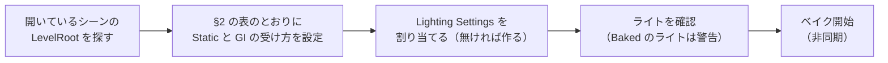
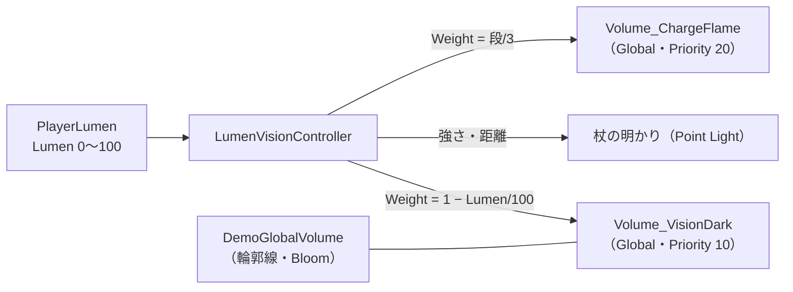

# ライティングと視界 設計書（Mixed ライティング・ベイク・Lumen の見せ方）

> **このドキュメントは非配布です。**
> **状態：実装（2026-10-02。§8）。ライトの配置・Probe はステージが組み上がってから合わせる。数値は仮。**
> シェーダーは [05-graphics.md](05-graphics.md)、Lumen の決め方（ゲームのルール）は [10-level-design.md](10-level-design.md) §6、エフェクトは [12-vfx.md](12-vfx.md)

> 調整の場所（どこを触れば何が変わるか）は [13-graphics-tuning.md](13-graphics-tuning.md) にまとめた。

---

## 1. 方針

---

| 対象 | ライティング | 理由 |
| --- | --- | --- |
| **ステージの動かない物**（地面・壁・岩・建物） | **ベイク（間接光をライトマップに）** | 開けたフィールドでも、間接光の計算を実行時にしなくてよい |
| **キャラクター・動くギミック**（箱・扉・瓦礫） | **Realtime ＋ Light Probe** | 動くのでライトマップに焼けない |
| **直接光** | **すべて実行時に計算する（Mixed / Realtime）** | トゥーンの段（[05-graphics.md](05-graphics.md) §4）は直接光で作る。直接光を焼くと段が消えてグラデーションになる |

### 1.1 Mixed Lighting Mode は Baked Indirect

---

| モード | 静的な物の直接光 | 静的な物の影 | トゥーンに合うか |
| --- | --- | --- | --- |
| **Baked Indirect（採用）** | 実行時 | 実行時（Shadow Distance 内） | ✅ 直接光がシェーダーを通るので、段がそのまま出る |
| Shadowmask | 実行時 | 遠くは焼いた影 | △ シェーダーに Shadowmask の対応が要る。遠景の影が要るほど広くない |
| Subtractive | **ライトマップに焼く** | 焼く | ❌ 主光源の直接光がライトマップに入り、段が出ない |

- ライトマップに入るのは**間接光（跳ね返り）と空の光だけ**。シェーダーは今もライトマップを「環境光」として足しているので（`ToonAmbient`）、**シェーダーの変更は要らない**
- 影は実行時。Shadow Distance は今の 50 m（`PC_RPAsset`）。フィールドの見通しに合わせて、ステージを組んでから調整する

---

## 2. レイヤーと LevelRoot

---

**ベイクする物は「`LevelRoot` の下にあって、レイヤーが `Level`」の物だけです。**

```
DemoInGame
├── LevelRoot                  ← ステージの置き場。ここより下だけを見る
│   ├── Terrain / Ground       Layer: Level   → ベイクする
│   ├── Ruins/…                Layer: Level   → ベイクする
│   ├── Bonfire_01             Layer: Level（台座）／ Default（炎のエフェクト）
│   ├── LanternArea_1
│   │   ├── Ledge              Layer: Level   → ベイクする
│   │   ├── PressBox           Layer: Interactable → 動く。Light Probe
│   │   └── Lantern            Layer: Interactable → Light Probe
│   └── GameSystem             Layer: Default → 何もしない
├── DemoPlayer                 LevelRoot の外 → 動く
└── DemoEnemy…                 LevelRoot の外 → 動く
```

| 判定 | Static の設定 | GI の受け方 |
| --- | --- | --- |
| `LevelRoot` の下 ＋ Layer `Level` | Contribute GI・Occluder・Occludee・Reflection Probe・Batching | **Lightmaps** |
| `LevelRoot` の下 ＋ それ以外のレイヤー | すべて外す | **Light Probes** |
| `LevelRoot` の外 | 触らない | （各自。キャラは Light Probes） |

- **レイヤーで分ける理由**：同じ「ギミックのエリア」の中に、動かない段差と動く箱が混ざる。親子関係では分けられないので、物ごとにレイヤーで持たせる
- レイヤーは **User Layer 9 に `Level`** を足す（`ProjectSettings/TagManager.asset` → [setup.md](../setup.md) §6）
- 当たり判定のレイヤーは今のまま使える（`PlayerAttack` は全レイヤー、`PlayerInteractor` は `Interactable` だけを見る）

---

## 3. ベイクの仕組み

---

### 3.1 Lighting Settings

---

`Graphics/Settings/LS_DemoInGame.lighting`（Lighting Settings アセット）を DemoInGame に割り当てます。

| 項目 | 値 | 理由 |
| --- | --- | --- |
| Realtime Global Illumination | OFF | Enlighten は使わない |
| Baked Global Illumination | ON | |
| Lighting Mode（Mixed） | **Baked Indirect** | §1.1 |
| Lightmapper | Progressive GPU | |
| Directional Mode | **Non-Directional** | トゥーンはライトマップの向きを使わない。容量が半分 |
| Lightmap Resolution | 8 texel/unit（仮） | 野外で広いので低め。ステージを組んでから上げ下げする |
| Ambient Occlusion（ベイク） | OFF | SSAO（[05-graphics.md](05-graphics.md) §4）と二重にしない |
| Max Lightmap Size | 1024 | |

### 3.2 ベイクのメニュー

---

**`DemoGame > Lighting > Bake Level`**（Editor 専用スクリプト `LevelLightBaker`）で、次を順に行います。



| メニュー | すること |
| --- | --- |
| `Bake Level` | 上の流れを全部 |
| `Apply Static Flags` | Static と GI の受け方の設定だけ（ベイクしない）。何を変えたかをログに出す |
| `Clear Baked Data` | ベイクした結果を消す |

- 設定はシーンに保存される（Undo できる）。**ベイクの前にシーンを保存しておく**
- ライトマップ（`DemoInGame/` フォルダの LightingData・Lightmap）は**シーンと一緒に `.unitypackage` に入れる**。配布先でベイクし直さなくてよい

### 3.3 Light Probe・Reflection Probe

---

**ステージが完成してから置きます。今は置かない。**

| | 置き方 | いつ |
| --- | --- | --- |
| **Light Probe Group** | 道とエリアの、キャラの腰の高さ（0.5 m・1.8 m）の2段。明るさが変わる所（篝火のまわり・建物の入口）を細かく | ステージ完成後 |
| **Reflection Probe** | **基本は置かない。** `DemoGame/Toon` は鏡面反射を持たない（[05-graphics.md](05-graphics.md) §4）ので、効く物が無い | 水面など反射の要る物を足したときだけ |

> Light Probe が無いうちは、キャラの環境光は空の色（Ambient）になります。暗いフィールドでキャラが浮きすぎないかは、Probe を置いたあとで見ます。

---

## 4. ライトの一覧

---

| ライト | 種類 | Mode | 影 | 実行時に変えるもの |
| --- | --- | --- | --- | --- |
| **主光源（月の光）** | Directional | **Mixed** | Soft | 色・強さ（灯火の数。§5.1） |
| **篝火（ステージに置く物）** | Point | **Mixed** | なし | 揺らぎ（強さを少し揺らす。Realtime 側だけが揺れる） |
| **灯火** | Point | **Realtime** | なし | 点灯で ON（点くまで消えている＝焼けない） |
| **篝火（ボス戦で出てくる物）** | Point | **Realtime** | なし | 出てきたら ON |
| **杖の明かり** | Point | **Realtime** | なし | 強さ・届く距離（Lumen。§5.2） |
| **火焔玉** | Point | **Realtime** | なし | 弾と一緒に動く。範囲は狭く（3〜5 m） |
| **光の柱**（灯火・クリア） | Point または Spot | **Realtime** | なし | 柱が出たら ON |

- **Baked のライトは使わない**（直接光を焼くと段が消える。§1）。メニュー（§3.2）で見つけたら警告を出す
- **途中で点く・消える・出てくるライトは Realtime。** Mixed のライトを消しても、焼いた間接光は残ってしまうため
- 追加ライトの影は使わない（数が多く、トゥーンでは追加ライトは「当たっているか」だけ見ているので効果が薄い）
- Forward+ なので、追加ライトの数の上限は気にしなくてよい（[05-graphics.md](05-graphics.md) §1.2）

---

## 5. 明るさの変化（灯火と Lumen）

---

**2つの明るさを分けて描きます。**

| | **世界の明るさ** | **視界の明るさ（Lumen）** |
| --- | --- | --- |
| 何で決まるか | 点けた灯火の数（`GameProgress.LitCount`） | `PlayerLumen.Lumen`（[10-level-design.md](10-level-design.md) §6） |
| 変えるもの | 主光源・霧・空の色 | 画面全体の Volume・杖の明かり・画面の周りの炎 |
| 担当 | `WorldLightingController`（新規） | `LumenVisionController`（新規） |

### 5.1 世界の明るさ（灯火の数）

---

| 灯火 | 主光源 | 霧（RenderSettings の Fog・Exponential Squared） | 霧のエフェクト（[12-vfx.md](12-vfx.md) #22 地面の霧・#23 黒い霧） |
| --- | --- | --- | --- |
| 0 | 寒色・弱い（0.3） | 濃い（Density 0.035） | 多い |
| 1 | | 0.025 | |
| 2 | | 0.015 | |
| 3 | 暖色寄り・やや強い（0.8） | 薄い（0.008） | 少ない |

- 灯火が点いたら、**3 秒かけて**次の段の値へ動かす（光の柱が昇る演出と合わせる）
- **ライトマップの物には、実行時の環境光（Ambient）の変更が効かない。** 明るさの変化は主光源と霧で出す（主光源は Mixed ＝直接光は実行時なので効く）
- **霧の色は黒に近い寒色から始める**（ステージ全体を覆う黒い霧。[12-vfx.md](12-vfx.md) #23）。灯火を点けるほど明るく、暖色寄りに。シェーダーは `MixFog` で霧を受けているので、エフェクトにもかかる

### 5.2 視界の明るさ（Lumen）

---

**「暗い」側の Volume を1枚用意し、その重み（Weight）を Lumen で動かします。** 自作の VolumeComponent は作りません。



| Volume | 中身（Override） | Weight |
| --- | --- | --- |
| `DemoGlobalVolume`（今ある物） | 輪郭線・Bloom | 1 のまま |
| **`Volume_VisionDark`**（新規） | Vignette（強さ 0.55・暗い寒色）／ Color Adjustments（Post Exposure −1.2・Saturation −35）／ Shadows Midtones Highlights（影を寒色に） | **1 − Lumen / 100** |
| **`Volume_ChargeFlame`**（新規） | `FlameVignetteVolume`（自作。§5.3）／ Bloom の Intensity を少し上げる | **チャージの段 / 3** |

- Lumen 100 で暗さが 0（何もかからない）、Lumen 20（最初）でほぼ全部かかる
- **Volume の値をスクリプトで書き換えない。** 重みを変えるだけにする（プロファイルを共有アセットのまま使える）
- 杖の明かり：強さ 0.5〜2.0、届く距離 4〜10 m を Lumen で補間（杖が消えているときは Lumen の「灯火の分」だけの弱い明かり）

### 5.3 画面の周りの炎（チャージ）

---

チャージの段に応じて、**画面の縁が燃える**演出を全画面のポストエフェクトで描きます。

| 部品 | 種類 | 内容 |
| --- | --- | --- |
| `FlameVignetteVolume` | `VolumeComponent` | `Intensity`（0 で描かない）・色（HDR）・縁からの幅・揺らぎの速さ |
| `FlameVignetteRendererFeature` / `FlameVignettePass` | Renderer Feature（Render Graph） | 輪郭線（[05-graphics.md](05-graphics.md) §5）と同じ作り。`BeforeRenderingPostProcessing` に差し込み、**Bloom で光らせる** |
| `DemoFlameVignette.shader` | HLSL（全画面） | 画面の縁からの距離 × ノイズ（`T_Noise` を上へ流す）で炎の形を作り、加算する |

| 段 | 見え方 |
| --- | --- |
| 0 | なし |
| 1 | 画面の四隅がわずかに揺らめく |
| 2 | 縁全体に炎。下側が強い |
| 3 | 縁の炎が大きく、色が白っぽく明るくなる（Lumen 最大） |

---

## 6. 今のシーンからの移し方

---

| # | すること |
| --- | --- |
| 1 | User Layer 9 に `Level` を足す（済） |
| 2 | 今の仮配置（`TestGround`・各エリアの壁・`Ledge`）を Layer `Level` にする。`BossDoor`・`SlidingDoor`・`PressBox`・`Lantern` は今のまま |
| 3 | `LevelRoot` の下の `Directional Light` を Mixed にする（今は Realtime） |
| 4 | `DemoGame > Lighting > Bake Level` |
| 5 | ステージを組んだら、2〜4 をやり直す。Light Probe を置く |

> 今のモックはハブ型なので、本番のステージ（一本道のフィールド。[10-level-design.md](10-level-design.md) §3.3）を組んだら作り直します。それまではベイクの流れの確認用です。
> ステージの骨組みは `DemoLevel.unity` で作り、最後に DemoInGame の `LevelRoot` へ移します（[10-level-design.md](10-level-design.md) §3.4）。
> メニューは**アクティブなシーンの `LevelRoot`** を見るので、DemoLevel でも試しに焼けます（DemoLevel にも `LevelRoot` を作っておく）。

---

## 7. 決まっていないこと

---

| # | 内容 | 今の案 |
| --- | --- | --- |
| 1 | 霧を Unity の Fog だけにするか、高さのある霧（地面を這う霧）をシェーダーに足すか | まず Unity の Fog ＋ 霧のエフェクト（[12-vfx.md](12-vfx.md) #22）。足りなければ高さの霧を検討 |
| 2 | 空（Skybox） | 今はデフォルト。暗い夜空のグラデーションにする（ステージ制作のとき） |
| 3 | 各数値（霧の濃さ・主光源の強さ・Volume の中身） | 仮。ステージを組んで見ながら決める |

---

## 8. 実装状況

---

| # | 項目 | 状態 |
| --- | --- | --- |
| 1 | User Layer 9 `Level`（`TagManager.asset`。setup.md に追記）。無いときはメニューが足す | ✅ |
| 2 | `Scripts/Editor/LevelLightBaker.cs`（`DemoGame > Lighting` のメニュー）と `DemoGame.Editor.asmdef`（Editor 専用） | ✅ コンパイル済み。**メニューの実行（ベイク）はまだ** |
| 3 | `LS_DemoInGame.lighting`（メニューから作られる） | ⏳ 初回の `Bake Level` で作られる |
| 4 | 仮配置のレイヤー分け・主光源を Mixed に（§6 の 2〜3） | ✅ 地面・各エリアの壁・段差・ボス部屋の壁を Layer `Level`。主光源を Mixed。霧を ON（Exponential Squared。ビルドで霧のバリアントが消えないよう、シーンでも ON にしておく） |
| 5 | `WorldLightingController`（§5.1） | ✅ DemoInGame の `WorldLighting`。主光源・霧の色と濃さを灯火の数（0〜3）で 3 秒かけて変える |
| 6 | `PlayerLumen`・`LumenVisionController`・`Volume_VisionDark`（§5.2） | ✅ `Graphics/Settings/DemoVisionVolumes.prefab`（`Volume_VisionDark`＝`VP_VisionDark`：Vignette・Color Adjustments ／ `Volume_ChargeFlame`＝`VP_ChargeFlame`）。**杖の明かりは Lumen ではなく `StaffVisual` が火の量・光の段で決めている**（Lumen とほぼ同じ動き） |
| 7 | `FlameVignetteVolume` / Renderer Feature / シェーダー（§5.3） | ✅ `FlameVignetteVolume`・`FlameVignetteRendererFeature`・`FlameVignettePass`・`DemoFlameVignette.shader`。`PC_Renderer` に追加（`BeforeRenderingPostProcessing`。Game カメラだけ） |
| 8 | Light Probe（§3.3） | ⏳ ステージ完成後 |
