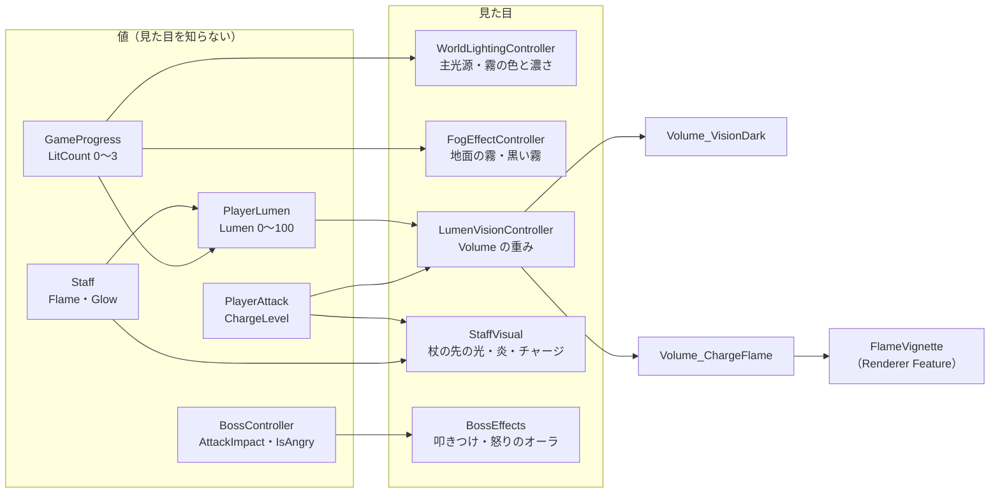
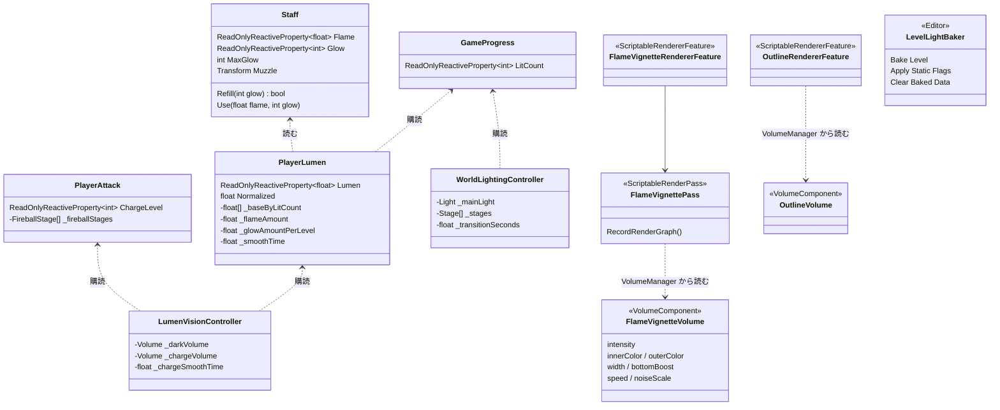
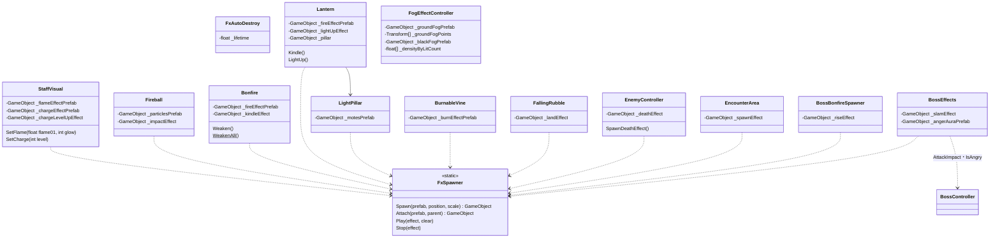

# 見た目の設定と調整ガイド（ライティング・Volume・エフェクト）

> **このドキュメントは非配布です。**
> **状態：2026-10-02 時点の実装に合わせて書いた。数値はすべて仮（Unity で見ながら調整する）。**
> 「どこを触れば何が変わるか」をまとめたものです。仕組みの理由は各設計書を見てください。
> ライティング・視界は [11-lighting.md](11-lighting.md)、エフェクトは [12-vfx.md](12-vfx.md)、シェーダー・輪郭線は [05-graphics.md](05-graphics.md)、Lumen のルールは [10-level-design.md](10-level-design.md) §6

---

## 1. 全体の流れ

---

**値を持つ側（進行・プレイヤー）は見た目を知りません。** 見た目の側が値を購読して、ライト・Volume・エフェクトを動かします。

---

## 2. クラス図

---

### 2.1 ライティング・Volume

---

### 2.2 エフェクト

---

- **1回だけのエフェクト**は `FxSpawner.Spawn` で出し、Prefab のルートの `FxAutoDestroy` が消す
- **ループのエフェクト**（炎・霧など）は `FxSpawner.Attach` で親の子に付ける。親の拡縮を打ち消すので、エフェクトの大きさは Prefab のまま。篝火の炎は `_flame` の子なので、篝火が弱くなると一緒に小さくなる
- 部品はエフェクトの **Prefab を参照するだけ**。部品の Prefab の中にエフェクトを入れ子にしていない

---

## 3. ライティングの調整

---

### 3.1 ベイク

---

| すること | 場所 |
| --- | --- |
| 焼く物を決める | ステージの動かない物を **`LevelRoot` の下・Layer `Level`** に置く。動く物（箱・扉・灯火・篝火の当たり）は別のレイヤーのまま |
| 焼く | メニュー **`DemoGame > Lighting > Bake Level`**（Static の設定 → Lighting Settings の割り当て → ベイク） |
| 設定だけ直す | `DemoGame > Lighting > Apply Static Flags`（何を変えたかがコンソールに出る） |
| 焼いた結果を消す | `DemoGame > Lighting > Clear Baked Data` |
| ライトマップの細かさ | `Graphics/Settings/LS_DemoInGame.lighting`（最初の Bake Level で作られる）の Lightmap Resolution（今は 8） |
| Light Probe | ステージ完成後に、道とエリアに Light Probe Group を置く（腰の高さ 0.5 m・1.8 m の2段） |

> **直接光は焼かない**（Mixed Lighting Mode = Baked Indirect）。Baked のライトがあると、メニューが警告を出します。

### 3.2 ライト

---

| ライト | 場所 | Mode | 調整するもの |
| --- | --- | --- | --- |
| 主光源（月の光） | `LevelRoot/Directional Light` | Mixed | 色と強さは **`WorldLighting` が実行時に上書きする**（§3.3）。向き・影はこのライトで |
| 篝火 | `Bonfire.prefab/Point Light` | Mixed | Intensity 2.5・Range 10。揺らぎは `Bonfire` の `Flicker Amount` / `Flicker Speed` |
| ボス戦の篝火 | シーンの `Bonfire_Boss_L / R`（Bonfire にボス用の上書き） | Realtime | `Weakest Scale`（いちばん弱い段の大きさ） |
| 灯火 | `Lantern.prefab/Point Light` | Realtime | 点くまで消えている。火だけの間は `Kindled Ratio`（0.35）の明るさ |
| 杖の明かり | `Staff.prefab/Model/Muzzle` | Realtime | `StaffVisual` の `Light Intensity Min / Max / Per Glow`・`Light Range / Per Glow` |
| 火焔玉 | `Fireball.prefab/Point Light` | Realtime | Range 4（段の大きさの平方根で広がる） |
| 光の柱 | `Lantern.prefab/Pillar/Point Light` ／ `ClearBeacon.prefab` | Realtime | 柱が伸びるのに合わせて明るくなる（`LightPillar` の `Rise Seconds`） |

- 影の届く距離：`Assets/Settings/PC_RPAsset` の Shadow Distance（今は 50 m）

### 3.3 世界の明るさ（灯火の数）

---

**DemoInGame の `WorldLighting`（`WorldLightingController`）の `Stages`**（0〜3 灯の4段）

| 項目 | 0 灯 | 3 灯 | 効き方 |
| --- | --- | --- | --- |
| Light Color / Intensity | 寒色・0.3 | 暖色寄り・0.8 | 主光源（ライトマップの物にも効く） |
| Fog Color | 黒に近い寒色 | 暖かい暗い色 | ステージ全体の黒い霧の色 |
| Fog Density | 0.035 | 0.008 | Exponential Squared。上げると遠くが早く沈む |
| Transition Seconds | 3 | | 次の段へ移る時間 |

- シーンの Lighting ウィンドウの Fog（Environment）も ON・Exponential Squared にしてある。**OFF にするとビルドで霧のシェーダーが消える**ので、OFF にしない
- Ambient（環境光）を変えても、ライトマップの物には効かない。明るさは主光源と霧で出す

---

## 4. Volume の調整

---

| Volume | 場所 | Priority | 中身（プロファイル） | 重み |
| --- | --- | --- | --- | --- |
| `DemoGlobalVolume` | シーン（`Graphics/Settings/DemoGlobalVolume.prefab`） | 0 | `DemoGameVolumeProfile`：輪郭線（Outline）・Bloom | 1 のまま |
| `Volume_VisionDark` | `DemoVisionVolumes` の子 | 10 | `VP_VisionDark`：Vignette（強さ 0.55・暗い寒色）・Color Adjustments（Post Exposure −1.2・Saturation −35・Color Filter 寒色） | **1 − Lumen / 100**（暗いほど強い） |
| `Volume_ChargeFlame` | `DemoVisionVolumes` の子 | 20 | `VP_ChargeFlame`：Flame Vignette（強さ 1）・Bloom（強さ 1） | **チャージの段 / 3** |

- **暗さを変えたい**：`VP_VisionDark` の中身を変える（重みはスクリプトが動かすので触らない）
- **視界が暗くなり始める所を変えたい**：`PlayerLumen`（DemoPlayer のルート）の `Base By Lit Count`（20 / 35 / 50 / 65）・`Flame Amount`（20）・`Glow Amount Per Level`（5）
- **チャージの炎の見え方**：`VP_ChargeFlame` の Flame Vignette

| Flame Vignette の項目 | 意味 |
| --- | --- |
| Intensity | 炎の強さ（0 で描かない）。重みが掛かるので、ここは最大の段の強さ |
| Inner / Outer Color | 芯と外側の色（HDR。Bloom で光る） |
| Width | 画面の縁からの幅 |
| Bottom Boost | 下側をどれだけ強くするか |
| Speed / Noise Scale | 炎が昇る速さ・揺らぎの細かさ |

- 描いているのは `Assets/Settings/PC_Renderer` の `FlameVignetteRendererFeature`（ポストエフェクトの前。Game カメラだけ）。Scene ビューには出ない

### 4.1 輪郭線

---

| 変えたいもの | 場所 |
| --- | --- |
| 画面全体の線の太さ・濃さ・色 | `DemoGameVolumeProfile` の Outline（Volume でエリアごとに変えられる） |
| オブジェクトごとの線の強さ | マテリアルの **Outline Strength**（0 = 線なし）。今は目まわり 0・顔と頬 0.5・ボス 0.7 |

---

## 5. エフェクトの調整

---

### 5.1 共通

---

| ルール | 内容 |
| --- | --- |
| 置き場所 | Prefab は `Graphics/Effects/FX_*`、テクスチャは `Graphics/Textures/FX/`、マテリアルは `Graphics/Materials/Effect/M_FX_*` |
| 中身 | ルートは空で、**子がパーティクル**（炎・火の粉・煙など）。1つずつ選んで Particle System を直す |
| 色 | **設定した色の 2 倍の明るさで出る**（エフェクト経路が頂点の Custom Data を発光として足すため）。色は 1 以下で書く |
| 大きさ | 親の拡縮に従う（Scaling Mode = Hierarchy）。篝火・火焔玉の段はこれで大きくしている |
| 1回だけのもの | ルートの `FxAutoDestroy` の `Lifetime` を、いちばん長く残る粒の寿命より長くしておく |
| マテリアル | 加算（`M_FX_FlameAdd`・`M_FX_DotAdd`・`M_FX_RingAdd`）／ アルファ（`M_FX_SmokeAlpha`・`M_FX_FogAlpha`）。地面に触れる物は Soft Particle Distance で交線を消す |

### 5.2 エフェクトごとの調整場所

---

| エフェクト | Prefab | Prefab の外で効く設定 |
| --- | --- | --- |
| 篝火・灯火の炎 | `FX_Fire` | 篝火の強さで小さくなる（`Bonfire` の `Weakest Scale`）。灯火は火だけのとき半分 |
| 杖の火 | `FX_StaffFlame` | `StaffVisual` が数（火の量・光の段）と大きさ（光の段・チャージ）を掛ける |
| チャージ | `FX_Charge` ／ `FX_ChargeLevelUp` | `StaffVisual`：1段以上で出て、段の数だけ多くなる。段が上がった瞬間に輪 |
| 火が移る・灯火の点灯 | `FX_Kindle` | 出る位置は杖を伸ばした先（`Bonfire` の `Reach Point`）・灯の中心 |
| 火焔玉 | `FX_Fireball` | 段の大きさ：DemoPlayer の `PlayerAttack` の `Fireball Stages` の `Scale` |
| 着弾 | `FX_FireballImpact` | 同じく段の `Scale` で大きくなる |
| 殴りの当たり | `FX_MeleeHit` | |
| 光の柱の粒 | `FX_PillarMotes` | 柱の本体（円柱）は `Lantern.prefab/Pillar/Beam`（高さは Beam の Scale Y＝25 → 50 m）・`M_FX_LightPillar` |
| 敵の消滅 | `FX_EnemyDeath` | `EnemyController` の `Death Effect Scale`（雑魚 1・ボス 2.5） |
| 敵の出現 | `FX_EnemyAppear` | `EncounterArea` の `Spawn Effect` |
| 地面叩きつけ | `FX_Slam` | DemoInGame の `BossArea/BossEffects` の `Slam Forward`（ボスの前、何 m に出すか） |
| 怒りのオーラ | `FX_AngerAura` | 形はボスの体（SkinnedMeshRenderer）に実行時に合わせる |
| 蔦が燃える | `FX_VineBurn` | 形は蔦のメッシュに実行時に合わせる。燃える時間は `BurnableVine` の `Burn Seconds` |
| 砂煙 | `FX_Dust` | 瓦礫の着地・ボス戦の篝火がせり上がるとき |
| 地面を這う霧 | `FX_GroundFog` | 置き場所：DemoInGame の `FogEffects/FogPoint_*`（Transform を動かす・増やしたら `Ground Fog Points` に足す） |
| 黒い霧 | `FX_BlackFog` | カメラについていく。濃さは `FogEffects` の `Density By Lit Count`（1 / 0.7 / 0.45 / 0.2） |

---

## 6. よくある調整

---

| 困っていること | まず触る所 |
| --- | --- |
| 最初のエリアが暗すぎる | `VP_VisionDark` の Post Exposure を上げる → `PlayerLumen` の `Base By Lit Count` の最初を上げる → `WorldLighting` の 0 灯の Light Intensity |
| 霧が濃すぎて先が見えない | `WorldLighting` の Fog Density（0 灯）を下げる → `FogEffects` の `Density By Lit Count` |
| 光の柱が遠くから見えない | 霧に消されている。Fog Density を下げるか、`M_FX_LightPillar` の色を明るくする |
| 杖の明かりが弱い | `StaffVisual` の `Light Intensity Max`・`Light Range` |
| 炎が大きすぎる・小さすぎる | 各 `FX_*` の子の Start Size。篝火だけなら `Bonfire.prefab/Visual/Flame` の Scale |
| チャージの炎がうるさい | `VP_ChargeFlame` の Flame Vignette の Intensity・Width |
| 目のまわりに線が出る | そのマテリアルの Outline Strength を 0 |
| Bloom が強すぎる | `DemoGameVolumeProfile` の Bloom の Threshold を上げる・Intensity を下げる（チャージ中は `VP_ChargeFlame` の Bloom が足される） |
