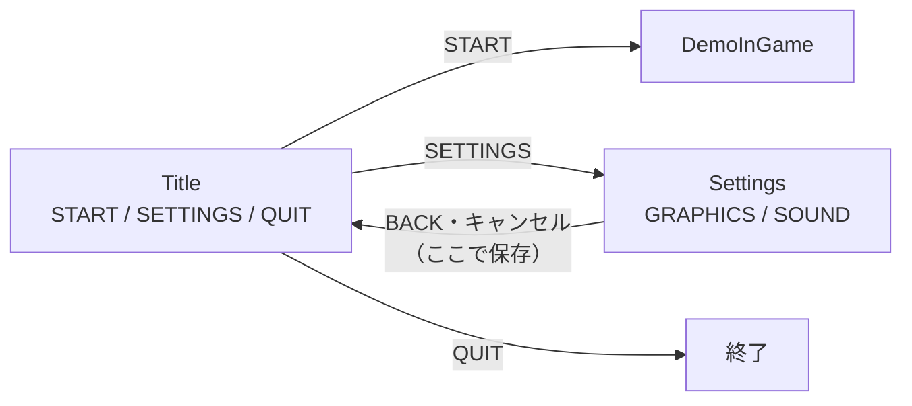
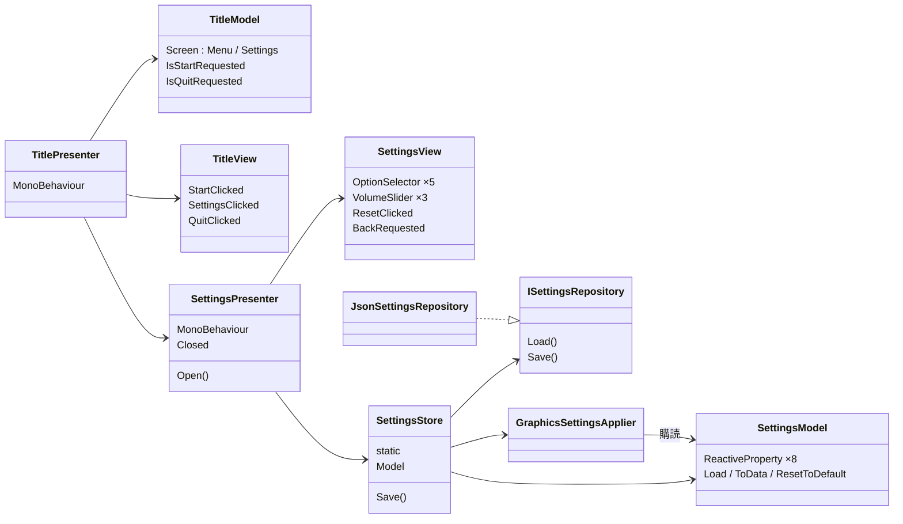

# 『LUMEN』アウトゲーム（タイトル・設定）設計書

> **このドキュメントは非配布です。**
> タイトル画面 `DemoTitle.unity` と、設定画面・設定の保存の構造をまとめます。
> 仕様書（[02-spec.md](02-spec.md) §8・§9）とずれたところは、こちらを正とします。

最終更新：2026-10-02

---

## 1. 方針

---

- 画面は **MVP（Model / View / Presenter）＋ R3** で作る。値の流れは「View の入力 → Presenter → Model を変える → Model の変化を Presenter が購読 → View に出す」の一方向
- **Model は MonoBehaviour を継承しない普通のクラス**。Unity の画面のことを知らない（テキストやボタンを持たない）
- **View は表示と入力だけ**。押されたことを流すだけで、押されたら何が起きるかを知らない
- **保存（JSON ファイル）と、設定を Unity に反映する処理は Model の外**に置く。Model は「どこに保存されるか」「どう反映されるか」を知らない
- 設定は**変えたその場で反映**し、設定画面を閉じたときに保存する
- UI の文字は英字だけ（フォントが LiberationSans のため。[00-tasks.md](00-tasks.md) §3.5）
- キーボード・マウスとゲームパッドの両方で操作できる（上下で項目、左右で値、決定、キャンセルで戻る）

---

## 2. 画面

---



### 2.1 設定の項目

---

| 区分 | 項目 | 選択肢 | 既定値 | 反映先 |
| --- | --- | --- | --- | --- |
| GRAPHICS | Resolution | `Screen.resolutions`（幅×高さで重複を除く） | 画面の解像度（一番大きいもの） | `Screen.SetResolution` |
| | Screen Mode | Fullscreen / Windowed | Fullscreen | 同上（`FullScreenWindow` / `Windowed`） |
| | Graphics Quality | Low / Medium / High / Ultra | High | URP アセットの値（§4.1） |
| | VSync | Off / On | On | `QualitySettings.vSyncCount` |
| | Frame Rate | 30 / 60 / 120 / 144 / Unlimited | 60 | `Application.targetFrameRate`（**VSync が On のときは効かないので選べなくする**） |
| SOUND | Master / BGM / SE | 0〜100（10 刻み。マウスなら連続） | 80 / 50 / 50 | **未接続（値の保存だけ）**。サウンドを入れたら AudioMixer につなぐ |

- **RESET** で全項目を既定値に戻す（その場で反映。保存は閉じたとき）
- マウス感度は設定に入れていない（ポーズ画面を作るときに足すか決める）

---

## 3. クラス構成

---



| 層 | クラス | 場所 | 役割 |
| --- | --- | --- | --- |
| Model | `TitleModel` | `Scripts/UI/Title/` | 今どの画面か・開始／終了が押されたか。開始を受け付けたら、ほかの操作は受け付けない |
| Model | `SettingsModel` | `Scripts/Settings/` | 設定の値（ReactiveProperty）。範囲外の値を弾く（音量は 0〜1、フレームレートは選択肢の中だけ） |
| Model | `SettingsData` ほか | `Scripts/Settings/` | 保存する形（`[Serializable]`）。`ScreenResolution`・`ScreenMode`・`GraphicsQuality` |
| 保存 | `ISettingsRepository` / `JsonSettingsRepository` | `Scripts/Settings/` | JSON の読み書き（§5） |
| 反映 | `GraphicsSettingsApplier` | `Scripts/Settings/` | Model を購読し、解像度・画質・VSync・フレームレートを Unity に反映する（§4） |
| 反映 | `GraphicsQualityPreset` | `Scripts/Settings/` | 画質 4 段の数値の表（§4.1） |
| つなぎ | `SettingsStore` | `Scripts/Settings/` | ゲーム中に1つだけの `SettingsModel` を持つ。初めて使われたときに読み込み・反映を始める。`Save()` |
| Presenter | `TitlePresenter` | `Scripts/UI/Title/` | タイトルの View と Model をつなぐ。画面の切り替え、シーン遷移、終了 |
| Presenter | `SettingsPresenter` | `Scripts/UI/Settings/` | 設定の View と `SettingsModel` を双方向につなぐ。`Open()` で開き、閉じたら保存して `Closed` を流す。**ポーズ画面からも同じものを使える** |
| View | `TitleView` | `Scripts/UI/Title/` | ボタン 3 つ。表示・非表示と、最後に選んでいたボタンへの選択の戻し |
| View | `SettingsView` | `Scripts/UI/Settings/` | 項目の部品を持つ。BACK とキャンセル入力を `BackRequested` にまとめる |
| View | `OptionSelector` | `Scripts/UI/Settings/` | `< 値 >` の選択部品（`Selectable` を継承）。左右・決定・矢印のクリックで値が変わる |
| View | `VolumeSlider` | `Scripts/UI/Settings/` | Slider と数値の表示 |

- 設定画面の View と Model は**値をやりとりするとき、通知を返さない書き方（`SetValueWithoutNotify`）**で入れる。View → Model → View と戻ってきても輪にならない
- Model が変わったら View に出す、の1本だけにしてあるので、**RESET も「Model を既定値に戻す」だけで画面がそろう**

---

## 4. グラフィック設定の反映

---

- 解像度と画面モードは2つをまとめて（`CombineLatest`）`Screen.SetResolution` に渡す。**Editor では何もしない**（Game ビューの大きさは変えられないため）
- 解像度が `0 × 0`（保存が無い・未設定）のときは、画面の解像度を使う
- 保存されていた解像度がそのモニターに無いときは、選択肢の一番大きいものを選んで見せる

### 4.1 画質（Graphics Quality）

---

Quality Level は PC と Mobile の2つしかなく、PC 向けのビルドで選べるのは PC だけです。そのため **Quality Level は切り替えず、今使っている URP アセット（`PC_RPAsset`）の値を書き換えます。**

| | Render Scale | MSAA | 影の距離 | 影の解像度 | カスケード | 追加ライト数 |
| --- | --- | --- | --- | --- | --- | --- |
| Low | 0.7 | なし | 25 | 1024 | 1 | 2 |
| Medium | 0.85 | なし | 35 | 1024 | 2 | 4 |
| **High（既定）** | 1.0 | なし | 50 | 2048 | 4 | 4 |
| Ultra | 1.0 | 4x | 70 | 4096 | 4 | 8 |

- High は `PC_RPAsset` の元の値と同じ
- **URP アセットと `QualitySettings.vSyncCount` は Editor では書き換えるとプロジェクトに残る**ので、再生の終わり（`Application.quitting`）に元の値へ戻す
- 数値は `GraphicsQualityPreset` の表で変える

---

## 5. 保存

---

| 項目 | 内容 |
| --- | --- |
| 場所 | `Application.persistentDataPath/settings.json`（Mac：`~/Library/Application Support/<会社名>/<製品名>/`） |
| 形式 | `JsonUtility`（整形あり）。中身は `SettingsData` |
| 読み込み | 初めて `SettingsStore.Model` を使ったとき。ファイルが無い・壊れているときは既定値（警告をログに出す） |
| 書き込み | 設定画面を閉じたとき |
| 進行状況 | 保存しない |

```json
{
    "Version": 1,
    "Graphics": {
        "ResolutionWidth": 1920,
        "ResolutionHeight": 1080,
        "ScreenMode": 0,
        "Quality": 2,
        "VSync": true,
        "FrameRateLimit": 60
    },
    "Sound": {
        "Master": 0.8,
        "Bgm": 0.5,
        "Se": 0.5
    }
}
```

---

## 6. シーン `DemoTitle.unity`

---

```
Main Camera
Directional Light
EventSystem            InputSystemUIInputModule（DefaultInputActions）。背景のクリックで選択を外さない
Canvas                 Screen Space - Overlay・Scale With Screen Size（1920×1080、Match 0.5）
├── BackGround
├── TitleScreen        TitleView・CanvasGroup
│   ├── Logo           「LUMEN」
│   ├── Menu           START / SETTINGS / QUIT（VerticalLayoutGroup）
│   └── Hint
└── SettingsScreen     SettingsView・CanvasGroup
    └── Panel
        ├── Header     「SETTINGS」
        ├── Graphics   見出し＋OptionSelector ×5
        ├── Sound      見出し＋VolumeSlider ×3
        └── Buttons    RESET / BACK
Presenters             TitlePresenter・SettingsPresenter
```

- ボタンは押していないときは透明で、選択中・カーソルが乗ったときに火の色（橙）の帯を出す

---

## 7. 実装状況

---

| # | 内容 | 状況 |
| --- | --- | --- |
| 1 | Model・保存・反映（`Scripts/Settings/`） | ✅ |
| 2 | タイトル・設定の View / Presenter | ✅ |
| 3 | `DemoTitle.unity` の組み立て | ✅ |
| 4 | 動作の確認（キーボード・マウス・ゲームパッド、保存されたファイル、ビルドでの解像度） | まだ |
| 5 | DemoInGame を直接再生したときにも保存した設定を反映する（今はタイトルを通ったときだけ） | まだ |
| 6 | サウンドの音量を AudioMixer につなぐ | まだ（[00-tasks.md](00-tasks.md) §3.8） |
