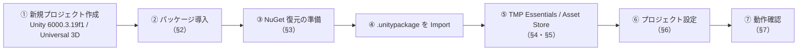

# 🛠 配布先PCでの導入手順（講師用）

このプロジェクトは `.unitypackage` で別PCへ移します。
`.unitypackage` には **`Assets/` 配下しか入りません**。パッケージ設定（`Packages/manifest.json`）とプロジェクト設定（`ProjectSettings/`）は届かないので、配布先で作り直します。

> 外部依存（Asset Store / 外部ライブラリ / 追加した Unity 公式パッケージ）は `.unitypackage` に**含めません**。
> 依存を追加したら、**このページの一覧に必ず追記**してください。

---

## 全体の流れ

---

**順番が大事です。** パッケージより先に `.unitypackage` を入れると、コンパイルエラーで止まります（壊れはしませんが、エラーが大量に出ます）。

---

## 1. 新規プロジェクトを作る

---

| 項目 | 値 |
| --- | --- |
| Unity バージョン | **6000.3.19f1** |
| テンプレート | **Universal 3D**（URP） |
| プロジェクト名 | `unity-game-dev-advance`（揃えておくと資料のパスと一致する） |

---

## 2. パッケージを入れる

---

`Window → Package Manager` で入れます。テンプレートにすでに入っているものは、**バージョンだけ確認**してください。

### 2.1 Git URL で入れるもの

---

Package Manager 左上の **＋ → Install package from git URL...** に貼り付けます。

| パッケージ | 用途 | Git URL |
| --- | --- | --- |
| **UniTask** | 非同期処理（お手本・Appendix） | `https://github.com/Cysharp/UniTask.git?path=src/UniTask/Assets/Plugins/UniTask` |
| **NuGetForUnity** | R3 を NuGet から入れるため | `https://github.com/GlitchEnzo/NuGetForUnity.git?path=/src/NuGetForUnity` |

### 2.2 Unity Registry から入れるもの

---

Package Manager の **Unity Registry** で検索して入れます。**バージョンは下表に合わせてください。**

| パッケージ | 名前（ID） | バージョン | 用途 |
| --- | --- | --- | --- |
| **Cinemachine** | `com.unity.cinemachine` | **2.10.7** | カメラ（W02）。⚠️ 下の注意を参照 |
| **ProBuilder** | `com.unity.probuilder` | 6.1.2 | ステージ制作（W09・お手本） |
| **AI Navigation** | `com.unity.ai.navigation` | 2.0.13 | NavMesh（W04・お手本） |
| **Animation Rigging** | `com.unity.animation.rigging` | 1.4.1 | 箱押しで両手を箱に添える IK（お手本） |
| **Timeline** | `com.unity.timeline` | 1.8.12 | 演出（W03・お手本） |
| **Shader Graph** | `com.unity.shadergraph` | 17.3.0 | シェーダー（W06） |
| **Input System** | `com.unity.inputsystem` | 1.19.0 | 入力（全週） |
| **Universal RP** | `com.unity.render-pipelines.universal` | 17.3.0 | テンプレートに同梱 |
| **uGUI** | `com.unity.ugui` | 2.0.0 | UI・TextMeshPro。テンプレートに同梱 |

#### ⚠️ Cinemachine は 2.x を入れること

Unity 6 の Package Manager で普通に Install すると **Cinemachine 3.x** が入ります。
お手本のコードは **2.x の API（`using Cinemachine;`）** で書いてあるので、3.x だとコンパイルが通りません。

2.10.7 を入れる手順：

1. **＋ → Install package by name...** を選ぶ
2. Name に `com.unity.cinemachine`、Version に `2.10.7` を入れて Install

> Burst / Collections / Mathematics / Searcher / Render Pipelines Core などは、上のパッケージの**依存として自動で入ります**。手で入れる必要はありません。

### 2.3 入れなくてよいもの

---

元のPCには入っていますが、授業とお手本には使っていません。

| パッケージ | 理由 |
| --- | --- |
| Unity AI Assistant / AI Inference | 作業補助用。プロジェクトのコードからは参照していない |
| Package Validation Suite / Performance Testing | 作業補助用 |
| Multiplayer Center / Visual Scripting / Version Control | テンプレート由来。不要なら削除してよい |

---

## 3. R3（NuGet）を復元する

---

R3 は **NuGetForUnity 経由**で入れています。`.unitypackage` には DLL 本体（`Assets/Packages/`）を含めず、**設定ファイルだけ**を入れてあります。

| ファイル | 中身 |
| --- | --- |
| `Assets/packages.config` | 入れる NuGet パッケージの一覧（R3 1.3.1 と、その依存） |
| `Assets/NuGet.config` | 取得先（nuget.org）と、`Assets/Packages/` に置く設定 |

**§2 で NuGetForUnity を入れておけば、§4 の Import 後に自動で復元されます。**
自動で入らなかったときは、メニューの **NuGet → Restore Packages** を実行してください。

復元後、`Assets/Packages/` に次の5つが並べば成功です。

- `R3.1.3.1`
- `Microsoft.Bcl.AsyncInterfaces.6.0.0`
- `Microsoft.Bcl.TimeProvider.8.0.0`
- `System.ComponentModel.Annotations.5.0.0`
- `System.Threading.Channels.8.0.0`

---

## 4. `.unitypackage` を Import する

---

1. メニューの **Assets → Import Package → Custom Package...** で `.unitypackage` を選ぶ
2. 一覧はすべてチェックを入れたまま **Import**
3. テンプレートの同名ファイル（`Assets/Settings/` の URP アセットなど）は**上書きしてよい**

続けて **TextMesh Pro の必須リソース**を入れます。

- メニューの **Window → TextMeshPro → Import TMP Essential Resources**

> `Assets/TextMesh Pro/` は Unity 公式パッケージから取り込むものなので、`.unitypackage` には含めていません。

---

## 5. Asset Store のアセットを入れる

---

学生と同じものを入れます。一覧と手順は **[使用アセット一覧](assets.md)** にまとめてあります。

| 区分 | 内容 |
| --- | --- |
| **最初に入れるもの** | サニーサイドアップ ユニティちゃん / Starter Assets - ThirdPerson / Low Poly Swords / RPG Animations Pack FREE |
| **週ごとに追加するもの** | `assets.md` の「2. 週ごとに追加するアセット」を参照（選定中のものあり） |

> Starter Assets の Import 中に Input System の再起動ダイアログが出たら **Yes** で再起動します。

> **Import 先のフォルダはそのままで構いません。** DemoGame の Prefab やマテリアルはアセットを GUID で参照しているので、置き場所に関係なくつながります。

---

## 6. プロジェクト設定を合わせる

---

`ProjectSettings/` は `.unitypackage` に入らないので、次の項目を手で合わせます。

| 設定 | 場所 | 値 |
| --- | --- | --- |
| **ビルドに含めるシーン** | File → Build Profiles → Scene List | ① `Assets/_DemoGame/Scenes/DemoTitle.unity` ② `Assets/_DemoGame/Scenes/DemoInGame.unity` （**この順番**。タイトルから始まる） |
| **入力の方式** | Project Settings → Player → Other Settings → Active Input Handling | **Input System Package (New)** |
| **描画パイプライン** | Project Settings → Graphics → Default Render Pipeline | `Assets/Settings/PC_RPAsset` |
| **品質ごとのパイプライン** | Project Settings → Quality | PC 系の品質に `PC_RPAsset`、Mobile 系に `Mobile_RPAsset` |

| **レイヤー** | Project Settings → Tags and Layers → Layers | **User Layer 8 に `Interactable`**（E キーで働きかける対象。灯・箱） **User Layer 9 に `Level`**（ライトマップに焼く、ステージの動かない物。[11-lighting.md](demo-game/11-lighting.md) §2。`DemoGame > Lighting > Bake Level` を実行すると無ければ足される） |

> Tags / NavMesh Areas はデフォルトのまま使っているので、設定不要です。
> デバッグ用スクリプト（`Assets/_DemoGame/Scripts/Debug/`）は、**エディタ上では常に有効**です。
> ビルドに含めたいときだけ、Scripting Define Symbols に `APP_DEBUG` を足してください。

---

## 7. 動作確認

---

| 確認すること | 合格の状態 |
| --- | --- |
| Console | **赤いエラーが0件** |
| `DemoTitle` シーンを再生 | タイトル画面が出て、開始でインゲームへ遷移する |
| マテリアル | ピンク色のものがない（あれば §5 のアセット不足か、§6 の描画パイプライン設定漏れ） |

### うまくいかないとき

| 症状 | 原因と対処 |
| --- | --- |
| `The type or namespace name 'Cinemachine' could not be found` | Cinemachine が 3.x になっている。§2.2 の手順で 2.10.7 を入れ直す |
| `The type or namespace name 'R3' could not be found` | NuGet が未復元。**NuGet → Restore Packages** |
| `Cysharp` が見つからない | UniTask 未導入。§2.1 |
| UI の文字が出ない | TMP Essential Resources 未導入。§4 |
| キャラクターが動かない | Active Input Handling の設定漏れ、または Starter Assets 後の再起動漏れ |

---

## 8. 書き出し手順（元のPC側）

---

`.unitypackage` を作るときの対象です。

1. Project ウィンドウで `Assets` を選ぶ
2. 右クリック → **Export Package...**
3. **Include dependencies のチェックを外す**
4. 下表の「含めない」フォルダのチェックを外して **Export...**

| | 対象 |
| --- | --- |
| **含める** | `_DemoGame/` `Application/` `Appendix/` `Scenes/` `Settings/` `InputSystem_Actions.inputactions` `packages.config` `NuGet.config` |
| **含めない** | `Packages/`（NuGet の DLL。§3 で復元する） `TextMesh Pro/`（§4 で取り込む） **`_GitIgnore/`**（元のPCで外部アセットをまとめている場所。§5 で各自入れる。再配布禁止のものが大半） |

> 元のPCでは、外部アセットを Import したら `Assets/_GitIgnore/` へ移しています（GitHub で再配布しないため。`.gitignore` 済み）。
> 移したら下の表に足してください。配布先で何を入れればよいかの一覧になります。

| 外部アセット | 入手先 | 置き場所 | 使っている所 |
| --- | --- | --- | --- |
| ユニティちゃん 3Dモデルデータ Ver 1.4.0（UCL 2.02） | [公式サイト](https://unity-chan.com/) | `_GitIgnore/UnityChan/` | `DemoPlayer.prefab`、`Animations/AC_Player.controller`、`Graphics/Materials/Character/M_Player_*`（テクスチャ） |
| Monster Minion Survivor PBR Polyart | [Asset Store](https://assetstore.unity.com/packages/3d/characters/creatures/monster-minion-survivor-pbr-polyart-269515) | `_GitIgnore/Monster Minion Survivor PBR Polyart/` | `DemoEnemyNormal.prefab`、`Animations/AC_EnemyMinion.controller`、`M_Enemy_Minion`（テクスチャ） |
| RPG Animations Pack FREE（DoubleL） | [Asset Store](https://assetstore.unity.com/packages/3d/animations/rpg-animations-pack-free-288783) | `_GitIgnore/DoubleL/` | `Animations/AC_Player.controller` の Attack（`Enemy_Attack_1`） |
| Mini Legion Rock Golem PBR HP Polyart | [Asset Store](https://assetstore.unity.com/packages/3d/characters/humanoids/fantasy/mini-legion-rock-golem-pbr-hp-polyart-94707) | `_GitIgnore/Mini Legion Rock Golem PBR HP Polyart/` | `DemoEnemyBoss.prefab`、`Animations/AC_EnemyGolem.controller`、`M_Enemy_Golem`（テクスチャ） |
