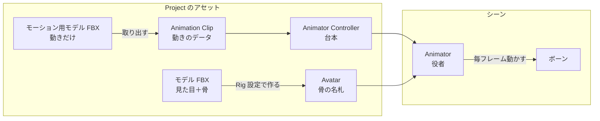
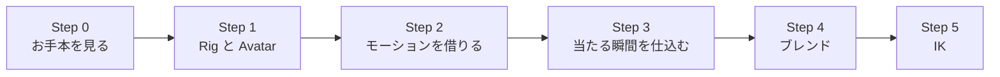

# Animation・Animator 深掘り 導入編

## 概要

---

前期でアニメーションの再生はできるようになりました。しかし「剣を振ったら敵に当たる」を作ろうとすると、
すぐに手が止まります。アニメーションは見た目が動いているだけで、ゲームは「いつ当たったのか」を知らないからです。

さらに 3D では、2D には無かった困りごとが増えます。

- 手に入るモーションが、**自分のキャラクター用に作られているとは限らない**
- 「歩き」から「走り」へ、**パッと切り替わると不自然**に見える
- 箱を押す手が、**箱の表面から浮いたり、めり込んだり**する

この回では、アニメーションを**見た目の再生**から**ゲームの進行と噛み合った仕組み**へ引き上げます。

> **今週の問い**：「攻撃が当たった」を、ゲームはどうやって知るのか？

---

## 今週扱う内容

---

今週は内容が多いため、ページを分けています。上から順に進めてください。

| ページ | 内容 |
| --- | --- |
| **導入編**（このページ） | 全体像・授業の流れ・お手本で見るところ |
| [① Rig と Avatar](02-rig-avatar.md) | 3D キャラクターの「骨組み」。**Humanoid と Avatar の設定** |
| [② モーションの取り込みとコピー](03-motion-import.md) | **モーション用モデル**から動きだけを借りる。**アニメーションデータだけをコピー**して編集する。Animation Event |
| [③ アニメーションブレンド](04-animation-blend.md) | 遷移のブレンド・**Blend Tree**・Layer と Avatar Mask |
| [④ IK と FK](05-ik-fk.md) | **FK と IK の違い**。Humanoid の IK と Animation Rigging |
| [課題](99-assignment.md) | 今週の課題と振り返り |

#### 使用する無料アセット

この回では次のアセットを使います。導入手順は [使用アセット一覧](../assets.md) を参照してください。

- サニーサイドアップ ユニティちゃん — 主人公のモデルと、待機・歩き・走りなどのモーション
- RPG Animations Pack FREE — 攻撃モーション（**モーション用モデル**の題材にもします）

#### 今週使う部品

演習では、**お手本『LUMEN』で実際に使っている部品をそのままコピーしたもの**を使います。
お手本と同じ部品なので、「作るとこうなる」と「自分で触るもの」が同じです。

| 部品 | 場所（`Assets/Application/Week01-Animation/`） | 今週見るところ |
| --- | --- | --- |
| **DemoPlayer** | `Prefabs/DemoPlayer.prefab` | プレイヤー一式。ユニティちゃん・Animator・両手と右腕の IK |
| **AC_Player** | `Animations/AC_Player.controller` | プレイヤーの Animator Controller（待機・歩き・走りの Blend Tree、攻撃・被弾・死亡） |
| **PressBox** | `Prefabs/Gimmick/PressBox.prefab` | 押せる箱。押している間、**両手が箱の面に添う** |
| **Bonfire** | `Prefabs/Gimmick/Bonfire.prefab` | 篝火。E で**右腕を炎へ伸ばし**、杖に火を移す |
| **Lantern** | `Prefabs/Gimmick/Lantern.prefab` | 灯火。火の点いた杖で E を押すと、**右腕を伸ばして**灯す |
| スクリプト | `Scripts/` | `PlayerAttack`・`PlayerAnimation`・`PlayerBoxPusher`・`PlayerStaffReach` など |

> お手本（`Assets/_DemoGame/`）は編集しません。**触ってよいのは Week01 フォルダのコピーだけ**です。
> コピーのスクリプトは namespace が `Week01` になっています。中身はお手本と同じです。

---

## まず全体像

---

3D キャラクターのアニメーションには、登場人物がたくさんいます。前期の 2D で見たものに、**Rig（骨組み）** と **Avatar（骨組みの地図）** が加わります。

- **モデル（FBX）**
見た目のメッシュと、それを動かす骨（ボーン）が入ったファイル。例：`unitychan.fbx`
- **モーション用モデル（FBX）**
**動きだけ**が入ったファイル。見た目は入っていないか、確認用の簡素な人形だけ。例：RPG Animations Pack の `Enemy_Attack_1.fbx`
- **Avatar（骨組みの地図）**
「このボーンが右腕、このボーンが左足」という対応表。**これがあるから、別のキャラ用のモーションを流用できます**
- **Animation Clip（動きのデータ）**
「何秒目に、どのボーンがどう回っているか」の記録。前期の 2D と同じものです
- **Animator Controller（動きの台本）**
どの Clip を、どんな条件で、どう繋いで再生するかを決めるもの
- **Animator（再生係）**
キャラクターに付けるコンポーネント。Controller と Avatar を受け取って、実際にボーンを動かします

> 基本的な考え方は、Avatar が「**骨の名札**」、Animator Controller が「**台本**」、Animator が「**役者**」に相当すると覚えるとよいでしょう。
> 名札さえ付いていれば、別の役者のために書かれた動きでも演じられます。



DemoPlayer の中では、これが次のように並んでいます。

```
DemoPlayer                     ← ロジック（PlayerController / PlayerAttack / PlayerAnimation / PlayerBoxPusher / PlayerStaffReach）
├── Visual                     ← CharacterVisual（Animator にパラメータを送る窓口）
│   └── unitychan              ← Animator（AC_Player ＋ unitychanAvatar）・Rig Builder
│       ├── Character1_Reference …  ← ボーン
│       ├── Rig_Hands          ← 両手の IK（箱押し）
│       └── Rig_Reach          ← 右腕の IK（篝火・灯火に手を伸ばす）
└── LookAt                     ← カメラの注視点
```

**Animator はルートではなく、モデル（`unitychan`）に付いています。** これは今週、何度も効いてきます。

左側はすべて Project のアセット、右側がシーンの中です。
**Animator は「台本（Controller）」と「骨の名札（Avatar）」の2つを受け取って、ボーンを動かしています。**
今週の4ページは、この図の矢印を1本ずつ見ていく構成です。


Animator の Inspector です。**Controller** と **Avatar** の2つの欄があることを確認してください。

### 2D のときと何が違うのか

---

| | 2D（前期） | 3D（今週） |
| --- | --- | --- |
| 動かすもの | スプライトの切り替え、位置・回転 | **ボーンの回転**（数十本） |
| モーションの入手 | 自分で描く・アセットを使う | アセットのモーションを**別のキャラに流用**することが多い |
| 切り替えの不自然さ | 絵が切り替わるだけなので目立ちにくい | 姿勢が一瞬で飛ぶので**とても目立つ** → ブレンドが要る |
| 周囲との接触 | ほぼ気にしない | 手や足が**物に触れる**場面で、ずれが見える → IK が要る |

3D で増えた困りごとに、それぞれ道具が用意されています。今週はその道具を順に見ていきます。

---

## 演習シーン

---

**使用シーン**：`Assets/Application/Week01-Animation/Week01-Animation_Start.unity`
**完成見本**：`Assets/Application/Week01-Animation/Week01-Animation_Goal.unity`

> 先週欠席した人も `_Start` シーンから入れば合流できます。

シーンには、DemoPlayer・箱（PressBox）・篝火（Bonfire）・灯火（Lantern）が置いてあります。

| 操作 | キーボード・マウス | ゲームパッド |
| --- | --- | --- |
| 移動 | WASD | 左スティック |
| 視点 | マウス | 右スティック |
| 走る | 左 Shift | 左トリガー |
| ジャンプ | Space | South ボタン |
| 攻撃 | 左クリック | West ボタン |
| 箱を押す・火を移す・灯す | E | North ボタン |
| TPS / FPS の切り替え | Tab | 右スティック押し込み |

> 操作の割り当ては `Scripts/Input/DemoGameInput.inputactions` で確認できます。

---

## 授業の流れ

---



### Step 0: お手本を見る

---

お手本『LUMEN』を遊び、**次の3つ**に注目してください（場所は下の「お手本で見るところ」）。

1. 歩きから走りに変わるとき、**足の動きがどう変わるか**（なめらかか、カクッとするか）
2. 攻撃モーションは、もともと**ユニティちゃん用のものではない**こと
3. 箱を押しているとき、**手が箱の表面に添っている**こと
4. 篝火や灯火で E を押すと、**右腕が炎に向かって伸びる**こと

「なんとなく自然」に見えるものが、それぞれ別の仕組みで作られています。

### Step 1: Rig と Avatar

---

→ [① Rig と Avatar](02-rig-avatar.md)

ユニティちゃんの FBX の **Rig** 設定を開き、**Humanoid** と **Generic** の違いを確認します。
Avatar の **Configure** 画面で、ボーンの対応表を見ます。DemoPlayer の `unitychan` を展開して、ボーンの親子も確かめます。

### Step 2: モーションを借りる

---

→ [② モーションの取り込みとコピー](03-motion-import.md)

`AC_Player` の Attack ステートに入っている `Enemy_Attack_1` が、どこから来たのかをたどります。
RPG Animations Pack の**モーション用モデル**が、**Copy From Other Avatar** でどう取り込まれているかを確認します。

### Step 3: 当たる瞬間を仕込む

---

→ [② モーションの取り込みとコピー](03-motion-import.md) の後半

実は今の `PlayerAttack` は、**ボタンを押した瞬間に**ダメージを与えています。モーションはまだ振りかぶっている途中です。
FBX の中の Animation Clip は編集できないので、**アニメーションデータだけをコピー**して `.anim` にし、
杖が振り下ろされる瞬間に **Animation Event** を置いて、判定をそこへ移します。**ここで今週の問いに答えます。**

### Step 4: ブレンド

---

→ [③ アニメーションブレンド](04-animation-blend.md)

`AC_Player` の Locomotion（待機・歩き・走りの **Blend Tree**）を開き、速度で混ざる様子をプレイ中に観察します。
**歩き → 走りの瞬間に何が起きているか**を、Animator ウィンドウのパラメータで確かめます。
余裕があれば、**Avatar Mask** で「走りながら上半身だけ攻撃」を足します。

### Step 5: IK

---

→ [④ IK と FK](05-ik-fk.md)

**FK と IK の違い**を確認し、`Rig_Hands`（箱押し）と `Rig_Reach`（手を伸ばす）の Weight を動かして、アニメーションと IK が切り替わる様子を見ます。

---

## コード例

---

今週書くスクリプトも、コピーした部品と同じ `Week01` の namespace に入れます。

```csharp
using UnityEngine;

namespace Week01
{
    public class Sample : MonoBehaviour
    {
    }
}
```

> **namespace は必ず `Week01` を付けてください。**
> 付けないと、同じクラス名を作った人とぶつかってプロジェクト全体がコンパイルできなくなります。

---

## 🎬 お手本（DemoGame）で見るところ

---

| 見るところ | 使われている仕組み | 対応するページ |
| --- | --- | --- |
| 見るところ | 使われている仕組み | Week01 のコピー | 対応するページ |
| --- | --- | --- | --- |
| ユニティちゃんが**別アセットの攻撃モーション**で杖を振る | Humanoid の Avatar・Copy From Other Avatar | `AC_Player` の Attack | [①](02-rig-avatar.md)・[②](03-motion-import.md) |
| 待機 → 歩き → 走りが**速度に応じて混ざる** | Blend Tree（速度 0 / 2 / 5） | `AC_Player` の Locomotion・`PlayerAnimation` | [③](04-animation-blend.md) |
| 灯の間 A で箱を押すとき、**両手が箱の面に添う** | Animation Rigging の Two Bone IK | `Rig_Hands`・`PlayerBoxPusher` | [④](05-ik-fk.md) |
| 篝火・灯火で E を押すと、**右腕が炎へ伸びる** | 同上（右腕だけの Rig） | `Rig_Reach`・`PlayerStaffReach` | [④](05-ik-fk.md) |

> `Assets/_DemoGame/` は**完成形の参考展示**です。授業中に編集はしません。
> 演習で触るのは、同じ部品を Week01 フォルダにコピーしたものです。

---

## 💡 今週持ち帰る考え方

---

> 曖昧な要求を「**観測できる瞬間**」に分解する

「攻撃が当たったら」「自然に切り替わるように」「手が箱に触れているように」。どれも、そのままではプログラムに書けません。
書けるようになるのは、**「Clip の 0.35 秒目」「速度が 2 から 5 の間」「手と箱の面の距離が 0」**のように、
**いつ・何が・どうなっていたら成立なのか**を、目で確かめられる形に言い換えたときです。

これはゲームに限りません。「いい感じにして」「使いやすくして」と頼まれたときも、
まず**何がどうなっていたら「いい感じ」なのか**を相手と確かめるところから始めると、手が止まらなくなります。

---

## ✅ チェックリスト

---

授業の終わりに、自分で確認してください。

- [ ] Humanoid と Generic の違いを、「**モーションを流用できるかどうか**」で説明できる
- [ ] モーション用モデルを **Copy From Other Avatar** で取り込み、自分のキャラクターで再生できる
- [ ] FBX の中の Clip を **`.anim` にコピー**する理由を説明できる
- [ ] **Animation Event** で、攻撃が当たる瞬間に `PlayerAttack` の判定を出せる
- [ ] **Blend Tree** で、速度に応じて歩きと走りを滑らかに切り替えられる
- [ ] **FK と IK の違い**を、「どこから動きを決めるか」で説明できる
- [ ] IK の **Weight** を 0 と 1 の間で動かして、アニメーションと IK を切り替えられる

---

## 🔗 参考リンク

---

- [Animation Events](https://docs.unity3d.com/Manual/script-AnimationWindowEvent.html)
- [Blend Trees](https://docs.unity3d.com/Manual/class-BlendTree.html)
- [Inverse Kinematics](https://docs.unity3d.com/Manual/InverseKinematics.html)
