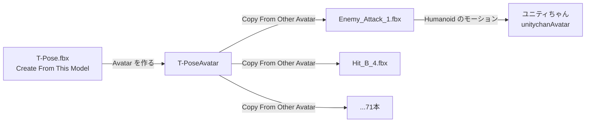
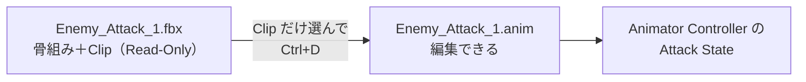
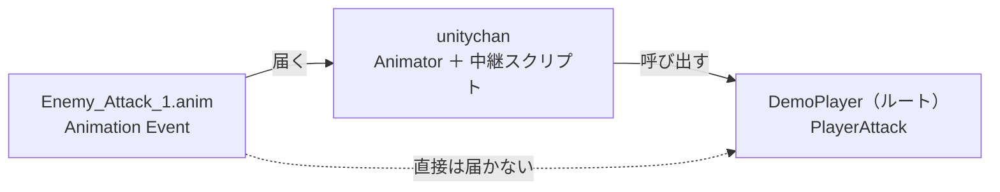

# Animation・Animator 深掘り ② モーションの取り込みとコピー

## 概要

---

ユニティちゃんには、待機・歩き・走り・ジャンプなどのモーションが付属しています。しかし**攻撃モーションはありません。**
自分で作るのは大変なので、**別のアセットからモーションだけを借りてきます。**

このページでは、次の2つを扱います。

1. **モーション用モデル**から、動きだけを自分のキャラクターに取り込む
2. 取り込んだモーションの**アニメーションデータだけをコピー**して、編集できるようにする

そして最後に、コピーしたデータに **Animation Event** を仕込み、今週の問いに答えます。

> **今週の問い**：「攻撃が当たった」を、ゲームはどうやって知るのか？

---

## モーション用モデルとは

---

- **モーション用モデル**
**動きを渡すためだけ**に作られた FBX です。中には骨組みと Animation Clip が入っていて、見た目のメッシュは入っていないか、確認用の簡素な人形だけです

モーション集のアセットは、たいていこの形で配られています。RPG Animations Pack FREE の中身を見てみましょう。

```
DoubleL/
├── Model/
│   └── T-Pose.fbx            ← 骨組みの基準（T ポーズの人形）
├── FBX Unity/                ← モーション用モデル（71本）
│   ├── Enemy Attack/
│   │   ├── Enemy_Attack_1.fbx
│   │   └── InPlace/          ← その場で動く版
│   ├── Hit/
│   ├── One Hand Up/
│   └── ...
└── FBX Unreal/               ← Unreal Engine 用。今回は使わない
```

`FBX Unity/` の下の1ファイルが、1つのモーションです。▶ を押して FBX を展開すると、中に Animation Clip（三角のアイコン）が入っています。


> 見た目のモデルとモーションが**別ファイルに分かれている**のがポイントです。
> モーションの側は「どんな骨組みにでも当てはめられる素材」として作られています。

---

## Copy From Other Avatar で取り込む

---

モーション用モデルも FBX なので、そのまま置くと**1ファイルごとに Avatar が作られます。**
71本あれば Avatar が71個できてしまい、どれが正しいのかわからなくなります。

そこで、**基準になるモデル（T-Pose.fbx）の Avatar を1つだけ作り、全モーションはそれを借りる**ようにします。



**モーション側の Avatar と、再生するキャラクター側の Avatar は別物で構いません。** どちらも Humanoid なら、標準骨格を通して読み替えられます（[① Rig と Avatar](02-rig-avatar.md)）。

### 手順

---

1. `DoubleL/Model/T-Pose.fbx` を選び、Rig タブを開く
2. **Animation Type** を **Humanoid**、**Avatar Definition** を **Create From This Model** にして **Apply**
3. `FBX Unity/` の下で、使いたいモーションの FBX を選ぶ（**Shift / Ctrl でまとめて選べます**）
4. Rig タブで **Animation Type** を **Humanoid**、**Avatar Definition** を **Copy From Other Avatar** にする
5. **Source** に `T-PoseAvatar` を指定して **Apply**


> **RPG Animations Pack FREE は、最初からこの設定になっています。**
> 手順どおりにやる前に、まず今の設定を開いて確認してください。「最初からこうなっていた」と気づけることが大事です。
> 他のモーション集では設定されていないことも多いので、そのときはこの手順で自分で設定します。

### ユニティちゃんで再生されているところを見る

---

1. `Week01-Animation/Animations/AC_Player.controller` をダブルクリックして、Animator ウィンドウで開く
2. **Attack** ステートを選び、Inspector の **Motion** を確認する（`Enemy_Attack_1`）
3. Motion の欄をクリックすると、Project ウィンドウで元の FBX（`DoubleL/FBX Unity/Enemy Attack/Enemy_Attack_1.fbx`）が光る
4. `_Goal` シーンを再生して左クリックし、ユニティちゃんが攻撃モーションをすることを確認する

**ユニティちゃん用に作られていないモーションが、そのまま動いています。** これがリターゲットです。

> 他の攻撃モーションでも試せます。Attack ステートの Motion に、`One Hand Up/Attack_A` の中の Clip などをドラッグしてみてください。

---

## Animation タブの設定

---

FBX の Import Settings の **Animation** タブでは、中に入っている Clip の扱いを決めます。


| 設定項目 | 内容 |
| --- | --- |
| **Import Animation** | Clip を取り込むか。**見た目用のモデル（unitychan.fbx など）はオフでよい** |
| **Clips** | FBX の中の Clip の一覧。**Start / End** で1本のモーションを複数の Clip に切り分けられる |
| **Loop Time** | 最後まで再生したら頭に戻るか。**待機・歩き・走りはオン、攻撃・被弾はオフ** |
| **Loop Pose** | ループの継ぎ目で姿勢が飛ばないように補正する |
| **Root Transform Rotation / Position (Y) / Position (XZ)** | キャラクター全体の回転・上下・前後の動きを、**モーションに焼き込む（Bake Into Pose）**か、**キャラクターの移動として扱う**か |
| **Mirror** | 左右反転する。右手攻撃を左手攻撃にできる |
| **Events** | Clip に Animation Event を付ける（後述） |

設定を変えたら、ここでも **Apply** を押します。

### その場で動くモーションと、前に進むモーション

---

`Enemy_Attack_1` は、攻撃しながら**一歩前に踏み込みます。** 一方 `InPlace/` の中の版は、**その場で**攻撃します。

| | 踏み込む版 | InPlace 版 |
| --- | --- | --- |
| キャラクターの位置 | モーションが動かす | 動かない。移動はスクリプトが担当 |
| 必要な設定 | Animator の **Apply Root Motion** をオン | Apply Root Motion はオフ |
| 向いている場面 | 重みのある踏み込み・回避 | 移動を自分のコードで制御したいとき |

> お手本『LUMEN』のプレイヤーは、**移動をスクリプトで決めている**ので Apply Root Motion をオフにしています。
> 踏み込む版をオフのまま再生すると、**体だけ前に出て、すぐ元の位置に戻る**ように見えます。おかしいと思ったらここを疑ってください。

---

## アニメーションデータだけをコピーする

---

ここからが本題です。攻撃が当たる瞬間を仕込むには、Clip を**編集**する必要があります。
ところが、FBX の中の Clip を Animation ウィンドウで開くと、**`(Read-Only)` と表示されて編集できません。**


FBX の中身は、モデルを作ったツール（Maya・Blender など）から書き出されたものです。
Unity 側で書き換えても、元のツールで書き出し直せば消えてしまうので、**編集させない作り**になっています。

そこで、**Clip だけを `.anim` ファイルとして複製**します。

### 手順

---

1. Project ウィンドウで FBX の ▶ を押して展開する
2. 中の **Animation Clip（三角のアイコン）だけ**を選ぶ
3. **Ctrl + D**（Mac は **Cmd + D**）で複製する
4. FBX と同じフォルダに `Enemy_Attack_1.anim` ができる。**`Week01-Animation/Animations/` に移す**
5. `AC_Player` の **Attack** ステートの **Motion** を、コピーした `.anim` に差し替える


コピーした `.anim` は普通の Animation Clip なので、Animation ウィンドウで**キーもイベントも編集できます。**



### コピーするとき・しないとき

---

コピーは便利ですが、**元の FBX とのつながりが切れます。**

| | FBX の Clip をそのまま使う | `.anim` にコピーして使う |
| --- | --- | --- |
| キーの編集 | できない | **できる** |
| Animation Event | Import Settings の **Events** で付けられる | Animation ウィンドウで付けられる |
| 元の FBX を差し替えたとき | **自動で反映される** | **反映されない**（コピーし直し） |
| ファイルサイズ | 増えない | 1本ぶん増える |

> **イベントを付けたいだけなら、Import Settings の Events でも足ります。**
> コピーが必要になるのは「**モーションの中身（キー）を直したいとき**」と「**元のアセットのフォルダを触らずに、自分のフォルダで管理したいとき**」です。
> 今回は Week フォルダの中で完結させたいので、コピーします。

---

## Animation Event で「当たった瞬間」を作る

---

ここで今週の問いに戻ります。まず、**今の `PlayerAttack` がいつ当たり判定を出しているか**を見てください。

```csharp
// Week01-Animation/Scripts/Player/PlayerAttack.cs（抜粋）
private void OnAttacked()
{
    // …（杖を持っているか・火が点いているかの確認）…

    _nextAttackTime = Time.time + _cooldown;
    Swung?.Invoke();   // → PlayerAnimation が Animator の Attack トリガーを立てる

    ApplyDamage();     // ← ボタンを押したフレームに、もう判定を出している
}
```

`ApplyDamage` は、プレイヤーの前に球の判定（`Physics.OverlapSphere`）を出して、当たった相手にダメージを与えます。
これが**ボタンを押したフレーム**に呼ばれています。モーションはまだ構え始めたところなのに、です。

> `_Goal` シーンで攻撃すると、判定の球が一瞬描かれます（`DebugShapes`。当たれば赤、外れれば白）。
> **球が出るタイミングと、杖が振り下ろされるタイミングがずれている**ことを、コマ送り（Game ビュー上の一時停止 → ステップ実行）で確かめてください。


コマ送りで見ると、攻撃モーションには段階があります。**判定を出してよいのは、振り下ろしの途中**です。

```mermaid
gantt
    title Enemy_Attack_1 の中身（イメージ）
    dateFormat X
    axisFormat %s
    section 動き
    構え（振りかぶる）     :a1, 0, 30
    振り下ろし            :a2, 30, 45
    戻り                  :a3, 45, 80
    section 判定
    今（押した瞬間）       :done, n1, 0, 2
    本当はここ             :crit, h1, 38, 40
```



この「振り下ろしの途中」を、**Clip の中の時刻**として指定するのが **Animation Event** です。

- **Animation Event**
Clip の指定した時刻に、**スクリプトの関数を呼び出す**仕組み。再生速度が変わっても、モーションを差し替えても、**その動きのその瞬間**に呼ばれます

### イベントを受け取る場所に注意する

---

**Animation Event は、Animator と同じ GameObject に付いているスクリプトにしか届きません。**

DemoPlayer では、`PlayerAttack` は**ルート**に、Animator は**モデル（`Visual/unitychan`）**に付いています。
このままイベントを置いても、`PlayerAttack` には届きません。



そこで、**モデルの側に「中継役」のスクリプトを置いて、`PlayerAttack` を呼び出します。**

```csharp
using UnityEngine;

namespace Week01
{
    // Animator と同じ GameObject（Visual/unitychan）に付ける。Animation Event はここに届く
    public class AttackAnimationEvents : MonoBehaviour
    {
        [Tooltip("ルートの PlayerAttack")]
        [SerializeField]
        private PlayerAttack _attack;

        // Animation Event から呼ぶ：杖が振り下ろされた瞬間
        public void OnAttackImpact()
        {
            _attack.ApplyDamageFromAnimation();
        }
    }
}
```

`PlayerAttack` の側は、**押した瞬間の `ApplyDamage()` を消し**、外から呼べる入口を足します。

```csharp
// PlayerAttack.cs（変更するところだけ）
private void OnAttacked()
{
    // …
    _nextAttackTime = Time.time + _cooldown;
    Swung?.Invoke();

    // ApplyDamage();  ← 消す。判定はモーションの側（Animation Event）が決める
}

// Animation Event（AttackAnimationEvents）から呼ばれる
public void ApplyDamageFromAnimation()
{
    ApplyDamage();
}
```

> **お手本のスクリプトを書き換えてよいのか？** と思ったかもしれません。
> 書き換えているのは **Week01 にコピーしたもの**です。お手本（`_DemoGame/`）は変わりません。

### イベントを置く手順

---

1. Hierarchy で **DemoPlayer → Visual → unitychan** を選ぶ（Animator が付いている GameObject）
2. `AttackAnimationEvents` を追加し、**Attack** にルートの `PlayerAttack` を入れる
3. **Window → Animation → Animation** で Animation ウィンドウを開く
4. 左上のドロップダウンで、コピーした `Enemy_Attack_1.anim` を選ぶ
5. 再生ヘッド（白い縦線）を動かして、**杖が振り下ろされるフレーム**に合わせる
6. **Add Event**（旗に＋のボタン）を押す
7. 置かれたイベントを選び、Inspector の **Function** で `OnAttackImpact` を選ぶ


> Function の一覧に関数が出てこないときは、**public になっているか**、**Animator と同じ GameObject に付いているか**を確認してください。

### 時間で当てる方法と、何が違うのか

---

「攻撃ボタンを押してから 0.35 秒後に `ApplyDamage` を呼ぶ」と書いても、一見同じように動きます。

| | 時間で当てる（`Delay` など） | Animation Event |
| --- | --- | --- |
| モーションを別のものに差し替えた | **数字を測り直す**。忘れると空振りする | イベントを置き直すだけ。**コードは変えない** |
| 攻撃速度を 1.5 倍にした | **判定だけ遅れる** | 動きと一緒に早まる |
| 遷移のブレンドで再生開始がずれた | ずれる | ずれない |
| 「いつ当たるか」を決める人 | プログラマ | **モーションを見ている人**（自分でもアニメーターでも） |

**押した瞬間に判定を出す今の作りも、時間で当てる作りも、「当たる瞬間」をコードの側で決めつけています。**
Animation Event は、**モーションの中の「その瞬間」そのもの**に判定を結びつけています。だから、モーションが変わっても崩れません。

### 🧯 よくある詰まり

---

| 症状 | 原因と対処 |
| --- | --- |
| `AnimationEvent 'OnAttackImpact' has no receiver!` というエラー | 中継スクリプトがルートに付いている。**`Visual/unitychan`** に付ける |
| イベントを置いたのに呼ばれない | `AC_Player` の Attack ステートが、**コピー前の FBX の Clip**のままになっている |
| 判定が**2回**出る | `OnAttacked` の `ApplyDamage()` を消し忘れている |
| 攻撃を連打すると、**判定が出ないことがある** | 振り下ろしの前に次の攻撃で頭から再生し直している（Attack は自分自身への遷移を許可している）。イベントの位置か、攻撃の間隔（`_cooldown`）を見直す |

---

## 🔗 参考リンク

---

- [Animation タブ](https://docs.unity3d.com/Manual/class-AnimationClip.html)
- [Animation Events](https://docs.unity3d.com/Manual/script-AnimationWindowEvent.html)
- [Root Motion の仕組み](https://docs.unity3d.com/Manual/RootMotion.html)
