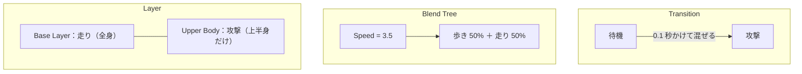
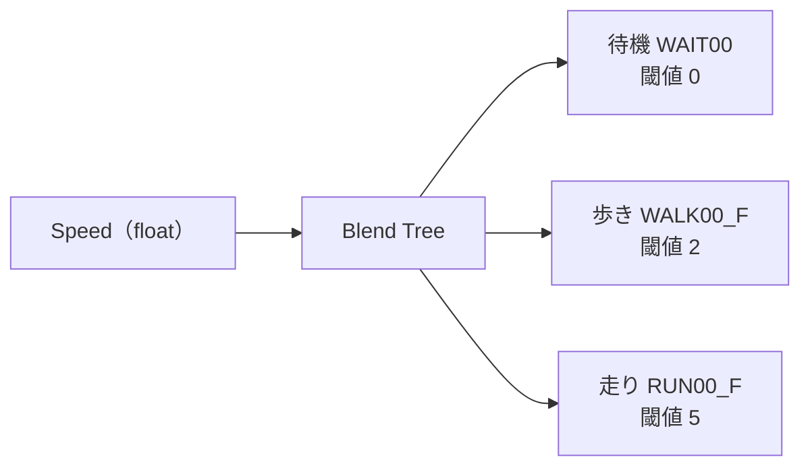
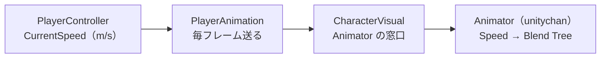
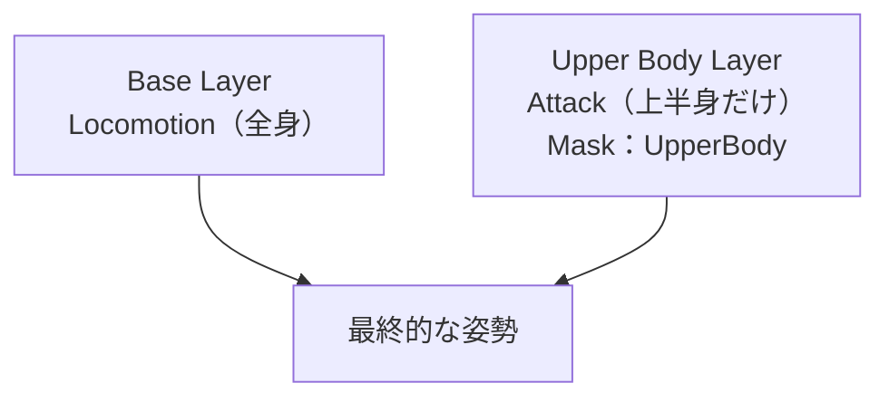

# Animation・Animator 深掘り ③ アニメーションブレンド

## 概要

---

3D のキャラクターは、モーションを切り替えた瞬間に**姿勢がパッと飛ぶ**と、とても目立ちます。
2D のようにコマ絵を差し替えるのとは違い、腕も足も一瞬で別の位置にワープするからです。

これを防ぐのが**アニメーションブレンド**です。**2つのモーションの姿勢を、割合を決めて混ぜ合わせます。**

> **このページの問い**：「自然に切り替わる」とは、何がどうなっていることか？

---

## ブレンドの3つの場面

---

Unity の Animator には、ブレンドが使われる場面が3つあります。

- **Transition（遷移）のブレンド**
State から State へ移るときに、**少しの間だけ**両方を混ぜる。例：待機 → 攻撃
- **Blend Tree**
**パラメータの値に応じて、ずっと**混ぜ続ける。例：速度に応じて歩きと走りを混ぜる
- **Layer のブレンド**
**体の部位ごとに**別のモーションを重ねる。例：下半身は走り、上半身は攻撃



| | 混ぜる時間 | 何で決まるか |
| --- | --- | --- |
| **Transition** | 一瞬（切り替えの間だけ） | 遷移の条件（トリガーなど） |
| **Blend Tree** | ずっと | float パラメータの値 |
| **Layer** | ずっと（Weight が 0 でない間） | Avatar Mask と Layer の Weight |

---

## Transition のブレンド

---

Animator ウィンドウで State の間の矢印（Transition）を選ぶと、Inspector に設定が出ます。


| 設定項目 | 内容 |
| --- | --- |
| **Has Exit Time** | オンだと、元の State が**決まった位置まで再生されてから**遷移する。オフだと、**条件を満たした瞬間**に遷移する |
| **Exit Time** | 元の State の、どの位置で遷移を始めるか（0〜1。0.9 なら 90% 再生したところ） |
| **Fixed Duration** | オンだと Transition Duration を**秒**、オフだと**元の State の長さに対する割合**で数える |
| **Transition Duration** | **何秒かけて混ぜるか**。これがブレンドの長さ |
| **Transition Offset** | 遷移先を、どの位置から再生し始めるか |
| **Interruption Source** | 遷移の途中に、別の遷移で割り込めるか |
| **Conditions** | 遷移する条件（パラメータ） |

#### まず押さえる2項目

**Has Exit Time** と **Transition Duration** の2つだけで、ほとんどの「不自然さ」は説明できます。

| やりたいこと | Has Exit Time | Transition Duration の目安 |
| --- | --- | --- |
| 攻撃ボタンを押したら**すぐ**攻撃する | **オフ** | 0.05〜0.1 秒（短く） |
| 攻撃が**終わってから**待機に戻る | **オン**（Exit Time 0.8〜0.9） | 0.2〜0.3 秒 |
| 被弾したら**何をしていても**すぐのけぞる | **オフ**（Any State から） | 0.05 秒 |

> **攻撃が遅れて出る**ときは、まず Has Exit Time を疑ってください。オンのままだと、待機モーションが終わるまで攻撃が始まりません。
> 逆に、**ブレンドが長すぎる**と、攻撃の振りかぶりが「もやっと」して手応えがなくなります。

---

## Blend Tree

---

歩きと走りを Transition で切り替えると、速度が閾値をまたぐたびに**カクッ**と切り替わります。
本当は、速度がだんだん上がるなら、**モーションもだんだん走りに近づいて**ほしいはずです。

Blend Tree は、**float パラメータの値に応じて、複数のモーションを混ぜる割合を決めます。**



| Speed の値 | 待機 | 歩き | 走り |
| --- | --- | --- | --- |
| 0 | 100% | 0% | 0% |
| 1 | 50% | 50% | 0% |
| 2 | 0% | 100% | 0% |
| 3.5 | 0% | 50% | 50% |
| 5 | 0% | 0% | 100% |

> お手本『LUMEN』のプレイヤーは、まさにこの値（**歩き 2.0 m/s・走り 5.0 m/s**）で作っています。
> **閾値を「実際の移動速度（m/s）」で決めている**のがポイントです。これで、足の動きと移動の速さが合います。

### AC_Player の Blend Tree を見る

---

1. `Week01-Animation/Animations/AC_Player.controller` を開く
2. **Locomotion** ステートをダブルクリックして、Blend Tree の中に入る
3. Inspector で **Blend Type**（1D）・**Parameter**（`Speed`）・3つの Motion と **Threshold**（0 / 2 / 5）を確認する
4. `_Goal` シーンを再生し、Animator ウィンドウを開いたまま歩いたり走ったりする。**Blend Tree の中の赤い線（今の Speed）が動き、各モーションの割合が変わる**様子を見る

> 再生中に Blend Tree の図の上でつまみをドラッグすると、Speed を手で動かしてプレビューできます。

#### 自分で作るときの手順

1. Animator ウィンドウの空いているところを右クリック → **Create State → From New Blend Tree**
2. できた State の名前を `Locomotion` にする
3. ダブルクリックして Blend Tree の中に入る
4. Inspector で **Blend Type** を **1D**、**Parameter** を `Speed` にする
5. **Motion** の **＋ → Add Motion Field** を3回押し、待機・歩き・走りの Clip を入れる
6. **Automate Thresholds** のチェックを外し、各 **Threshold** に 0 / 2 / 5 を入れる


| 設定項目 | 内容 |
| --- | --- |
| **Blend Type** | 何個のパラメータで混ぜるか（下の表） |
| **Parameter** | 混ぜる割合を決める float パラメータ |
| **Threshold** | そのモーションが 100% になる値 |
| **Automate Thresholds** | 閾値を自動で等間隔に振る。**実際の速度に合わせたいときはオフ** |
| **Compute Thresholds** | Clip の中の移動速度から、閾値を自動で計算する（Root Motion があるモーションのみ） |

### Blend Type の種類

---

| Blend Type | パラメータ | 使う場面 |
| --- | --- | --- |
| **1D** | 1つ | 速度だけで決まる移動（待機・歩き・走り） |
| **2D Simple Directional** | 2つ（X・Y） | 前後左右の移動。**1方向に1モーション**のとき |
| **2D Freeform Directional** | 2つ | 前後左右の移動。**同じ方向に歩きと走りがある**とき |
| **2D Freeform Cartesian** | 2つ | 方向ではない2つの値（例：前進速度と旋回速度） |
| **Direct** | モーションの数だけ | 割合を直接コードで指定する（表情など） |

> 敵に向かって**構えたまま横歩き**する（ロックオン移動）なら、2D で前後左右のモーションを混ぜます。
> ユニティちゃんには `WALK00_L` / `WALK00_R` / `WALK00_B` が付属しているので、試せます。

### スクリプトからパラメータを送る

---

DemoPlayer では、Speed は次の順で Animator に届きます。



```csharp
// Week01-Animation/Scripts/Player/PlayerAnimation.cs（抜粋）
private void Update()
{
    if (_visual == null || _controller == null) return;

    _visual.SetFloat(CharacterAnimatorParams.Speed, _controller.CurrentSpeed);
    _visual.SetBool(CharacterAnimatorParams.IsGrounded, _controller.IsGrounded);
}
```

ポイントは2つです。

- **送っているのは「実際の移動速度（m/s）」です。** `PlayerController` の歩き 2.0・走り 5.0 と、Blend Tree の閾値 2・5 が**同じ単位**なので、足の動きと移動の速さが合います
- **`PlayerController` は Animator を知りません。** 間に `PlayerAnimation` と `CharacterVisual` が入っているので、モデルを差し替えてもロジックは触らずに済みます

> パラメータ名は `CharacterAnimatorParams` に1か所でまとめ、`Animator.StringToHash` で数値にしてあります。
> 文字列を毎回書くと、打ち間違えてもエラーにならず、**黙って動かない**のが Animator の怖いところです。

#### 気づいてほしいこと：Speed は一瞬で変わっている

プレイ中に Animator ウィンドウの **Parameters** を見ながら、歩いている最中に Shift を押してください。
**Speed が 2 から 5 へ、1フレームで飛びます。** `PlayerController` は「歩くなら 2、走るなら 5」をそのまま入れているからです。

Blend Tree は Speed の値どおりに混ぜるだけなので、**値が飛べば、モーションも飛びます。**
Blend Tree を使っていても、**送る値がなめらかでなければ、切り替わりはなめらかになりません。**

`Animator.SetFloat` には、**値を少しずつ目標に近づける**書き方があります。

```csharp
// 3番目が「何秒かけて近づけるか」、4番目がこのフレームの経過時間
animator.SetFloat(SpeedHash, speed, 0.15f, Time.deltaTime);
```

> `CharacterVisual` にはまだこの書き方の入口がありません。足すのは課題 2 の内容です。

---

## Layer と Avatar Mask

---

「走りながら攻撃したい」とき、攻撃モーションを全身で再生すると**足が止まって**しまいます。
**下半身は走りのまま、上半身だけ攻撃**させるのが Layer と Avatar Mask です。

- **Avatar Mask**
**体のどの部位に効かせるか**を決めるアセット。人の形の図をクリックして、部位ごとにオン・オフします
- **Layer**
Animator Controller の中の**もう1枚の State Machine**。上の Layer ほど後から重ねられます



### 手順

---

1. Project で右クリック → **Create → Animation → Avatar Mask**。名前を `UpperBody` にする
2. Inspector の **Humanoid** を開き、**下半身（脚・足元の円）と Root をクリックして赤（オフ）にする**
3. Animator ウィンドウ左上の **Layers** タブで **＋** を押し、Layer を追加する（名前 `Upper Body`）
4. 歯車アイコンから、**Weight** を 1、**Mask** を `UpperBody`、**Blending** を **Override** にする
5. `Upper Body` Layer の中に、空の State（何もしない）と Attack State を作り、遷移を張る（条件は Base Layer と同じ `Attack` トリガー）

> `AC_Player` は今 **Base Layer だけ**です。この手順で Layer を足すのは、課題 3 の内容でもあります。


| Layer の設定項目 | 内容 |
| --- | --- |
| **Weight** | この Layer をどれだけ効かせるか（0〜1） |
| **Mask** | 効かせる部位（Avatar Mask） |
| **Blending** | **Override**：下の Layer を上書きする／**Additive**：下の Layer に足し込む |
| **Sync** | 別の Layer と同じ State 構成を使い回す |
| **IK Pass** | この Layer で `OnAnimatorIK` を呼ぶか（[④ IK と FK](05-ik-fk.md)） |

> 上半身の Layer は、**攻撃していないときは「何もしない State」にいる**ようにします。
> 空の State（Motion が None）にいる間、その Layer は下の Layer の姿勢をそのまま通します。

---

## 🧯 よくある詰まり

---

| 症状 | 原因と対処 |
| --- | --- |
| 攻撃ボタンを押してから**一拍遅れて**攻撃が出る | Transition の **Has Exit Time** がオンになっている |
| 歩きと走りの間で、**足がもつれる**ように見える | 歩きと走りの Clip で、**足の出る順番（右足始まり・左足始まり）がずれている**。Clip の開始位置をそろえるか、Transition Offset で合わせる |
| 速度を上げても**ずっと歩きのまま** | Blend Tree の閾値と、スクリプトから送っている Speed の単位が合っていない。**Animator ウィンドウの Parameters で実際の値を見る** |
| 上半身の Layer の攻撃が**まったく見えない** | Layer の **Weight** が 0 のまま（追加直後は 0） |
| 上半身だけのはずが、**全身で攻撃して足が止まる** | Layer の **Mask** が空のまま。`UpperBody` の Avatar Mask を入れる |

> **詰まったら、まず Animator ウィンドウをプレイ中に開いてください。**
> どの State にいるか、パラメータが今いくつかが、すべてリアルタイムで見えます。推測する前に、まず見る。

---

## 🔗 参考リンク

---

- [Animation Transitions](https://docs.unity3d.com/Manual/class-Transition.html)
- [Blend Trees](https://docs.unity3d.com/Manual/class-BlendTree.html)
- [Animation Layers](https://docs.unity3d.com/Manual/AnimationLayers.html)
- [Avatar Mask](https://docs.unity3d.com/Manual/class-AvatarMask.html)
