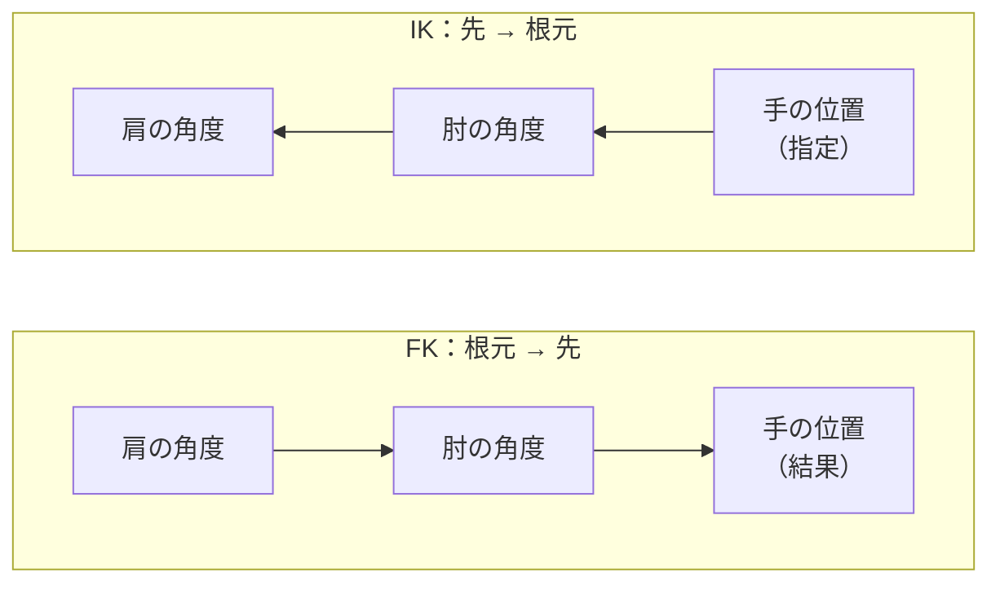
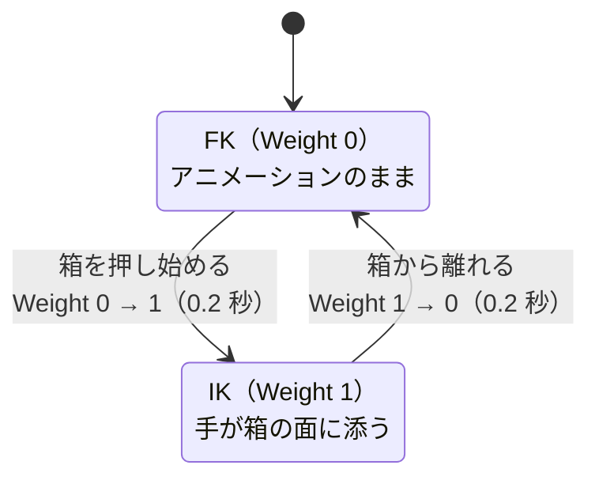
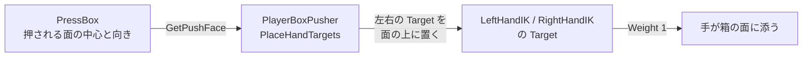

# Animation・Animator 深掘り ④ IK と FK

## 概要

---

箱を押すモーションを再生すると、手が**箱の手前で空振り**したり、**箱にめり込んだり**します。
モーションを作った人は、この箱の大きさも、キャラクターの立ち位置も知らないからです。

「手は**ここ**に置いてほしい」という位置から逆算して、腕の曲げ方を決める。これが **IK** です。

> **このページの問い**：「手が箱に触れている」を、どうやってゲームに保証させるか？

---

## FK と IK

---

- **FK（Forward Kinematics：順運動学）**
**根元から先へ**、関節の角度を1つずつ決めていく動かし方。肩を何度、肘を何度…と決めた結果、**手の位置が決まる**。普通のアニメーションはすべて FK です
- **IK（Inverse Kinematics：逆運動学）**
**先端の位置から逆算して**、関節の角度を決める動かし方。「手をここに置く」と決めると、**肩と肘の角度が自動で決まる**



[① Rig と Avatar](02-rig-avatar.md) で見たとおり、ボーンは親子でつながっています。
FK はこの親子関係をそのまま上から順にたどり、IK は**逆向き**にたどります。

> 基本的な考え方は、FK が「**操り人形の糸を、肩から順に引く**」、IK が「**人形の手をつまんで、目的の場所に持っていく**」に相当すると覚えるとよいでしょう。
> 手をつまんで動かせば、肘と肩は勝手についてきます。

| | FK | IK |
| --- | --- | --- |
| 決めるもの | 各関節の**角度** | 先端の**位置**（と向き） |
| 得意なこと | 大きく自然な動き（歩く・振る・踊る） | **周りの物に合わせる**（掴む・押す・段差に足を置く） |
| 苦手なこと | 周りの物に正確に合わせる | 自然な全身の動き |
| ゲームでの使われ方 | アニメーションそのもの | アニメーションの**上から補正する** |

**ゲームでは、FK のアニメーションを再生しつつ、必要な瞬間だけ IK で手足を補正します。**
どちらか一方ではなく、**混ぜて使う**のが普通です。

---

## Weight で FK と IK を混ぜる

---

IK には必ず **Weight（0〜1）** があります。

| Weight | 結果 |
| --- | --- |
| **0** | IK は効かない。**アニメーション（FK）の姿勢のまま** |
| **0.5** | アニメーションの手の位置と、IK の目標の**中間** |
| **1** | 手は**IK の目標の位置**にぴったり合う |



> **Weight を 0 から 1 へ一瞬で変えると、手がワープします。**
> [③ アニメーションブレンド](04-animation-blend.md) と同じで、**少しの時間をかけて**変えるのがコツです。

---

## Unity で IK を使う2つの方法

---

| | Humanoid の IK（`OnAnimatorIK`） | Animation Rigging |
| --- | --- | --- |
| 導入 | 追加不要（Animator の標準機能） | パッケージ `com.unity.animation.rigging`（**このプロジェクトは導入済み**） |
| 対象 | **Humanoid のみ** | Generic も Humanoid も |
| 動かせる部位 | 両手・両足・視線（頭） | **任意のボーン**（しっぽ・武器・腕の途中なども） |
| 設定のしかた | **スクリプトで**毎フレーム指定する | **コンポーネントで**組み立てる（Scene で目に見える） |
| 向いている場面 | 手足だけを、手早く合わせたい | 複数の IK を組み合わせたい／人型以外にも使いたい |

> DemoPlayer は **Animation Rigging** で作っています（箱押しの両手 `Rig_Hands`、篝火・灯火に手を伸ばす右腕 `Rig_Reach`）。
> Humanoid の IK でも同じことはできます。**どちらを選ぶかは「何を動かしたいか」と「どう調整したいか」で決まります。**

---

## 方法① Humanoid の IK（OnAnimatorIK）

---

Animator には、Humanoid の両手・両足・視線を動かす IK が最初から入っています。
DemoPlayer では使っていませんが（`AC_Player` の IK Pass はオフ）、課題で選べるように仕組みを押さえておきます。

### 準備：IK Pass をオンにする

---

1. Animator ウィンドウ左上の **Layers** タブを開く
2. IK を使う Layer の歯車アイコンを押す
3. **IK Pass** にチェックを入れる


> **IK Pass がオフだと、`OnAnimatorIK` は呼ばれません。** エラーも出ません。
> 「IK のスクリプトを書いたのに何も起きない」ときは、まずここです。

### スクリプト

---

`OnAnimatorIK` は、**Animator と同じ GameObject** に付けたスクリプトで、アニメーションの計算の途中に呼ばれます。

```csharp
using UnityEngine;

namespace Week01
{
    // Animator と同じ GameObject に付ける（OnAnimatorIK はここに届く）
    [RequireComponent(typeof(Animator))]
    public class HandIK : MonoBehaviour
    {
        [Tooltip("右手を置きたい位置（箱の面の上の空の GameObject）")]
        [SerializeField]
        private Transform _rightHandTarget;

        [Tooltip("IK の効き具合。0 でアニメーションのまま、1 でターゲットに合わせる")]
        [SerializeField, Range(0f, 1f)]
        private float _weight;

        private Animator _animator;

        private void Awake()
        {
            _animator = GetComponent<Animator>();
        }

        private void OnAnimatorIK(int layerIndex)
        {
            if (_rightHandTarget == null) return;

            // 位置と回転、それぞれに Weight がある
            _animator.SetIKPositionWeight(AvatarIKGoal.RightHand, _weight);
            _animator.SetIKRotationWeight(AvatarIKGoal.RightHand, _weight);

            _animator.SetIKPosition(AvatarIKGoal.RightHand, _rightHandTarget.position);
            _animator.SetIKRotation(AvatarIKGoal.RightHand, _rightHandTarget.rotation);
        }
    }
}
```

プレイ中に Inspector の **Weight** スライダーを 0 → 1 に動かしてみてください。**アニメーションの手と、ターゲットの間を手が移動**します。

| 主なメソッド | 内容 |
| --- | --- |
| `SetIKPosition` / `SetIKRotation` | 手足（`AvatarIKGoal`）を置く位置・向き |
| `SetIKPositionWeight` / `SetIKRotationWeight` | その効き具合（0〜1） |
| `SetIKHintPosition` | 肘・膝（`AvatarIKHint`）を**どちらに向けて曲げるか**のヒント |
| `SetLookAtPosition` / `SetLookAtWeight` | 頭（と上半身）をどこへ向けるか |

---

## 方法② Animation Rigging（DemoPlayer の作り）

---

Animation Rigging では、IK を**コンポーネントの組み合わせ**で作ります。Scene ビューで骨と目標が見えるので、調整がしやすいのが特徴です。

- **Rig Builder**
Animator と同じ GameObject に付ける。登録された Rig をまとめて実行する係
- **Rig**
子の GameObject に付ける。**中の IK をまとめて Weight で効かせる**
- **Two Bone IK Constraint**
**2本の骨（上腕と前腕、太ももとすね）**を IK で曲げる。腕や脚に使う

DemoPlayer の中はこうなっています。Hierarchy で開いて確かめてください。

```
DemoPlayer
└── Visual
    └── unitychan              ← Animator・Rig Builder（Rig Layers に Rig_Hands と Rig_Reach）
        ├── Character1_Reference …（ボーン）
        ├── Rig_Hands          ← Rig（普段は Weight 0）。箱押し用
        │   ├── LeftHandIK     ← Two Bone IK（Character1_LeftArm → LeftForeArm → LeftHand）
        │   │   ├── Target     ← 左手を置きたい位置
        │   │   └── Hint       ← 左肘を向けたい方向
        │   └── RightHandIK    ← 同上（右）
        └── Rig_Reach          ← Rig（普段は Weight 0）。篝火・灯火に手を伸ばす用
            └── RightArmReachIK
                ├── Target
                └── Hint
```


| 設定項目 | 内容 |
| --- | --- |
| **Weight** | この IK の効き具合 |
| **Root / Mid / Tip** | 根元（上腕）・中間（前腕）・先端（手）のボーン |
| **Target** | 先端を置きたい位置と向き |
| **Hint** | 中間の関節（肘）を曲げる方向 |
| **Target Position Weight / Rotation Weight** | 位置と向き、それぞれの効き具合 |

> **Animation Rigging → Bone Renderer Setup** を押すと、Scene ビューでボーンが線で表示されます。骨がどこにあるか見えないときに使ってください。

### まず手で動かしてみる

---

1. `_Goal` シーンを再生する
2. Hierarchy で `Rig_Hands` を選び、Inspector の **Rig → Weight** を 0 → 1 に動かす
3. `LeftHandIK/Target` を Scene ビューで動かすと、**歩きのモーションのまま、左手だけが Target についてくる**
4. Weight を 0.5 にすると、手が**アニメーションの位置と Target の中間**に来る

これが「**FK のアニメーションの上から、IK で補正する**」の正体です。

### 自分で作るときの手順

---

1. Animator が付いている GameObject（`unitychan`）を選ぶ
2. メニューの **Animation Rigging → Rig Setup** を押す（Rig Builder と、子に `Rig` ができる）
3. できた `Rig` の子に空の GameObject を作り、**Two Bone IK Constraint** を付ける
4. コンポーネントの **Tip** に手のボーン（例：`Character1_RightHand`）を入れる
5. コンポーネント右上の **︙ → Auto Setup from Tip Transform** を押す（Root・Mid・Target・Hint が自動で作られる）
6. 作られた **Target** を動かすと、手がついてくることを Scene ビューで確認する

### 箱押し：PlayerBoxPusher

---

箱を押し始めたら Weight を 1 へ、離したら 0 へ。**IK そのものはコンポーネントが解き、スクリプトは Weight と Target を動かすだけ**です。

```csharp
// Week01-Animation/Scripts/Player/PlayerBoxPusher.cs（抜粋）
public void Begin(PressBox box, PlayerInteractor interactor)
{
    // …（箱の面の正面に立たせ、面の方を向かせる）…
    _rigTargetWeight = 1f;   // 押し始め：IK へ
}

public void End()
{
    // …
    _rigTargetWeight = 0f;   // 離した：FK（アニメーション）へ戻す
}

private void Update()
{
    BlendRig();
    // …（押している間は、毎フレーム手の目標を箱の面に置き直す）
    PlaceHandTargets();
}

private void BlendRig()
{
    // 一瞬で切り替えると手がワープするので、_rigBlendTime（0.2 秒）かけて近づける
    _handRig.weight = Mathf.MoveTowards(_handRig.weight, _rigTargetWeight, Time.deltaTime / _rigBlendTime);
}
```

押すモーションはありません。**足は歩きのモーション（FK）のまま、手だけを IK で箱の面に置いています。**

### 火を移す：PlayerStaffReach

---

篝火（`Bonfire`）や灯火（`Lantern`）で E を押すと、右腕の Rig の Weight を **0 → 1 → 0** と動かします。

```csharp
// Week01-Animation/Scripts/Player/PlayerStaffReach.cs（抜粋）
private async UniTask ReachAsync(Vector3 point, Action onReached, CancellationToken ct)
{
    // …（対象の方を向く）…
    _handTarget.position = point;                        // 手を置きたい場所（炎・灯火の中心）

    await BlendAsync(0f, 1f, _reachSeconds, ct);         // 0.3 秒で腕を伸ばす
    onReached?.Invoke();                                 // ★ 手が届いた瞬間に火が移る

    await UniTask.Delay(TimeSpan.FromSeconds(_holdSeconds), cancellationToken: ct);
    await BlendAsync(1f, 0f, _returnSeconds, ct);        // 0.3 秒で戻す
}
```

篝火・灯火の側は、`PlayerStaffReach.ReachOrRun(interactor, 手を置く位置, 届いたときの処理)` を呼ぶだけです。
**「火が移った」を、「Weight が 1 になった瞬間」という観測できる瞬間に結びつけています。** Animation Event と同じ考え方です。

> 箱押しの `Rig_Hands` と別の Rig にしてあるのは、`PlayerBoxPusher` が毎フレーム `Rig_Hands` の Weight を書き換えているからです。
> 同じ Rig を2つのスクリプトが取り合うと、どちらかの書いた値が消えます。

---

## IK の目標をどこに置くか

---

IK の仕組みを作っても、**目標（Target）の位置が正しくなければ**、手は正しい場所に行きません。



`PlaceHandTargets` は、箱の**押される面の中心**から左右に `_handSpread` だけ開き、高さ `_handHeight` に Target を置いています。
**「手が箱に触れている」は、「手の Target が箱の面の上にあり、Weight が 1」と言い換えられます。**
こう言い換えると、うまくいかないときに**どちらがおかしいのか**（Target の位置か、Weight か）を切り分けて確かめられます。

> Target は **`Update` の中で**置き直しています。Rig はアニメーションの計算の途中で解かれるので、それより前に置いておく必要があるからです。

---

## 🧯 よくある詰まり

---

| 症状 | 原因と対処 |
| --- | --- |
| `OnAnimatorIK` に書いたのに**何も起きない** | Layer の **IK Pass** がオフ／スクリプトが Animator と別の GameObject に付いている／モデルが Generic |
| **肘が逆に曲がる**・体の内側に入る | Hint（`SetIKHintPosition` / Two Bone IK の Hint）を、**肘の外側・少し後ろ**に置く |
| Animation Rigging の IK が**まったく効かない** | Rig Builder の **Rig Layers** に Rig が登録されていない（Rig Setup を使わずに作った場合）／Rig の Weight が 0 のまま |
| 2つの IK のうち、**片方しか効かない** | 同じ Rig の Weight を2つのスクリプトが書いている。**Rig を分ける**（DemoPlayer の `Rig_Hands` と `Rig_Reach`） |
| 手が**目標まで届かず、腕が伸びきる** | 目標がキャラクターから遠すぎる。**IK は腕の長さ以上には伸ばせない**。立ち位置を目標に近づける |
| 手が目標に**ワープする** | Weight を一瞬で 0 → 1 にしている。時間をかけて変える |

---

## 🔗 参考リンク

---

- [Inverse Kinematics（Humanoid の IK）](https://docs.unity3d.com/Manual/InverseKinematics.html)
- [Animation Rigging マニュアル](https://docs.unity3d.com/Packages/com.unity.animation.rigging@1.3/manual/index.html)
- [Two Bone IK Constraint](https://docs.unity3d.com/Packages/com.unity.animation.rigging@1.3/manual/constraints/TwoBoneIKConstraint.html)
