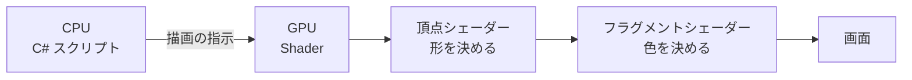

# グラフィックス基礎② Shader 導入編

## 概要

---

- shader とは何かを理解する
- Shader Graph で shader を作成してみる

前週のライティングは「**光をどう置くか**」の話でした。
今週は「**その光を受けて、どう色を計算するか**」の話です。ここが世界観を決めます。

> **今週の問い**：絵は「描く」しかないのか？

---

## 今週扱う内容

---

- **Shader の導入。** Shader Graph と Shader Code（HLSL）の導入と比較（初学者は Graph メイン）
- **Vertex と Fragment ステージの違い**について
- **Shader を使用する意味**（ゲームの世界観作り）
- DemoGame での**セルルック調**の紹介

> **この回は「深く」はやりません。**
> 入り口を案内することが目的です。Shader は Unity だけの機能ではなく、
> 他のゲームエンジンや DCC ツール（Blender、Maya など）にも同じ考え方で存在します。
> ここで掴んだ感覚は、そのまま他のツールでも効きます。

---

## 演習シーン

---

**使用シーン**：`Assets/Application/Week06-Shader/Week06-Shader_Start.unity`
**完成見本**：`Assets/Application/Week06-Shader/Week06-Shader_Goal.unity`

---

## Shader とは？

---

画面上の**描画処理を制御する部分**を担い、主に **GPU** で処理を行います。

ざっくり言えば、**オブジェクトに色をつけたり、形を変化させたりするもの**です。

Unity にはデフォルトですでに多くの shader が入っており、皆さんもすでに使用しています。


> **Material 1つにつき Shader が必ず1つ存在します。**

Unity の Shader でできることは、大きく2つです。

| ステージ | 役割 |
| --- | --- |
| **頂点シェーダー（Vertex Shader）** | **形**を決める |
| **フラグメントシェーダー（Fragment Shader）** | **色や陰影**を決める |

逆に言えば、**この2つ以外は「ほぼ」できない**と、一旦覚えておいてください。

### 補足：CPU と GPU の違い

---

| | 役割 | 特徴 |
| --- | --- | --- |
| **CPU** | C# などを実行する | 1つ1つの処理は速いが、同時にこなせる数は少ない |
| **GPU** | 描画処理を実行する | 同時に並列で処理するのに適している |

車で例えると

- **CPU → スポーツカー**（乗せられる人数は少ないが、スピードが速い）
- **GPU → バス**（たくさんの人を乗せて目的地まで行く）



---

## Shader の作成

---

Unity 上で shader を作成する方法は主に2つあります。

- `.shader` ファイルに **HLSL** というプログラミング言語で実装する方法
- ノードベースで作成する **Shader Graph** を利用する方法

**今回は Shader Graph を使って shader を作成していきます。**

> HLSL 言語で記述する方法はかなり難易度が高いです。
> 参考となる資料も少なく、数学の知識もそれなりに必要になるため、覚悟が要ります。
> ただし「そういう世界がある」ことは知っておいてください。

> **補足**：Unity 6 になる前（Built-in）は **Cg 言語**と言われるもので記述されていました。
> Cg 言語で記述された shader は、UI 上で描画する際の選択肢に入ります（`.cginc` ファイルが該当）。

### 例：Shader Graph（ノードベース）

---

ノード単位で処理がまとまっているものをつなぎ合わせて、shader を作成します。


### 例：HLSL（コード）

---

```c
Shader "Custom/NewUnlitUniversalRenderPipelineShader"
{
    Properties
    {
        [MainColor] _BaseColor("Base Color", Color) = (1, 1, 1, 1)
        [MainTexture] _BaseMap("Base Map", 2D) = "white"
    }

    SubShader
    {
        Tags { "RenderType" = "Opaque" "RenderPipeline" = "UniversalPipeline" }

        Pass
        {
            HLSLPROGRAM

            #pragma vertex vert
            #pragma fragment frag

            #include "Packages/com.unity.render-pipelines.universal/ShaderLibrary/Core.hlsl"

            struct Attributes
            {
                float4 positionOS : POSITION;
                float2 uv : TEXCOORD0;
            };

            struct Varyings
            {
                float4 positionHCS : SV_POSITION;
                float2 uv : TEXCOORD0;
            };

            TEXTURE2D(_BaseMap);
            SAMPLER(sampler_BaseMap);

            CBUFFER_START(UnityPerMaterial)
                half4 _BaseColor;
                float4 _BaseMap_ST;
            CBUFFER_END

            Varyings vert(Attributes IN)
            {
                Varyings OUT;
                OUT.positionHCS = TransformObjectToHClip(IN.positionOS.xyz);
                OUT.uv = TRANSFORM_TEX(IN.uv, _BaseMap);
                return OUT;
            }

            half4 frag(Varyings IN) : SV_Target
            {
                half4 color = SAMPLE_TEXTURE2D(_BaseMap, sampler_BaseMap, IN.uv) * _BaseColor;
                return color;
            }
            ENDHLSL
        }
    }
}
```

> 読めなくて構いません。**`vert`（頂点）と `frag`（フラグメント）という2つの関数があること**だけ見てください。
> Shader Graph でやっていることも、中身はこれと同じです。

---

## 頂点シェーダー（Vertex Shader）

---

オブジェクト上に存在する**各頂点（Vertex）を操作して形を変えます。**

WireFrame モードで頂点（vertex）と辺（edge）を見えるようにして、確認してみましょう。


上記の頂点の Position などを操作するイメージです。

---

## Shader Graph で Shader を作成する

---

Project ウィンドウ上で右クリック > **Create > Shader Graph > URP > Lit Shader Graph** を選択します。


Inspector 上に **「Open Shader Editor」** ボタンがあるので押下すると、
Shader Graph を編集するウィンドウが出てきます。


この画面で shader を作成していきます。

### ノード（Node）の作成

---

先ほど開いたウィンドウの空いている部分を右クリック > **Create Node** を押すと、
Node を選択するメニューが表示されます。

**ノード（Node）とは、プログラミングでいう1つのメソッドのようなもの**です。

例：Add ノード（足し算）


左側の緑の部分（Input）がメソッドでいう引数。
右側の Out がメソッドの戻り値で、次のノードに渡します。

内部のコード上は以下のようになっています。

```c
void Unity_Add_float4(float4 A, float4 B, out float4 Out)
{
    Out = A + B;
}
```

シェーダーは、このノードを組み合わせて作成していきます。
（※ノードの種類はたくさんあるので、ここでは紹介しません）

---

## 頂点シェーダーで球を膨らませる

---

では実際にノードを組み合わせて頂点シェーダーを作成しましょう。

> **【講師メモ】ここは一緒に画面上でやる。**
> あわせて「ローポリとハイポリ」について触れる（モデルの作り方と shader の関係）。

---

## フラグメントシェーダー（Fragment Shader）

---

（**ピクセルシェーダー**ともいう）

色付け、Texture の操作を行う部分です。

今回は **「UV Scroll」** と言われる Texture の操作を行ってみましょう。

> **【講師メモ】ここはヒントを出しながら、自分たちで考えて作らせる。**
> ・UV 座標について説明する
> ・Tiling And Offset ノードを使って、一緒に計算しながら進める

---

## 🎬 お手本（DemoGame）で見るところ

---

**セルルック調**の表現。陰影が滑らかなグラデーションではなく、**2〜3段の階段状**になっていること。
これは Shader の中で「明るさをどこで区切るか」を決めることで作られています。

> `Assets/_DemoGame/` は**完成形の参考展示**です。授業中に編集はしません。

> **【講師メモ】** ユニティちゃんに同梱の UTS2（トゥーンシェーダー2）を
> 「プロが作った実例」として見せると対比になる。

---

## 💡 今週持ち帰る考え方

---

> **大量の手作業を、1本の式に置き換える。**

「全部の面に少しずつ違う陰影をつけたい」を手で塗ると、面の数だけ作業が発生します。
shader は「**どう塗るか**」というルールを1つ書くだけで、それを全部の頂点・全部のピクセルに適用します。

同じことがプログラム全般に言えます。
**同じ作業が繰り返し出てきたら、それは「ルールとして書けないか」を疑う合図**です。

---

## ✅ チェックリスト

---

- [ ] Shader が GPU で動くものだと説明できる
- [ ] 頂点シェーダーとフラグメントシェーダーの役割の違いを説明できる
- [ ] Shader Graph を新規作成して、Material に適用できた
- [ ] 頂点シェーダーで形を変えられた
- [ ] UV Scroll を自分で作れた

---

## まとめ

---

- シェーダーとは **GPU で行う、描画処理を制御するもの**。
- `.material` 1つにつき `.shader` が1つ必ず存在する。
- **頂点シェーダー → フラグメントシェーダー**の順に実行される。
- シェーダーは C# スクリプトとは別で、**GPU で処理される**。

---

## この先の広がり

---

Shader の考え方は Unity 固有のものではありません。

- 他のゲームエンジン（Unreal Engine の Material Editor など）にも、ほぼ同じ仕組みがあります
- Blender や Maya といった DCC ツールのマテリアル設定も、根っこは同じ考え方です
- 「頂点を動かす」「ピクセルの色を決める」という枠組みは、どこでも共通です

**今日つかんだ感覚は、道具が変わっても持ち運べます。**

---

## 🔗 参考リンク

---

- [About Shader Graph](https://docs.unity3d.com/Packages/com.unity.shadergraph@latest)
- [Add Node | Shader Graph](https://docs.unity3d.com/Packages/com.unity.shadergraph@latest?subfolder=/manual/Add-Node.html)
