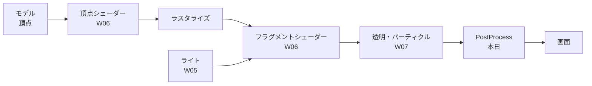

# グラフィックス基礎④ Rendering Pipeline 導入編

## 概要

---

Week05 から3週かけて、ライティング・シェーダー・エフェクトを扱ってきました。
どれも「画面に絵を出す」ための道具ですが、その道具たちがどういう順番で動いているのかは、まだ見ていません。

この回は**総復習**です。個々の機能ではなく、**描画そのものの仕組み**を俯瞰します。

> **今週の問い**：ボタンを押してから画面に絵が出るまでに、何が起きているのか？

---

## 今週扱う内容

---

- **Week05 Lighting 〜 からの総復習。** 描画そのものの仕組みを知る
- **Unity SRP の紹介**と **PBR（物理ベースレンダリング）**の古典紹介 → **セルルック調との対比**
- **PostProcess（Volume）** — 描画し終えた画面に、最後にかける処理


> **PostProcess をこの回で扱います。**
> PostProcess は「描画が終わったあとの画面全体に、もう一度手を加える」処理です。
> **描画の順番を理解していないと、なぜ最後にかけるのかが分かりません。**
> だから Rendering Pipeline と同じ回に置いています。

---

## 演習シーン

---

**使用シーン**：`Assets/Application/Week08-RenderingPipeline/Week08-RenderingPipeline_Start.unity`
**完成見本**：`Assets/Application/Week08-RenderingPipeline/Week08-RenderingPipeline_Goal.unity`

> 先週欠席した人も `_Start` シーンから入れば合流できます。

---

## 授業の流れ

---

### Step 1: これまでの3回を1枚の図にまとめる

---

Lighting（W05）・Shader（W06）・VFX（W07）が、**描画のどの段階の話だったのか**を整理します。



> **バラバラに見えた3回が、1本の流れの上に並んでいる**ことを見せるのがこの回の役目です。

### Step 2: Scriptable Render Pipeline（SRP）とは

---

<Built-in と URP の違い。なぜ「書き換えられる」パイプラインになったのか。>

### Step 3: PBR とセルルックの対比

---

<PBR は「現実の光の振る舞いを再現する」という考え方。>
<セルルックは「あえて現実から離れる」という選択。どちらも狙ってやっている。>

### Step 4: PostProcess（Volume）を触る

---

<Volume と Volume Profile の関係。Global と Local。>
<Bloom / Vignette / Color Adjustments を実際にかけて、絵がどう変わるかを見る。>

> **かけすぎに注意。** PostProcess は「効いている」と分かる時点でかけすぎなことが多いです。

---

## コード例

---

```csharp
namespace Week08
{
    public class Sample : MonoBehaviour
    {
    }
}
```

> **namespace は必ず `Week08` を付けてください。**
> 付けないと、同じクラス名を作った人とぶつかってプロジェクト全体がコンパイルできなくなります。

---

## 🎬 お手本（DemoGame）で見るところ

---

DemoGame がセルルックで描かれている理由。PBR で作った場合との見え方の違い。

> `Assets/_DemoGame/` は**完成形の参考展示**です。授業中に編集はしません。
> 「作るとこうなる」を先に見てから、演習シーンで自分の手を動かします。

---

## 💡 今週持ち帰る考え方

---

> **仕組みを知ると、選べるようになる**

<なぜそう言えるのかを、この回の題材に即して 2〜4 行で書く。>
<技術の話に戻さず、「他の場面でもこう使える」まで書ききること。>

---

## ✅ チェックリスト

---

授業の終わりに、自分で確認してください。

- [ ] <確認項目>
- [ ] <確認項目>
- [ ] <確認項目>

---

## 🔗 参考リンク

---

- [Universal Render Pipeline ドキュメント](https://docs.unity3d.com/Packages/com.unity.render-pipelines.universal@latest)
- [Scriptable Render Pipeline 概要](https://docs.unity3d.com/Manual/ScriptableRenderPipeline.html)
